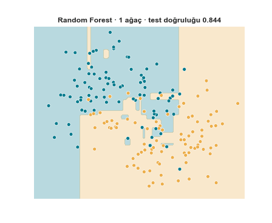
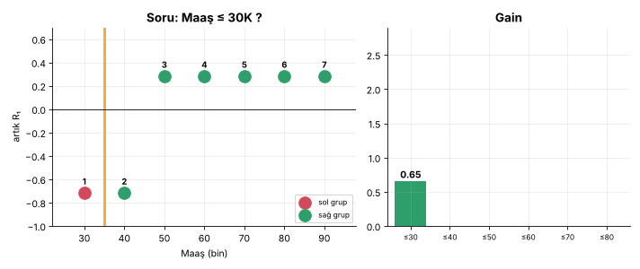
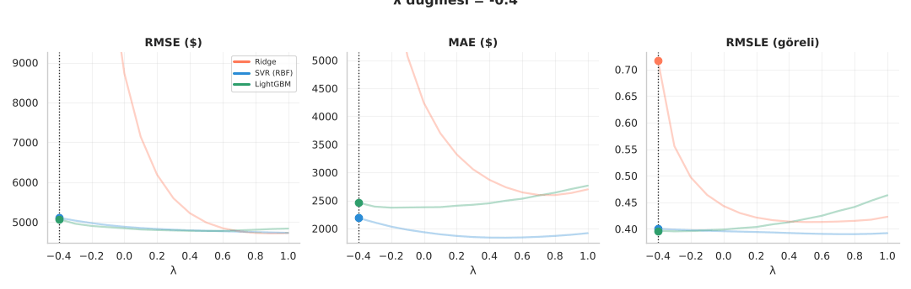
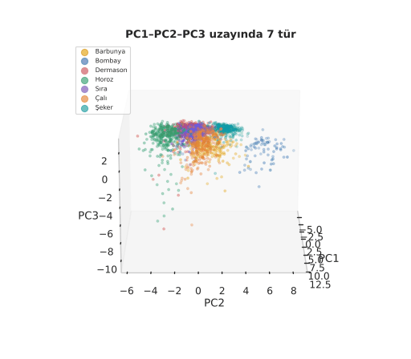
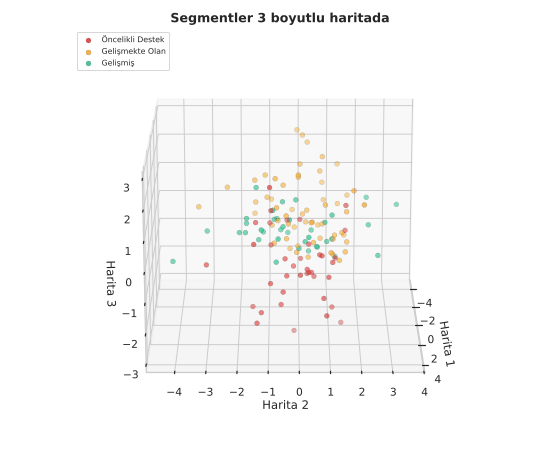
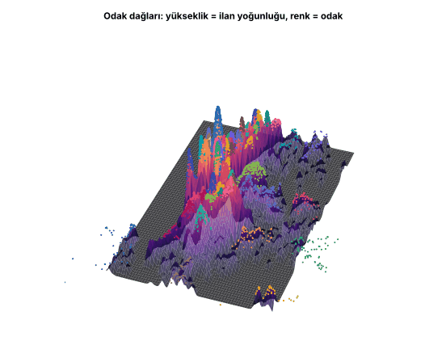

<div align="center">


<br/>

# 🎯 **AI & Data Science Bootcamp 2026**
## 🚀 Sıfırdan Uçtan Uca Makine Öğrenmesine: Yönetim Bilişim Sistemleri Gözüyle

<br/>

<!-- ILERLEME:ROZET -->
[-success?style=for-the-badge)](#️-öğrenme-yolculuğu)
[](./day57/)
[](LICENSE)
<!-- /ILERLEME:ROZET -->

[](https://www.python.org/)
[](https://jupyter.org/)
[](https://pandas.pydata.org/)
[](https://numpy.org/)
[](https://www.sqlite.org/)

[](https://scikit-learn.org/)
[](https://xgboost.readthedocs.io/)
[](https://lightgbm.readthedocs.io/)
[](https://catboost.ai/)
[](https://scipy.org/)

[](https://matplotlib.org/)
[](https://seaborn.pydata.org/)
[](https://plotly.com/python/)
[](https://dash.plotly.com/)
[](https://www.kaggle.com/)

<br/>

### 💎 **Bir Bakışta**

<!-- ILERLEME:SAYILAR -->
<table>
  <tr>
    <td align="center">
      <br/>
      <b>Tamamlanan Gün</b><br/><sub>Hedef: 70</sub>
    </td>
    <td align="center">
      <br/>
      <b>Ders Notu</b><br/><sub>çalıştırılmış, çıktılı</sub>
    </td>
    <td align="center">
      <br/>
      <b>Gerçek & Senaryo Verisi</b><br/><sub>CSV · XLSX · SQLite</sub>
    </td>
    <td align="center">
      <br/>
      <b>Model Yarışı</b><br/><sub>12–29 algoritmalık</sub>
    </td>
    <td align="center">
      <br/>
      <b>GIF Animasyon</b><br/><sub>+ 490 grafik, 750 SVG</sub>
    </td>
  </tr>
</table>
<!-- /ILERLEME:SAYILAR -->

<br/>

<!-- ILERLEME:CUBUK -->
```text
Gün 57 / 70   ████████████████░░░░   %81   ·   Son durak: DBSCAN & HDBSCAN · Sıradaki: Day 58
```
<!-- /ILERLEME:CUBUK -->

<br/>

### **Bu Repoyu Farklı Kılan Ne?**

<div align="center">

| 🎯 Özellik | 📝 Açıklama |
|:-----------|:-----------|
| ✨ **YBS Perspektifi** | Her konu bir iş senaryosuyla açılır: filo satın alma, kampanya hedefleme, tarama önceliği, denetim bütçesi |
| 🧪 **Dürüst Değerlendirme** | Kilitli test seti, grup/zaman/coğrafya bazlı doğrulama, bootstrap güven aralıkları; "ayırt edilemez" sonuç açıkça yazılır |
| 🚰 **Sızıntısız Pipeline** | İmputer, ölçekleyici, encoder, PCA ve dönüşümler `Pipeline` içinde; her kat istatistiğini yalnızca eğitimden öğrenir |
| 🏁 **Büyük Algoritma Yarışları** | Day 47'den beri her projede 22–29 algoritma + taban model aynı bölmede, aynı katlarda yarışır |
| 🎬 **Görsel Anlatım** | Kavram notebook'larında elle hesap, animasyonlu SVG diyagramlar ve GIF'ler; formüle boğmadan sezgi |
| 💼 **Karardan Sonuca** | Maliyet duyarlı eşik, bütçeli seçim, adalet/segment denetimi, model kaydı ve ayrı süreçte yükleme testi |

</div>

<br/>

---

</div>

## 🧭 **İçerik Navigasyonu**

<div align="center">

| 📌 Bölüm | 🎯 İçerik |
|:--------:|:----------|
| **[🎯 Bootcamp Hakkında](#-bootcamp-hakkında)** | Vizyon, yaklaşım, ilkeler |
| **[🗺️ Öğrenme Yolculuğu](#️-öğrenme-yolculuğu)** | 13 durakta 70 günlük rota |
| **[📚 Gün Gün Müfredat](#-gün-gün-müfredat)** | Her günün başlığı, verisi ve notebook'u |
| **[🏆 Proje Vitrini](#-proje-vitrini-day-4357)** | Day 43–57 senaryoları ve öne çıkan sonuçlar |
| **[🎬 Animasyon Galerisi](#-animasyon-galerisi)** | Notebook'lardan seçme GIF'ler |
| **[🧱 Bir Günün Anatomisi](#-bir-günün-anatomisi)** | Klasör yapısı ve ders standardı |
| **[📂 Veri Setleri](#-veri-setleri)** | Sektörlere göre veri haritası |
| **[🛠️ Teknoloji Stack](#️-kullanılan-teknolojiler)** | Gerçekten kullanılan kütüphaneler |
| **[📖 Kurulum](#-hızlı-başlangıç)** | 4 adımda çalıştırın |
| **[👥 Hedef Kitle](#-bu-repo-kimler-için)** | İdeal okuyucu profili |
| **[📜 Referanslar](#-lisans-ve-referanslar)** | Kaynak, lisans, teşekkür |
| **[📞 İletişim](#-iletişim)** | Bağlantılar |

</div>

---

<br/>

## 🎯 **Bootcamp Hakkında**

<div align="center">

### 🌟 **Bilgisayarın nasıl düşündüğünden HDBSCAN'in "alçalan su" sezgisine**

</div>

<br/>

<table>
<tr>
<td width="50%">

### 🎪 **Yaklaşım**

```yaml
🎯 Sıfırdan Uçtan Uca:
  - Day 1: Bilgisayar nasıl çalışır, Python'a ilk adım
  - Day 13-29: SQL, istatistik, NumPy, Pandas, görselleştirme, EDA
  - Day 30-57: Regresyondan kümelemeye makine öğrenmesi

💡 Kavram + Proje İkilisi (Day 46'dan beri):
  - Kavram notebook'u: elle hesap, animasyon, sezgi
  - Proje notebook'u: gerçek veriyle uçtan uca sistem
  - Sonuç: önce "neden", sonra "nasıl"

🧪 Dürüstlük Kuralları:
  - Seçim kuralları sonuç görülmeden yazılır
  - Test seti yalnızca bir kez açılır
  - Farklar bootstrap ile sınanır
```

</td>
<td width="50%">

### 🎖️ **YBS Avantajları**

```yaml
📊 İş Problemiyle Başlamak:
  - Her proje bir karar senaryosuyla açılır
  - Metrik, iş maliyetine göre seçilir
  - Eşik, kâr/zarar tablosundan gelir

🏢 Kurumsal Veri Okuryazarlığı:
  - SQLite ile e-ticaret ve ERP veritabanları
  - Veri kalitesi "karar defteri"
  - Sızıntı ve kopya kayıt denetimi

💼 Karar Destek Sistemleri:
  - Plotly ve Dash ile etkileşimli panolar
  - Risk basamakları, bütçeli hedefleme
  - Segment ve adalet denetimi
```

</td>
</tr>
</table>

---

<br/>

## 🗺️ **Öğrenme Yolculuğu**

<div align="center">

### 🎯 **13 Durakta 70 Günlük Dönüşüm**

</div>

<br/>

<table>
<tr>
<td align="center" width="18%">
<br/>
<b>🐍 Python</b><br/><b>Temelleri</b><br/>
<sub>Gün 1–12</sub><br/><code>✅ 12 gün</code>
</td>
<td align="center" width="2%"><b>➜</b></td>
<td align="center" width="18%">
<br/>
<b>🗄️ SQL &</b><br/><b>Veritabanı</b><br/>
<sub>Gün 13–14</sub><br/><code>✅ 2 gün</code>
</td>
<td align="center" width="2%"><b>➜</b></td>
<td align="center" width="18%">
<br/>
<b>📊 İstatistik</b><br/><b>Temelleri</b><br/>
<sub>Gün 15–16</sub><br/><code>✅ 2 gün</code>
</td>
<td align="center" width="2%"><b>➜</b></td>
<td align="center" width="18%">
<br/>
<b>🔢 NumPy</b><br/><b>Hesaplama</b><br/>
<sub>Gün 17–18</sub><br/><code>✅ 2 gün</code>
</td>
<td align="center" width="2%"><b>➜</b></td>
<td align="center" width="18%">
<br/>
<b>🐼 Pandas</b><br/><b>Uzmanlığı</b><br/>
<sub>Gün 19–20</sub><br/><code>✅ 2 gün</code>
</td>
</tr>
</table>

<div align="center"><b>⬇️</b></div>

<table>
<tr>
<td align="center" width="23%">
<br/>
<b>📈 Görselleştirme</b><br/><b>& Dashboard</b><br/>
<sub>Gün 21–24</sub><br/><code>✅ 4 gün</code>
</td>
<td align="center" width="2%"><b>➜</b></td>
<td align="center" width="23%">
<br/>
<b>🔍 EDA & Özellik</b><br/><b>Mühendisliği</b><br/>
<sub>Gün 25–29</sub><br/><code>✅ 5 gün</code>
</td>
<td align="center" width="2%"><b>➜</b></td>
<td align="center" width="23%">
<br/>
<b>📉 Regresyon</b><br/><b>Analizi</b><br/>
<sub>Gün 30–32</sub><br/><code>✅ 3 gün</code>
</td>
<td align="center" width="2%"><b>➜</b></td>
<td align="center" width="23%">
<br/>
<b>🎯 Klasik</b><br/><b>Sınıflandırma</b><br/>
<sub>Gün 33–42</sub><br/><code>✅ 10 gün</code>
</td>
</tr>
</table>

<div align="center"><b>⬇️</b></div>

<table>
<tr>
<td align="center" width="23%">
<br/>
<b>🌳 Ağaçlar &</b><br/><b>Topluluk Öğrenmesi</b><br/>
<sub>Gün 43–52</sub><br/><code>✅ 10 gün</code>
</td>
<td align="center" width="2%"><b>➜</b></td>
<td align="center" width="23%">
<br/>
<b>📐 Dönüşüm &</b><br/><b>Boyut İndirgeme</b><br/>
<sub>Gün 53–54</sub><br/><code>✅ 2 gün</code>
</td>
<td align="center" width="2%"><b>➜</b></td>
<td align="center" width="23%">
<br/>
<b>🧩 Kümeleme</b><br/><b>(Gözetimsiz)</b><br/>
<sub>Gün 55–57</sub><br/><code>✅ 3 gün</code>
</td>
<td align="center" width="2%"><b>➜</b></td>
<td align="center" width="23%">
<br/>
<b>🚀 Son Etap</b><br/><b>(planlanıyor)</b><br/>
<sub>Gün 58–70</sub><br/><code>🔜 13 gün</code>
</td>
</tr>
</table>

<div align="center"><b>⬇️</b></div>

<div align="center">
<br/>
<h2>🏆 <b>Veri Bilimci</b> 🏆</h2>
<sub>70 günlük yolculuğun sonunda</sub>
</div>

<br/>

<div align="center">

### 📊 **Zorluk Seviyesi İlerlemesi**

<table>
<tr>
<td align="center" width="20%">
<br/>
🟢 <code>Başlangıç</code><br/>
<sub>Python Temelleri</sub>
</td>
<td align="center" width="20%">
<br/>
🟡 <code>Temel</code><br/>
<sub>SQL, İstatistik, NumPy, Pandas, Görselleştirme</sub>
</td>
<td align="center" width="20%">
<br/>
🟠 <code>Orta</code><br/>
<sub>EDA, Regresyon, Klasik Sınıflandırma</sub>
</td>
<td align="center" width="20%">
<br/>
🔴 <code>İleri</code><br/>
<sub>Boosting, PCA, Kümeleme</sub>
</td>
<td align="center" width="20%">
<br/>
🟣 <code>Uzman</code><br/>
<sub>Son etap</sub>
</td>
</tr>
</table>

</div>

---

<br/>

## 📚 **Gün Gün Müfredat**

<div align="center">

### 🎓 **Her gün bir başlık, bir veri, bir notebook**

<sub>Başlıklar repodaki commit stiliyle yazılmıştır: <code>&lt;emoji&gt; Day NN · &lt;akılda kalan başlık&gt;</code></sub>

</div>

<br/>

<details>
<summary><b>🔷 Modül 1: Python Programming Fundamentals</b> <code>Gün 1–12</code> <code>🟢 Başlangıç</code> <code>✅</code></summary>

<br/>

| Gün | Başlık | İçerik | 📓 |
|:--:|:--|:--|:--:|
| 01 | 💻 **Day 01 · Bilgisayar nasıl düşünür, Python nasıl konuşur: Programlamaya ilk adım** | Girdi–işleme–çıktı, sayı sistemleri, metin/görsel temsili, Python'un yapı taşları | [📓](day01/Day1.ipynb) |
| 02 | 🔤 **Day 02 · Sayılar hesaplanır, metinler şekillenir: Operatörler, değişkenler ve string sanatı** | PEMDAS, veri tipleri, indeksleme/slicing, 20+ string metodu, f-string | [📓](day02/Day2.ipynb) |
| 03 | 📋 **Day 03 · Metinden listeye, sabitten değişkene: Python listeleri** | `split()`, mutability, negatif indeks, liste metodları, iç içe liste, dilimleme | [📓](day03/Day3.ipynb) |
| 04 | 🗝️ **Day 04 · Anahtar değeri bulur, küme tekrarı siler: Dictionary, set ve tuple** | Key–value mantığı, sözlük metodları, küme matematiği, tuple | [📓](day04/Day4.ipynb) |
| 05 | 📝 **Day 05 · İlk sınav, ilk özgüven: Temel Python quiz'i** | 10 soru: string, veri tipi, liste, sözlük, küme, boolean (soru + cevap) | [📓](day05/Python_Quiz_Sorular.ipynb) · [✅](day05/Python_Quiz_Cevaplari.ipynb) |
| 06 | 🚦 **Day 06 · Koşul varsa karar var: If-elif-else ve Online Retail verisi** | Karşılaştırma, mantıksal ve üyelik operatörleri; gerçek perakende verisinde koşullar | [📓](day06/IF-Controls.ipynb) |
| 07 | 🔁 **Day 07 · Bin satırı tek döngüye sığdır: for, while ve döngü ustalığı** | `for`, `while`, `break/continue`, maaş bordrosu senaryosu | [📓](day07/loops-donguler.ipynb) |
| 08 | 🧠 **Day 08 · Mantık sınavı: Operatörler ve list comprehension quiz'i** | Mantıksal ifadeler, comprehension, çözümlü sorular | [📓](day08/Quizz.ipynb) |
| 09 | 🧰 **Day 09 · Bir kez yaz, her yerde çağır: Fonksiyonlar, lambda, map-filter-reduce** | Parametre, `return`, `*args/**kwargs`, LEGB, İK yönetim sistemi projesi | [📓](day09/Python_Functions_YBS_MasterClass.ipynb) |
| 10–11 | 🏛️ **Day 10–11 · Sınıftan nesneye, nesneden sisteme: Nesne Yönelimli Programlama** | Class/object, kalıtım, çok biçimlilik, kapsülleme; e-ticaret şirketi senaryosu | [📓](day10%2611/day10%2611-oop.ipynb) |
| 12 | ✅ **Day 12 · Cevap anahtarı: Fonksiyon ve döngü quiz'inin çözümleri** | Üs alma, değişken parametreli fonksiyon ve döngü soruları | [📓](day12/quizzanswers.ipynb) |

</details>

<details>
<summary><b>🔷 Modül 2: SQL & Database Management</b> <code>Gün 13–14</code> <code>🟡 Temel</code> <code>✅</code></summary>

<br/>

| Gün | Başlık | İçerik | 📓 |
|:--:|:--|:--|:--:|
| 13 | 🗄️ **Day 13 · Veriden anlam çıkarmanın ilk sorgusu: SQL temelleri ve e-ticaret veritabanı** | SQLite, `CREATE/INSERT/SELECT`, `WHERE`, `GROUP BY`, `HAVING`, toplulaştırma | [📓](day13/sqlbasics.ipynb) |
| 14 | 🔗 **Day 14 · Tablolar el sıkışınca: TechnoVision ERP ile 6 JOIN türü** | INNER, LEFT, RIGHT, FULL OUTER, CROSS, SELF JOIN; Venn diyagramları | [📓](day14/sqljoins.ipynb) |

</details>

<details>
<summary><b>🔷 Modül 3: Statistics for AI</b> <code>Gün 15–16</code> <code>🟡 Temel</code> <code>✅</code></summary>

<br/>

| Gün | Başlık | İçerik | 📓 |
|:--:|:--|:--|:--:|
| 15 | 📊 **Day 15 · Rapordan karara: KampüsSepeti ile istatistiğe giriş** | Merkezi eğilim, yayılım, dağılım; tanımlayıcı istatistik | [📓](day15/intro-to-statistic-for-mis.ipynb) |
| 16 | 🔔 **Day 16 · Çanın altındaki gerçek: Normal dağılım, güven aralığı ve hipotez testleri** | 68-95-99.7 kuralı, z-skoru, QQ-plot, normallik testleri, güven aralıkları | [📓](day16/istatistik_normal_dagilim_ci_hipotez_testleri.ipynb) |

</details>

<details>
<summary><b>🔷 Modül 4: NumPy - Numerical Computing</b> <code>Gün 17–18</code> <code>🟡 Temel</code> <code>✅</code></summary>

<br/>

| Gün | Başlık | İçerik | 📓 |
|:--:|:--|:--|:--:|
| 17 | 🔢 **Day 17 · Döngüsüz hesap, vektörel güç: NumPy masterclass** | Array oluşturma, indeksleme, broadcasting, vektörleştirme, istatistik fonksiyonları | [📓](day17/numpy-masterclass.ipynb) |
| 18 | 🛍️ **Day 18 · 300.000 veri noktasında fiyat avı: NumPy e-ticaret vaka çalışması** | 10.000 ürün × 30 gün; filtreleme, fiyatlandırma ve indirim senaryoları (12 adım) | [📓](day18/numpy-casestudy.ipynb) |

</details>

<details>
<summary><b>🔷 Modül 5: Pandas - Data Manipulation</b> <code>Gün 19–20</code> <code>🟠 Orta</code> <code>✅</code></summary>

<br/>

| Gün | Başlık | İçerik | 📓 |
|:--:|:--|:--|:--:|
| 19 | 🐼 **Day 19 · Excel'in otomasyona bağlanmış hali: Pandas Series ve DataFrame** | Series aritmetiği, indeks hizalama, `loc/iloc`, okuma seçenekleri, kafeterya senaryosu | [📓](day19/YBS_Pandas_Bootcamp.ipynb) |
| 20 | 🧩 **Day 20 · Eksik parçayı doldur, tabloları birleştir: Pandas ileri seviye** | Eksik veri tespiti, drop/fill stratejileri, `groupby`, `merge` & `concat` | [📓](day20/pandas-advanced.ipynb) |

</details>

<details>
<summary><b>🔷 Modül 6: Data Visualization & Dashboards</b> <code>Gün 21–24</code> <code>🟠 Orta</code> <code>✅</code></summary>

<br/>

| Gün | Başlık | İçerik | 📓 |
|:--:|:--|:--|:--:|
| 21 | 🎨 **Day 21 · Grafik bir karar aracıdır: Matplotlib ve olimpiyat panosu** | Grafik türü seçim matrisi, alt grafikler, dışa aktarma (PNG/JPG/PDF) | [📓](day21/matplotlib.ipynb) |
| 22 | 🌊 **Day 22 · Az kodla çok anlam: Seaborn ile kampüs yemekhanesi ve spor kulübü** | Tema/stil, dağılım, kategorik ve ilişki grafikleri | [📓](day22/seaborn.ipynb) |
| 23 | 🖱️ **Day 23 · Dokun, yakınlaştır, karar ver: Plotly ve 12.356 sipariş** | Plotly Express vs Graph Objects, etkileşimli sipariş analitiği | [📓](day23/plotly.ipynb) |
| 24 | 🏕️ **Day 24 · Rapordan uygulamaya: Dash ile Kapıdağ Glamping CRM panosu** | Layout, callback, 34.563 rezervasyonluk etkileşimli pano | [📓](day24/dash.ipynb) |

</details>

<details>
<summary><b>🔷 Modül 7: EDA & Feature Engineering</b> <code>Gün 25–29</code> <code>🟠 Orta</code> <code>✅</code></summary>

<br/>

| Gün | Başlık | İçerik | 📓 |
|:--:|:--|:--|:--:|
| 25 | 🔍 **Day 25 · 34.563 rezervasyonun hikâyesi: Kapıdağ CRM keşifsel veri analizi** | Veri kalitesi, segmentasyon, finansal performans, zaman serisi, memnuniyet; yönetici özeti | [📓](day25/kapidag_crm_eda.ipynb) |
| 26 | 🚢 **Day 26 · Veri biliminin en ünlü yolculuğu: Titanic keşifsel veri analizi** | Eksik veri matrisi, tekli/ikili/çoklu analiz, 25+ grafik | [📓](day26/titanic-eda.ipynb) |
| 27 | 🕳️ **Day 27 · Boşluğun da bir anlamı var: Eksik veri ve özellik mühendisliği** | MCAR/MAR/MNAR, eksiklik göstergesi, sayısal/kategorik doldurma | [📓](day27/missingdata-featureng.ipynb) |
| 28 | ⚖️ **Day 28 · Dengesiz sınıf, akıllı kodlama: Telco churn ile resampling ve encoding** | One-hot, ordinal, frequency encoding; up/downsampling karşılaştırması | [📓](day28/resampling-encoding.ipynb) |
| 29 | 📱 **Day 29 · Mağaza vitrininden veri madenine: Google Play EDA ve özellik mühendisliği** | Kirli sütun temizliği (Installs, Price), keşif ve yeni özellikler | [📓](day29/googleplaystore-eda.ipynb) |

</details>

<details>
<summary><b>🔷 Modül 8: Regression Analysis</b> <code>Gün 30–32</code> <code>🔴 İleri</code> <code>✅</code></summary>

<br/>

| Gün | Başlık | İçerik | 📓 |
|:--:|:--|:--|:--:|
| 30 | 📈 **Day 30 · Reklam bütçesinden satış tahminine: Makine öğrenmesi ve regresyonun temelleri** | Öğrenme türleri, basit/çoklu doğrusal regresyon, metrikler | [📓](day30/regressionanalysis.ipynb) |
| 31 | 🏠 **Day 31 · Uçtan uca ev fiyatı: Eksik veriden 12 regresyon modelinin yarışına** | House Prices; eksik veri, korelasyon, özellik mühendisliği, 12 model | [📓](day31/regressionanalysis2.ipynb) |
| 32 | 🔥 **Day 32 · Kirli veriden yangın riskine: Cezayir orman yangınları ve VIF** | Ham veri temizliği, veri sözlüğü, çoklu doğrusallık (VIF), FWI tahmini | [📓](day32/regressionanalysis3.ipynb) |

</details>

<details>
<summary><b>🔷 Modül 9: Classic Classification (LogReg · SVM · Naive Bayes · KNN)</b> <code>Gün 33–42</code> <code>🔴 İleri</code> <code>✅</code></summary>

<br/>

| Gün | Başlık | İçerik | 📓 |
|:--:|:--|:--|:--:|
| 33 | 🎯 **Day 33 · Evet mi hayır mı: Lojistik regresyon, sigmoid ve karmaşıklık matrisi** | İkili/çok sınıflı sınıflandırma, ROC eğrisi, metrikler | [📓](day33/lojistik_regresyon_siniflandirma.ipynb) |
| 34 | 🏦 **Day 34 · Kampanyaya kim evet der: Bankacılıkta lojistik regresyon** | Pazarlama kampanyası senaryosu, veri anatomisi, karar destek | [📓](day34/lojistik_regresyon_detay.ipynb) |
| 35 | 🔄 **Day 35 · CRISP-DM'in altı adımı: Uçtan uca lojistik regresyon projesi** | Bank Marketing; iş anlayışı → EDA → hazırlık → model → değerlendirme → kayıt | [📓](day35/end2end-logistic-regression.ipynb) |
| 36 | ⚔️ **Day 36 · En geniş koridoru bul: Support Vector Machine ve terfi tahmini** | WᵀX + b = 0, marjin, karar sınırı, kernel sezgisi | [📓](day36/svm-algorithm.ipynb) |
| 37 | 👔 **Day 37 · Kim gidiyor, neden gidiyor: SVM ile İK analitiği ve 20 sınıflandırıcı** | IBM HR Attrition; ön işleme, GridSearchCV, 20 sınıflandırıcı karşılaştırması | [📓](day37/svm_hr_analytics_project.ipynb) |
| 38 | 💎 **Day 38 · Elmasın fiyatı çizgide değil: SVR ve 12 regresörün yarışı** | Diamonds; baseline, RBF çekirdek, aşırı öğrenme kontrolü, pipeline kaydı | [📓](day38/SVMRegressor.ipynb) |
| 39 | 🎲 **Day 39 · Olasılıkla düşünmek: Bayes teoremi ve Naive Bayes** | Bağımlı/bağımsız olay, Bayes teoremi, Laplace düzeltmesi, YBS projesi | [📓](day39/NavieBayes.ipynb) |
| 40 | 🌸 **Day 40 · Üç çiçek, on iki algoritma: Iris ile Naive Bayes sınıflandırması** | CRISP-DM, EDA, baseline, 12 sınıflandırma algoritması | [📓](day40/NavieBayesClassification.ipynb) |
| 41 | 🧭 **Day 41 · Bana komşunu söyle: KNN algoritmasının mantığı** | K seçimi, Öklid/Manhattan mesafesi, zaman karmaşıklığı, ağaç yapıları | [📓](day41/KNNAlgorithm.ipynb) |
| 42 | 🩺 **Day 42 · Dijital doktor: KNN ile sağlık riski sınıflandırması** | CRISP-DM, 12 adımlı plan, ölçekleme, K ayarı, model karşılaştırması | [📓](day42/KNNClassification.ipynb) |

</details>

<details open>
<summary><b>🔷 Modül 10: Trees & Ensemble Learning</b> <code>Gün 43–52</code> <code>🔴 İleri</code> <code>✅</code></summary>

<br/>

| Gün | Başlık | Veri | 📓 |
|:--:|:--|:--|:--:|
| 43 | 🌳 **Day 43 · Veriden kurala, kuraldan karara: Karar Ağaçları** | Car Evaluation (filo satın alma) | [📘](day43/) |
| 44 | 🌲 **Day 44 · Tek ağaç değil, bir orman: Topluluk Öğrenmesi ve Random Forest** | Census Income (32.561 kişi) | [📘](day44/) |
| 45 | 🏋️ **Day 45 · Dürüst skor, görkemli vitrin** | Campus Gym (62.184 kayıt) | [📘](day45/) |
| 46 | 🚀 **Day 46 · Zayıfların gücü: AdaBoost kavramı ve diyabet projesi** | Pima Indians Diabetes (768 kişi) | [📘](day46/) |
| 47 | 🚗 **Day 47 · Varsayılan sonuncu, ayarlı rakip: AdaBoost Regressor ve 22 algoritmanın fiyat yarışı** | CarDekho (15.411 ilan) | [📘](day47/) |
| 48 | 🏗️ **Day 48 · Hatadan öğrenen orman, güvenlik payıyla beton: Gradient Boosting** | Concrete Strength (1.030 numune) | [📘](day48/) |
| 49 | 🔭 **Day 49 · Hatadan öğrenen ekip, gökyüzünün sınıfları: XGBoost** | SDSS (10.000 gök cismi) | [📘](day49/) |
| 50 | 🏡 **Day 50 · Mahalle mahalle fiyat avı: XGBoost Regressor ve 29 algoritmanın yarışı** | California Housing (20.640 mahalle) | [📘](day50/) |
| 51 | 🍃 **Day 51 · Önce en çok kazandıran yaprağa: LightGBM'in hız hileleri ve premium mahalle avı** | Boston Housing (506 mahalle) | [📘](day51/) |
| 52 | 🚢 **Day 52 · Yaprak yaprak büyüyen ekip, Titanik'te dürüst yarış: LightGBM** | Titanic (891 yolcu) | [📘](day52/) |

</details>

<details open>
<summary><b>🔷 Modül 11: Transformations & Dimensionality Reduction</b> <code>Gün 53–54</code> <code>🔴 İleri</code> <code>✅</code></summary>

<br/>

| Gün | Başlık | Veri | 📓 |
|:--:|:--|:--|:--:|
| 53 | 📐 **Day 53 · Eğriyi düzleştir, ölçütü unutma: Box-Cox, Yeo-Johnson ve sigorta primi avı** | Medical Insurance (1.337 kişi) | [📘](day53/) |
| 54 | 🫘 **Day 54 · Gölgeden hikâye, fasulyeden harita: PCA ve 27 algoritmanın yarışı** | Dry Bean (13.611 fasulye) | [📘](day54/) |

</details>

<details open>
<summary><b>🔷 Modül 12: Unsupervised Learning · Clustering</b> <code>Gün 55–57</code> <code>🟣 Uzman</code> <code>✅</code></summary>

<br/>

| Gün | Başlık | Veri | 📓 |
|:--:|:--|:--|:--:|
| 55 | 🛒 **Day 55 · Benzer olan bir araya, müşteriden takımyıldız: K-Means ve 28 algoritmanın yarışı** | Customer Personality (2.240 müşteri) | [📘](day55/) |
| 56 | 🌳 **Day 56 · Benzerden aileye, ülkelerden soy ağacı: Hiyerarşik Kümeleme ve 27 algoritmanın yarışı** | Country Data (167 ülke) | [📘](day56/) |
| 57 | 🌃 **Day 57 · Kalabalığı bul, yalnızı tanı: DBSCAN, HDBSCAN ve New York'un 53 Airbnb odağı** | NYC Airbnb (48.895 ilan) | [📘](day57/) |

</details>

<!-- YENI-GUN-BURAYA: Day 58+ satırları "Modül 13" tablosuna eklenir -->
<details>
<summary><b>🔷 Modül 13: Son Etap</b> <code>Gün 58–70</code> <code>🟣 Uzman</code> <code>🔜 Planlanıyor</code></summary>

<br/>

> Bu etabın konuları kurs ilerledikçe kesinleşecek; her yeni gün eklendiğinde aşağıdaki tablo gerçek başlıkla doldurulur.

| Gün | Başlık | Veri | 📓 |
|:--:|:--|:--|:--:|
| 58–70 | 🔜 *Yakında* | — | — |

</details>

<br/>

---

<br/>

## 🏆 **Proje Vitrini (Day 43–57)**

<div align="center">

### 🎯 **Her gün bir iş senaryosu, her senaryoda dürüst bir sonuç**

<sub>Tüm sayılar ilgili günün README'sinden ve notebook'ta çalıştırılmış hücre çıktılarından alınmıştır.</sub>

</div>

<br/>

<div align="center">

| Gün | 🎬 Senaryo | 🏁 Yarış | 📊 Öne çıkan sonuç | 🧪 Dürüst ders |
|:--:|:--|:--:|:--|:--|
| [43](day43/) | Kamu filosu için araç sınıflandırma | 4 model | Optimize ağaç: test doğruluğu **0,991**, makro F1 **0,968** | Taban model %70 doğruluk alıp makro F1'de çöküyor |
| [44](day44/) | Bankanın premium kampanya hedef kitlesi | 5 model | Ayarlı orman ROC-AUC **0,924**, PR-AUC **0,476 → 0,822** | Maliyete göre eşik (0,18) net kazancı artırdı |
| [45](day45/) | Spor salonu anlık doluluk tahmini | 6 algoritma | RF MAE **10,03**, R² **0,24** (kilitli final test) | Rastgele bölme R² 0,92 verir; zamana saygılı test gerçeği söyler |
| [46](day46/) | Diyabet tarama önceliği | 5 model | AdaBoost ROC-AUC **0,818**; eşik 0,27 ile maliyet **149 → 71** | Lojistik regresyon farkı belirsizlik içinde |
| [47](day47/) | İlan platformu için adil fiyat | **22** regresör | Ayarlı AdaBoost test MAE **₹176,5 → ₹104,7 bin** | Varsayılan AdaBoost yarışın sonuncusu |
| [48](day48/) | Reçeteden beton dayanımı | **25** + taban | Final Voting test MAE **3,09 MPa**, R² **0,917** | Rastgele bölme, reçete bazlı bölmeye göre ≈ %24 iyimser |
| [49](day49/) | Yıldız / galaksi / kuasar | **24** + taban | Ayarlı XGBoost makro-F1 **0,959**, log-loss **0,109** | İki senaryo: redshift'li ve yalnız fotometri |
| [50](day50/) | Kaliforniya mahalle ev değeri | **29** + taban | Ayarlı XGBoost test RMSE **43.838 $**, R² **0,854** | Rastgele ↔ coğrafi doğrulama farkı ölçüldü |
| [51](day51/) | Premium mahalle avı | **29** + taban | Ayarlı LightGBM ROC-AUC **0,946** (görülmemiş ilçeler 0,905) | `MEDV`'yi özellik yapmak sahte F1 0,981 üretir |
| [52](day52/) | Titanik'te hayatta kalma | **27** + taban | Ayarlı LightGBM doğruluk **0,821**, AUC **0,856** | Bilet grubu sızıntısı AUC'yi 0,890'a şişirir |
| [53](day53/) | Yıllık sağlık masrafı | **27** × 2 senaryo | Final SVR RMSE **3.225 $**, R² **0,928** | Box-Cox göreli hatayı iyileştirir, dolar hatasını çoğu zaman kötüleştirir |
| [54](day54/) | 7 fasulye türünün tanınması | **27** × ham/PCA | SVM (RBF), PCA'sız: makro F1 **0,939** | PCA (%95 kuralı) neredeyse tüm algoritmalara 4–5 puan kaybettirdi |
| [55](day55/) | Müşteri segmentasyonu | **28** kümeleme | K-Medoids (k = 3): silüet test **0,275**, 3 segment | En yüksek silüet "tek dev segment" tuzağı olabilir |
| [56](day56/) | İnsani yardım için ülke segmentleri | **27** kümeleme | Konsensüs hiyerarşik: EAGÜ kesinliği **%80**, duyarlılığı **%90** | Ward deterministik ama kararlı değil |
| [57](day57/) | Kısa dönem kiralama denetimi | **23** + taban | HDBSCAN-yaprak: **53 odak**, DBCV test **0,107** | Ders kitabı dirseği ilanların %98,5'ini tek odağa koyar |

</div>

<br/>

---

<br/>

## 🎬 **Animasyon Galerisi**

<div align="center">

<table>
<tr>
<td align="center" width="50%">
<br/>
<sub>🌲 Day 44 · Orman büyüyor</sub>
</td>
<td align="center" width="50%">
<br/>
<sub>🔭 Day 49 · XGBoost bölünme tarayıcısı</sub>
</td>
</tr>
<tr>
<td align="center" width="50%">
<br/>
<sub>📐 Day 53 · Box-Cox λ düğmesi</sub>
</td>
<td align="center" width="50%">
<br/>
<sub>🫘 Day 54 · PCA'da 3B dönüş</sub>
</td>
</tr>
<tr>
<td align="center" width="50%">
<br/>
<sub>🌳 Day 56 · Ülke segmentleri 3B</sub>
</td>
<td align="center" width="50%">
<br/>
<sub>🌃 Day 57 · New York'un "odak dağları"</sub>
</td>
</tr>
</table>

</div>

<br/>

---

<br/>

## 🧱 **Bir Günün Anatomisi**

<div align="center">

### 🏗️ **Day 43'ten beri her gün aynı standartta**

</div>

<br/>

<table>
<tr>
<td width="50%">

### 📁 **Klasör Yapısı**

```text
dayNN/
├── README.md                    ← özet, sonuçlar, kaynakça
├── requirements.txt
├── NN-veri-seti.csv             ← gerçek veri
├── dayNN_<konu>_kavram.ipynb    ← sezgi + elle hesap
├── dayNN_<konu>_projesi.ipynb   ← uçtan uca proje
├── <alan>_yardimci.py           ← tekrar eden yardımcılar
├── assets/                      ← hero, yol haritası,
│                                  bölüm ve diyagram SVG'leri
└── outputs/
    ├── figures/                 ← PNG grafikler + GIF'ler
    ├── reports/                 ← CSV raporlar
    └── models/                  ← kayıtlı model (joblib)
```

</td>
<td width="50%">

### 🔄 **Proje Akışı**

```yaml
1️⃣ Senaryo:      İş problemi ve karar
2️⃣ Veri kalitesi: Karar defteri, kopya, sızıntı
3️⃣ EDA:          Dağılım, ilişki, segment
4️⃣ Bölme:        Kilitli test; grup/zaman/coğrafya
5️⃣ Pipeline:     Sızıntısız ön işleme
6️⃣ Yarış:        20+ algoritma + taban, bootstrap
7️⃣ Ayar:         RandomizedSearchCV, taze katlar
8️⃣ Yorum:        SHAP, permütasyon, ablasyon
9️⃣ Karar:        Eşik, bütçe, maliyet, adalet
🔟 Teslim:        Model kaydı + ayrı süreçte yükleme
```

</td>
</tr>
</table>

---

<br/>

## 📂 **Veri Setleri**

<div align="center">

### 🗃️ **32 veri dosyası, 8 sektör**

<table>
<tr>
<td align="center" width="25%">
<br/>
<b>🏦 Finans & Pazarlama</b><br/>
<sub>• Bank Customer (D34)<br/>• Bank Marketing (D35)<br/>• Census Income (D44)<br/>• Customer Personality (D55)</sub>
</td>
<td align="center" width="25%">
<br/>
<b>🛒 E-Ticaret & Perakende</b><br/>
<sub>• Online Retail (D6)<br/>• E-ticaret SQLite (D13)<br/>• Sipariş verisi (D23)<br/>• Google Play (D29)</sub>
</td>
<td align="center" width="25%">
<br/>
<b>🏥 Sağlık & Sigorta</b><br/>
<sub>• Sağlık riski (D42)<br/>• Pima Diabetes (D46)<br/>• Medical Insurance (D53)</sub>
</td>
<td align="center" width="25%">
<br/>
<b>🏠 Emlak & Konaklama</b><br/>
<sub>• House Prices (D31)<br/>• California Housing (D50)<br/>• Boston Housing (D51)<br/>• NYC Airbnb (D57)</sub>
</td>
</tr>
<tr>
<td align="center" width="25%">
<br/>
<b>🚗 Otomotiv & Sanayi</b><br/>
<sub>• Car Evaluation (D43)<br/>• CarDekho (D47)<br/>• Concrete Strength (D48)<br/>• Diamonds (D38)</sub>
</td>
<td align="center" width="25%">
<br/>
<b>📱 Telekom & İK</b><br/>
<sub>• Telco Churn (D28)<br/>• IBM HR Attrition (D37)<br/>• TechnoVision ERP (D14)</sub>
</td>
<td align="center" width="25%">
<br/>
<b>🌍 Bilim & Toplum</b><br/>
<sub>• SDSS gökyüzü (D49)<br/>• Dry Bean (D54)<br/>• Country Data (D56)<br/>• Cezayir yangınları (D32)<br/>• Iris (D40)</sub>
</td>
<td align="center" width="25%">
<br/>
<b>🎪 Turizm, Spor & Kampüs</b><br/>
<sub>• Kapıdağ Glamping CRM (D24–25)<br/>• Campus Gym (D45)<br/>• Olimpiyat (D21)<br/>• Titanic (D26, D52)<br/>• Advertising (D30)</sub>
</td>
</tr>
</table>

</div>

> ℹ️ Day 15–22 ve Day 36'daki bazı ders notları öğretim amaçlı, kodla üretilen **senaryo verileri** kullanır (KampüsSepeti, kafeterya, terfi tahmini); bu notebook'larda açıkça belirtilmiştir. Day 43'ten itibaren tüm projeler gerçek veriyle çalışır.

---

<br/>

## 🛠️ **Kullanılan Teknolojiler**

<div align="center">

### 🎨 **Notebook'larda gerçekten kullanılan araçlar**

</div>

<br/>

<table>
<tr>
<td width="50%">

### 🐍 **Çekirdek Python**


### 📊 **Görselleştirme & Pano**


-3776AB?style=for-the-badge)

### 🗄️ **Veri & Veritabanı**


</td>
<td width="50%">

### 🤖 **Makine Öğrenmesi**


### 🔬 **Yorumlama & Kümeleme**


-0C7BDC?style=for-the-badge)

### 🔧 **Geliştirme**


</td>
</tr>
</table>

---

<br/>

## 📖 **Hızlı Başlangıç**

<div align="center">

### ⚡ **4 Adımda Başlayın**

</div>

<br/>

<details open>
<summary><b>📥 Adım 1: Repository'yi Klonlayın</b></summary>

<br/>

```bash
git clone https://github.com/cemal-yuksel/ai-datascience-bootcamp2026.git
cd ai-datascience-bootcamp2026
```

</details>

<details>
<summary><b>🐍 Adım 2: Python Ortamını Hazırlayın (3.11+)</b></summary>

<br/>

```bash
# conda ile
conda create -n datascience python=3.11
conda activate datascience

# veya venv ile
python -m venv venv
source venv/bin/activate      # Linux/macOS
venv\Scripts\activate         # Windows
```

</details>

<details>
<summary><b>📦 Adım 3: Kütüphaneleri Yükleyin</b></summary>

<br/>

Day 45'ten itibaren her günün klasöründe kendi `requirements.txt` dosyası vardır:

```bash
pip install -r day57/requirements.txt
```

Önceki günler için temel paketler yeterlidir:

```bash
pip install numpy pandas scipy matplotlib seaborn plotly dash scikit-learn jupyterlab
pip install xgboost lightgbm catboost shap hdbscan kneed imbalanced-learn
```

</details>

<details>
<summary><b>▶️ Adım 4: Notebook'u Açın</b></summary>

<br/>

```bash
jupyter lab day01/Day1.ipynb
```

VS Code kullanıyorsanız Python ve Jupyter eklentilerini kurup `.ipynb` dosyasını açmanız yeterli. Notebook'lar çıktılarıyla kaydedildiği için GitHub üzerinde de doğrudan okunabilir.

</details>

<div align="center">

### 🎉 **Hazırsınız! Yolculuk Başlasın!**

[](./day01/)
[](./day57/)

</div>

---

<br/>

## 👥 **Bu Repo Kimler İçin?**

<table>
<tr>
<td width="50%">

### ✅ **İdeal Okuyucu**

```yaml
🎓 Eğitim Durumu:
  - Yönetim Bilişim Sistemleri öğrencisi
  - Mühendislik, iktisat, işletme öğrencisi/mezunu
  - Kendi kendine öğrenenler

💼 Kariyer Hedefleri:
  - Data Scientist / ML Engineer
  - Data Analyst / Business Analyst
  - Karar destek sistemleri uzmanı
```

</td>
<td width="50%">

### 🚀 **Ön Koşullar**

```yaml
⚠️ Gerekenler:
  - Temel bilgisayar kullanımı
  - Lise düzeyi matematik
  - İngilizce teknik doküman okuma
  - Haftalık 10–15 saat

🎯 Getirdikleri:
  - Excel'den Python'a geçiş
  - Manuel analizden otomasyona
  - Tahminden karara uzanan bakış
```

</td>
</tr>
</table>

---

## 📜 Lisans ve Referanslar

### 📚 Esinlenilen Kaynak

Bu eğitim serisi, **Udemy platformunda yayınlanan** ve Atıl Samancıoğlu'nun hazırladığı şu kursun izlediği yol örnek alınarak, özgün anlatım, kod ve görsellerle oluşturulmuştur:

> **"Veri Bilimi ve Makine Öğrenmesi 2026 : 100 Günlük Kamp"**
>
> 👨‍🏫 **Eğitmen**: Atıl Samancıoğlu
> 🎓 **Platform**: Udemy

Kurs 100 günlük bir program olarak adlandırılır; bu repo aynı konuları kendi hızında, tahminen **70 günde** tamamlar (bazı günler birleştirilmiş, bazıları kavram + proje olarak genişletilmiştir). Her günün kullandığı akademik kaynaklar ilgili günün `README.md` dosyasında APA 7 biçiminde listelenir.

### ⚖️ Lisans

Bu proje [MIT Lisansı](LICENSE) altında yayınlanmıştır. Eğitim amaçlı olarak özgürce kullanabilir, geliştirebilir ve paylaşabilirsiniz. Veri setleri kendi kaynaklarının lisanslarına tabidir.

### 🙏 Teşekkürler

- **Atıl Samancıoğlu**'na kurs içeriği ve ilham için
- Veri setlerini paylaşan **UCI Machine Learning Repository** ve **Kaggle** topluluklarına
- Tüm **açık kaynak** kütüphane geliştiricilerine

---

## 📞 İletişim

### 🌐 Bağlantılar

🔗 **GitHub**: [github.com/cemal-yuksel](https://github.com/cemal-yuksel)

💼 **LinkedIn**: [linkedin.com/in/cemal-yuksel](https://www.linkedin.com/in/cemal-yuksel)

📧 **E-posta**: [cyuksel@bandirma.edu.tr](mailto:cyuksel@bandirma.edu.tr)

🌍 **Website**: [www.cemalyuksel.org](https://www.cemalyuksel.org)

### 💬 Destek ve Sorular

💡 **Sorularınız ve hata bildirimleri için** GitHub Issues bölümünü kullanabilirsiniz.

---

<div align="center">

**Made with** ❤️ **for Data Science Community**

*Veri Bilimi Yolculuğunuzda Başarılar Dileriz!* 🚀

**© 2026 | Cemal Yüksel**

</div>
