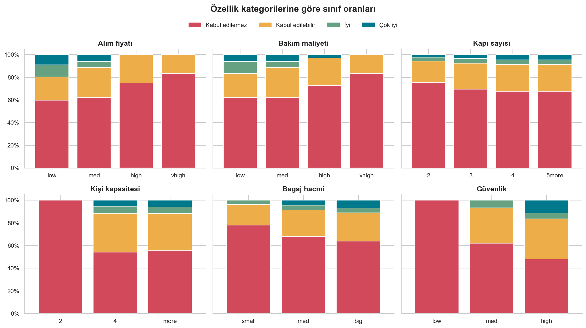
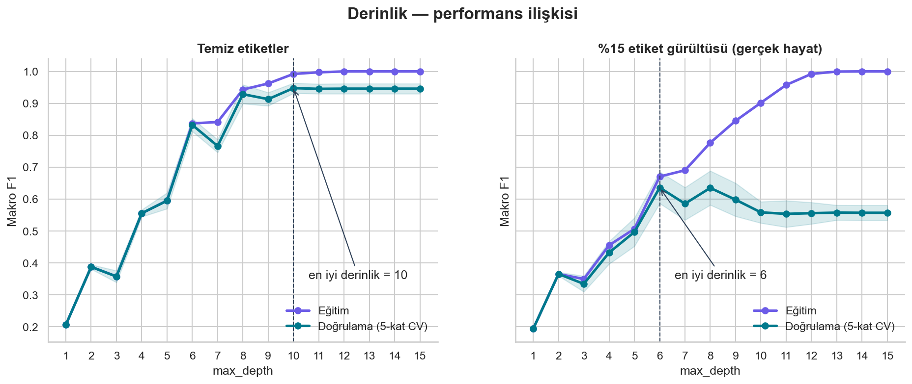
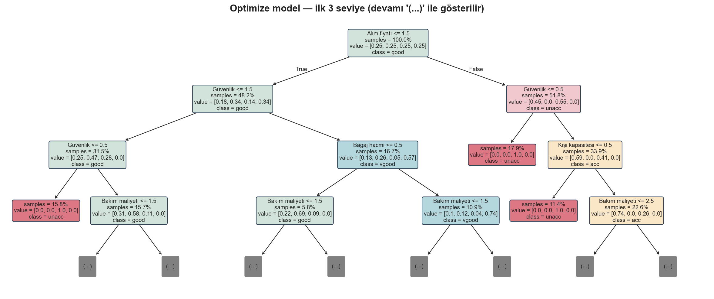

<p align="center">
  
</p>

<div align="center">

# 🌳 Gün 43 — Karar Ağaçları ile Sınıflandırma


</div>

## 📌 Özet

Bir kamu kurumunun lojistik departmanı için **filo satın alma karar destek sistemi** kuruyoruz. Karar ağacı; aday araçları *kabul edilemez / kabul edilebilir / iyi / çok iyi* olarak sınıflandırıyor ve her kararı **"EĞER … İSE …" kurallarıyla** gerekçelendiriyor.

👉 Ders notu: [`day43.ipynb`](day43.ipynb)

## 🗺️ İçerik

| # | Bölüm | # | Bölüm |
|:-:|:--|:-:|:--|
| 1 | Kurulum | 8 | Değerlendirme: doğruluk neden yetmez? |
| 2 | Sezgi: mini kredi onay ağacı | 9 | Aşırı öğrenme, budama, `ccp_alpha` |
| 3 | Gini, Entropi, Bilgi Kazancı (elle + sklearn) | 10 | `GridSearchCV` ile optimizasyon |
| 4 | Veri seti ve veri sözlüğü | 11 | Final model, özellik önemi, iş kuralları |
| 5 | Keşifçi veri analizi | 12 | YBS senaryosu: 8 aday aracın değerlendirilmesi |
| 6 | `OrdinalEncoder` + `Pipeline` | 13 | Özet, quiz, ödevler |
| 7 | İlk model (derinlik 3) | | |

## 📊 Sonuçlar (test seti, 346 araç)

| Model | Test doğruluğu | Dengeli doğruluk | Makro F1 | Yaprak |
|:--|:-:|:-:|:-:|:-:|
| Taban (hep *unacc*) | 0.699 | 0.250 | 0.206 | 1 |
| Sığ ağaç (derinlik 3) | 0.803 | 0.387 | 0.372 | 4 |
| Sınırsız ağaç | 0.991 | 0.977 | 0.976 | 81 |
| **Optimize ağaç (GridSearchCV)** | **0.991** | **0.974** | **0.968** | 100 |

> Optimize model 5 katlı CV'de makro F1 = **0.956** ile seçildi. Taban model %70 doğruluk alıp makro F1'de çöküyor: dengesiz veride doğruluk tek başına yanıltıcı.

<p align="center">
  <br>
  <br>
  
</p>

## 📁 Klasör Yapısı

```text
day43/
├── day43.ipynb                           ← ders notu (çıktılarıyla birlikte)
├── README.md
├── assets/                               ← notebook'un görsel dili (animasyonlu SVG)
│   ├── hero.svg                          ← giriş banner'ı
│   ├── bolum_01.svg … bolum_13.svg       ← bölüm banner'ları
│   ├── etiket_*.svg                      ← bilgi kartı etiketleri (İçgörü, Dikkat, YBS …)
│   ├── yol_haritasi.svg                  ← 13 duraklı ders yol haritası
│   └── kapanis.svg                       ← kapanış banner'ı
├── data/
│   ├── car_evaluation.csv                ← UCI Car Evaluation (1.728 satır, başlıklı)
│   └── aday_araclar.csv                  ← YBS senaryosu için 8 aday araç
└── outputs/
    ├── figures/                          ← 13 grafik (01_… → 13_…)
    ├── reports/
    │   ├── ilk_model_siniflandirma_raporu.csv
    │   ├── grid_search_sonuclari.csv
    │   ├── model_karsilastirma.csv
    │   ├── final_siniflandirma_raporu.csv
    │   ├── ozellik_onemleri.csv
    │   ├── karar_kurallari.csv           ← 100 okunabilir iş kuralı
    │   └── aday_arac_tahminleri.csv      ← aday araçlar için öneri + aksiyon
    └── models/
        ├── karar_agaci_pipeline.joblib   ← OrdinalEncoder + DecisionTree pipeline'ı
        └── model_karti.json              ← parametreler, metrikler, sürüm bilgisi
```

## ▶️ Çalıştırma

```bash
pip install scikit-learn pandas numpy matplotlib seaborn joblib
```

Notebook'u **`day43/` klasörünün içinden** açıp baştan sona çalıştırın (~20 saniye). Tüm yollar bu klasöre göredir; `data/car_evaluation.csv` yoksa UCI deposundan otomatik indirilir, `outputs/` alt klasörleri otomatik oluşturulur.

Kaydedilen modeli başka bir projede kullanmak için:

```python
import joblib, pandas as pd
model = joblib.load("outputs/models/karar_agaci_pipeline.joblib")
arac = pd.DataFrame([{"buying": "low", "maint": "low", "doors": "4",
                      "persons": "4", "lug_boot": "med", "safety": "high"}])
model.predict(arac)   # → ['vgood']
```

## 📚 Kaynak

Bohanec, M. & Rajkovič, V. (1988). *Knowledge acquisition and explanation for multi-attribute decision making.* — [UCI Machine Learning Repository: Car Evaluation](https://archive.ics.uci.edu/dataset/19/car+evaluation)
