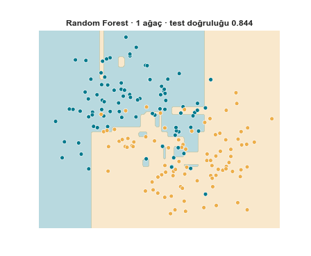
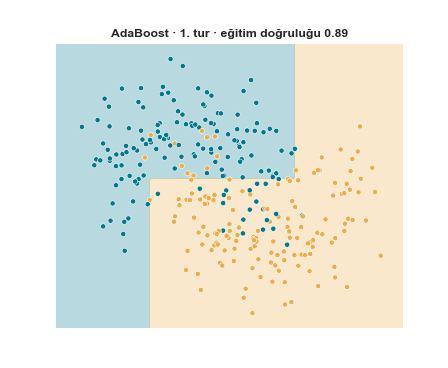
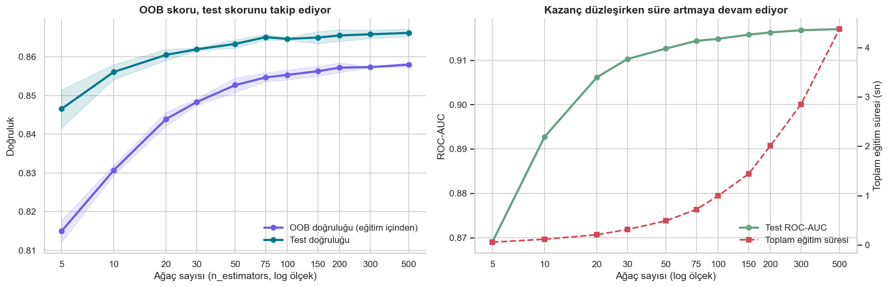
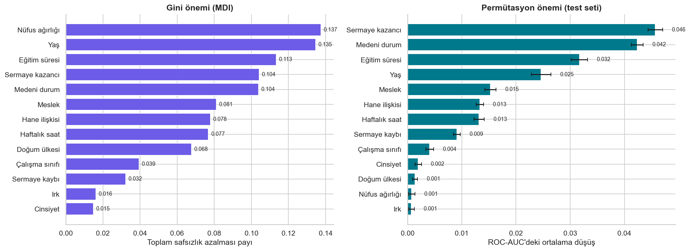
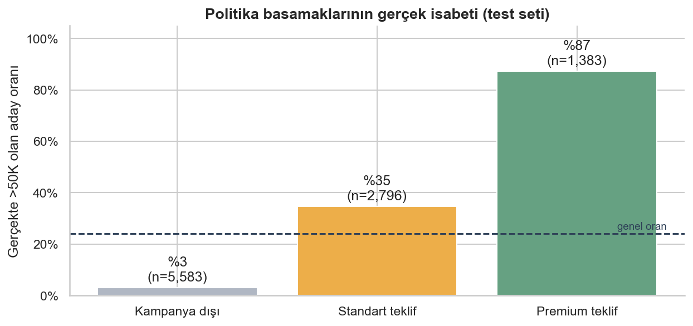

<p align="center">
  
</p>

<div align="center">

# 🌲 Gün 44 — Topluluk Öğrenmesi ve Random Forest


-16A34A?style=flat-square)


</div>

## 📌 Özet

Önce **topluluk (ensemble) öğrenmesini** sezgiden matematiğe anlatıyoruz: **Bagging**, **Boosting** ve bunların en ünlü uygulaması **Random Forest**. Ardından 32.561 kişilik *Census Income* verisiyle uçtan uca bir sistem kuruyoruz: bir bankanın **premium kampanya** hedef kitlesini, demografik bilgilerden **geliri >50K olan adayları** tahmin ederek belirliyor.

Kapsam: veri kalitesi → keşifçi analiz → sızıntısız `Pipeline` → ağaç / orman karşılaştırması → OOB → özellik önemi → değerlendirme → `RandomizedSearchCV` → eşik ve kampanya ekonomisi → adalet denetimi.

👉 Ders notu: [`day44.ipynb`](day44.ipynb) · Referans (ders videosu) notebook'u: [`14-RandomForestClassifier.ipynb`](14-RandomForestClassifier.ipynb)

## 🗺️ İçerik

| # | Bölüm | # | Bölüm |
|:-:|:--|:-:|:--|
| 1 | Kurulum | 9 | Ön işleme: `Pipeline`, `TargetEncoder`, ölçekleme deneyi |
| 2 | Topluluk öğrenmesi: kalabalığın bilgeliği (binom + simülasyon) | 10 | Tek ağaç mı, orman mı? |
| 3 | Bagging: bootstrap, OOB, sıfırdan Bagging | 11 | Kaç ağaç yeter? `n_estimators` ve **OOB skoru** |
| 4 | Boosting: elle AdaBoost, animasyon, Bagging ile fark | 12 | Özellik önemi (MDI vs permütasyon) ve özellik seçimi |
| 5 | Random Forest: yapı, oylama, varyans, animasyon | 13 | Değerlendirme: karmaşıklık matrisi, ROC, PR, eşik |
| 6 | Veri seti ve iş problemi | 14 | `RandomizedSearchCV` ile hiperparametre ayarı |
| 7 | Veri kalitesi: `?`, tekrar, yedek sütun | 15 | Final model, kampanya ekonomisi, politika, adalet, oy dağılımı |
| 8 | Keşifçi veri analizi | 16 | Özet, quiz, ödevler |

## 📊 Sonuçlar (test seti, 9.762 kişi)

| Model | Eğitim doğ. | Test doğ. | Duyarlılık (>50K) | Kesinlik (>50K) | F1 | ROC-AUC | PR-AUC |
|:--|:-:|:-:|:-:|:-:|:-:|:-:|:-:|
| Taban (hep ≤50K) | 0,759 | 0,759 | 0,000 | 0,000 | 0,000 | 0,500 | 0,241 |
| Tek karar ağacı | 0,961 | 0,815 | 0,630 | 0,614 | 0,622 | 0,752 | 0,476 |
| Orman · 10 ağaç | 0,951 | 0,855 | 0,597 | 0,749 | 0,665 | 0,892 | 0,733 |
| Orman · 100 ağaç | 0,970 | 0,863 | 0,633 | 0,760 | 0,691 | 0,915 | 0,798 |
| **Orman · ayarlı** | 0,882 | **0,871** | 0,617 | **0,800** | 0,696 | **0,924** | **0,822** |

> Tek ağaçtan ormana PR-AUC **0,476 → 0,822**; ayarlama eğitim–test makasını **≈ 10,6 puandan ≈ 1,2 puana** indirdi. Eşiği kampanya maliyetine göre seçmek (0,5 yerine 0,18) 1.000 aday başına net kazancı **14.112 $ → 18.211 $** yaptı (maliyet varsayımları örnektir). Politika basamaklarında *Premium* kesim (%14 aday) gerçekte **%87** isabetli.

<p align="center">
  
  <br>
  <br>
  <br>
  
</p>

## 🔍 Referans Notebook'tan Farklar

| Konu | Referans (video) | Bu notebook |
|:--|:--|:--|
| Boşluk / `?` temizliği | Sütun sütun `replace` | `skipinitialspace=True`, `na_values="?"` ile okuma anında |
| Tekrar eden satırlar, yedek sütun | Yok | 24 tekrar silindi; `education` (= `education_num`) çıkarıldı |
| Bölme | `random_state=0`, tabakasız | `stratify`, `random_state=42` |
| Eksik doldurma, kodlama | Pipeline dışı (sızıntı riski) | Hepsi `Pipeline` içinde; ülke için `TargetEncoder(smooth=20)` |
| Ölçekleme | `RobustScaler` | Gereksizliği **deneyle** gösterildi, çıkarıldı |
| Özellik seçimi | 10 sütun elle atıldı | Çapraz doğrulamalı çıkarma deneyleri + kontrol deneyi |
| Arama | `max_features="auto"` (sklearn ≥ 1.3'te hata) | `"sqrt"`, hedef metrik ROC-AUC |
| Değerlendirme | Doğruluk, karmaşıklık matrisi, rapor | + ROC, PR, eşik–maliyet analizi, politika, adalet denetimi |

## 📁 Klasör Yapısı

```text
day44/
├── day44.ipynb                           ← ders notu (çıktılarıyla birlikte)
├── README.md
├── 14-income_evaluation.csv              ← Census Income (32.561 satır)
├── 14-RandomForestClassifier.ipynb       ← referans notebook
├── assets/                               ← görsel dil (animasyonlu SVG)
│   ├── hero.svg · kapanis.svg · yol_haritasi.svg
│   ├── bolum_01.svg … bolum_16.svg       ← bölüm banner'ları
│   ├── diyagram_*.svg                    ← kalabalık, bagging, boosting, random forest, proje akışı, bias–varyans
│   └── etiket_*.svg                      ← bilgi kartı etiketleri
└── outputs/
    ├── figures/                          ← 24 grafik (PNG) + 2 animasyon (GIF)
    └── reports/                          ← 12 CSV: model karşılaştırma, özellik önemi, arama sonuçları,
                                             kampanya senaryoları, politika basamakları, adalet denetimi …
```

## 🏠 Ödevler

`day44.ipynb` sonunda: Boosting karşılaştırması · `ExtraTrees` · eksiklik bayrağı · maliyet duyarlılığı · vekil değişken denetimi · `class_weight` ve eşik · `fnlwgt` sırrı.

## 🔗 Kaynaklar

- Atıl Samancıoğlu — *Topluluk Öğrenme Yöntemleri: Bagging ve Boosting*, *Random Forest: Sınıflandırma ve Regresyon* ders notları
- Veri: [Kaggle · Income Classification](https://www.kaggle.com/datasets/lodetomasi1995/income-classification) · [UCI · Adult](https://archive.ics.uci.edu/dataset/2/adult)
