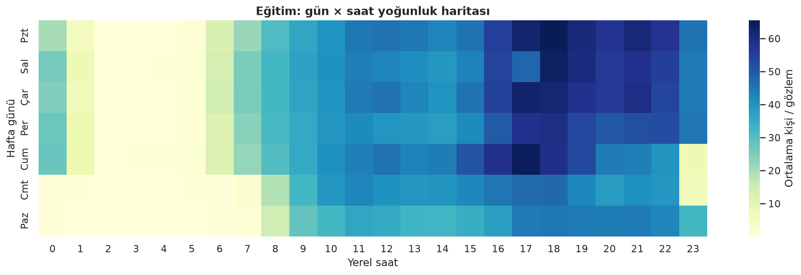
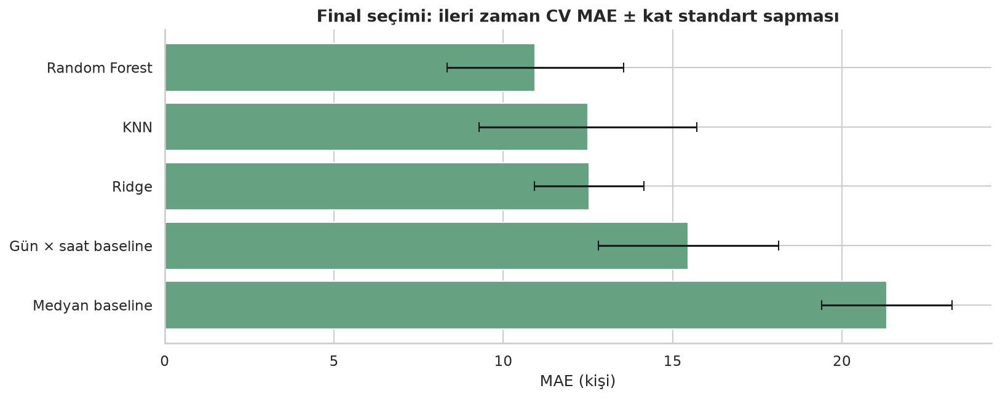
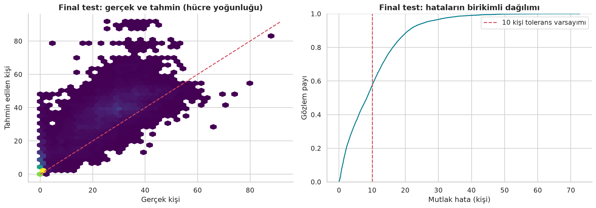
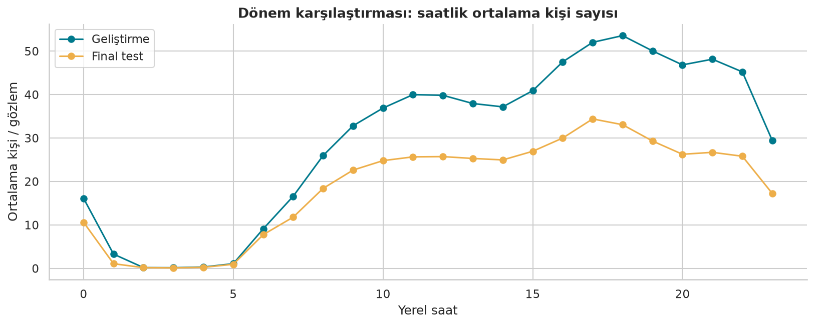
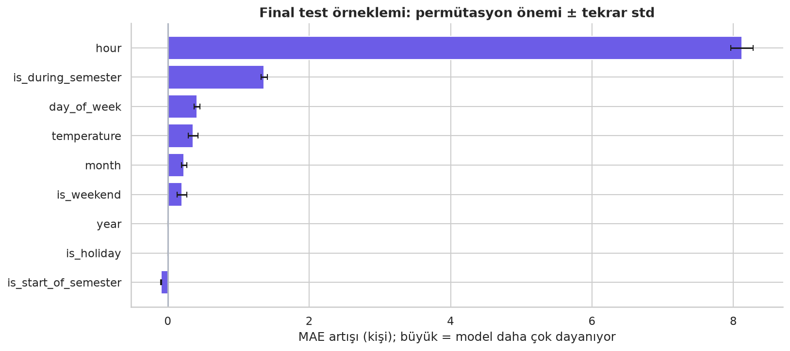

<p align="center">
  
</p>

<div align="center">

# 🏋️ Gün 45 — Spor Salonu Yoğunluk Tahmini


</div>

## 📌 Özet

Bir üniversite spor salonunun **o anki kişi sayısını** (`number_people`) saat, gün, dönem ve sıcaklık bilgisinden tahmin eden uçtan uca bir **regresyon** projesi. Senaryo YBS gözüyle kurulur: salon yönetimi, yoğun saatlerde personel ve alan planlamasını bu tahmine göre yapar.

Random Forest teorisi Gün 44'te işlendiği için tekrar edilmez; bu derste **veri bütünlüğü, zamana saygılı değerlendirme ve sonuçların dürüst yorumu** öne çıkar. Kapsam: veri kalitesi → zaman bölmesi → keşifçi analiz → sızıntısız `Pipeline` → baseline'lar → 6 algoritmanın karşılaştırması → ileri zaman CV'si ve `RandomizedSearchCV` → kilitli final test → hata analizi → özellik önemi → karar senaryosu → model teslimi.

👉 Ders notu: [`day45.ipynb`](day45.ipynb) · Kaydedilmiş çıktıların önizlemesi: [`day45.html`](day45.html)

## 🗺️ İçerik

| # | Bölüm | # | Bölüm |
|:-:|:--|:-:|:--|
| 1 | İş problemi, tahmin anı, kaynak planlama senaryosu | 9 | MAE, RMSE, R² ve iki baseline |
| 2 | Kurulum, sürümler, ortak görsel tema | 10 | Referanstaki altı algoritmanın karşılaştırması |
| 3 | Veri sözlüğü ve kaynak kimliği | 11 | KNN / Random Forest araması, ileri zaman CV'si |
| 4 | Eksik, tekrar, hedef ve zaman bütünlüğü denetimleri | 12 | Kilitli final test, gerçek–tahmin, tolerans analizi |
| 5 | Eğitim / doğrulama / kilitli final test ayrımı | 13 | Artıklar, segmentler, dönem kayması |
| 6 | Saat, gün ve yoğunluk keşfi | 14 | Permütasyon ve RF MDI önemi |
| 7 | Sıcaklık, tatil, dönem, korelasyon | 15 | YBS karar senaryosu, rastgele bölme deneyi, model teslimi |
| 8 | Sızıntısız imputer / scaler / model `Pipeline`'ı | 16 | Yönetici özeti, kontrol listesi, quiz, görevler |

## 📊 Sonuçlar (kilitli final test, 17.263 gözlem)

Veri 62.184 kayıttır; eğitim 2015-08-14 → 2016-07-01, doğrulama 2016-07-02 → 2016-09-20, **final test 2016-09-21 → 2017-03-18** (son %25 gözlenen takvim günü).

| Model | MAE | RMSE | R² |
|:--|:-:|:-:|:-:|
| Medyan baseline | 16,21 | 20,12 | −0,739 |
| Gün × saat baseline | 10,97 | 15,88 | −0,083 |
| **Random Forest (ayarlı)** | **10,03** | **13,27** | **0,243** |

> Seçim ölçütü, geliştirme verisinde 3 ileri zaman katının ortalama MAE'si oldu: **Random Forest 10,94**, KNN 12,50, Ridge 12,53, gün × saat baseline 15,47. Final testte Random Forest, gün × saat baseline'ı MAE'de yaklaşık **1 kişi** geride bırakıyor. Kazanç var ama büyük değil.
>
> **Referanstaki rastgele bölme R² = 0,92 (MAE 4,30) verir.** Aynı model zamana saygılı testte R² = 0,24'e düşer. Rastgele bölmede komşu saatler hem eğitimde hem testte yer aldığı için sonuç iyimserdir; ayrıca final testte dönem kayması da var. Bu yüzden zamana saygılı skor, canlı kullanımdaki performansa çok daha yakın bir beklentidir.
>
> Dönem kayması gerçek: geliştirme verisinde ortalama 33 kişi varken final testte 19 kişi var. Permütasyon önemine göre en belirleyici özellik `hour` (MAE artışı ≈ 8,1), ardından `is_during_semester` (≈ 1,4).

Yoğun saat uyarısı senaryosunda (50 kişi eşiği, 3:1 maliyet oranı; eğitim varsayımı) iki yaklaşım farklı davranıyor:

| Model | Yakalanan yoğun saat | Kaçırılan | Gereksiz uyarı | Ortalama maliyet puanı |
|:--|:-:|:-:|:-:|:-:|
| Random Forest | %40,7 (81 / 199) | 118 | 1.364 | **10,70** |
| Gün × saat baseline | %62,3 (124 / 199) | 75 | 2.010 | 11,95 |

Random Forest daha az yoğun saati yakalıyor ama çok daha az yanlış alarm veriyor; toplam maliyette önde. Hangisinin seçileceği, kaçırılan yoğunluğun gerçek maliyetine bağlı bir **iş kararıdır**.

<p align="center">
  
  <br>
  <br>
  
  
</p>

## 🔍 Referans Notebook'tan Farklar

| Konu | Referans (video) | Bu notebook |
|:--|:--|:--|
| Veri denetimi | Temel kontrol | Eksik, tekrar, hedef, saat / ay / gün / haftasonu uyuşmazlığı kontrolleri (hepsi 0) |
| Bölme | Rastgele bölme | **Gözlenen günlere göre zaman bölmesi**; eğitim / doğrulama / kilitli final test |
| Önişleme | Pipeline dışı | Imputer, scaler ve model tek `Pipeline` içinde (sızıntısız) |
| Baseline | Yok | Medyan ve gün × saat baseline'ları |
| Arama | 100 arama | İleri zaman CV'si (3 kat, 1 gün boşluk); RF'de 12, KNN'de 6 aday |
| Değerlendirme | Skor odaklı | + RMSE, tolerans analizi, saat / gün segmentleri, dönem kayması |
| Rastgele bölme | Ana değerlendirme | **Ayrı tanısal deney**; model seçimini etkilemez |
| Teslim | Yok | `joblib` paketi, model kartı, sürüm bilgisi, yeniden yükleme kontrolü |

## 📁 Klasör Yapısı

```text
day45/
├── day45.ipynb                           ← ders notu (çıktılarıyla birlikte)
├── day45.html                            ← notebook'un HTML önizlemesi
├── README.md
├── requirements.txt                      ← doğrulanmış sürümler (Python 3.12)
├── 15-gym_crowdedness.csv                ← Campus Gym (62.184 satır)
├── assets/                               ← görsel dil (SVG)
│   ├── hero.svg · yol_haritasi.svg
│   ├── bolum_01.svg … bolum_16.svg       ← bölüm banner'ları
│   └── etiket_*.svg                      ← bilgi kartı etiketleri
└── outputs/
    ├── figures/                          ← 18 grafik (PNG)
    ├── reports/                          ← 19 CSV: veri profili, kalite denetimi, bölme protokolü,
    │                                        model karşılaştırma, arama sonuçları, final test,
    │                                        segment hataları, önem skorları, karar senaryosu …
    └── models/                           ← day45_model.joblib · model_karti.json · requirements.txt
```

## ▶️ Çalıştırma

Bu klasörü çalışma dizini seçin, bağımlılıkları kurun ve `day45.ipynb` içinde **Restart Kernel and Run All** çalıştırın. SVG görsellerin görünmesi için `assets/` klasörü notebook'un yanında kalmalıdır.

```bash
pip install -r requirements.txt
```

## ⚠️ Değerlendirme Sınırları

- Sıcaklık birimi kaynakta doğrulanmadığı için özgün ölçek korunur. Canlı kullanımda sıcaklık **tahmini**nin hatası ayrıca değerlendirilmelidir.
- Gözlem toplamı günlük benzersiz ziyaretçi değildir.
- 50 kişi eşiği, 10 kişi toleransı ve 3:1 maliyet oranı gerçek salon politikası değil, **eğitim senaryosudur**.
- Veri 2015–2017 dönemine aittir; güncel bir salona doğrudan genellenemez.

## 🏠 Ödevler

`day45.ipynb` sonunda geliştirme görevleri yer alır.

## 🔗 Kaynaklar

- Veri: [Kaggle · Crowdedness at the Campus Gym](https://www.kaggle.com/datasets/nsrose7224/crowdedness-at-the-campus-gym/data)
- [scikit-learn · TimeSeriesSplit](https://scikit-learn.org/stable/modules/generated/sklearn.model_selection.TimeSeriesSplit.html)
- [scikit-learn · RandomForestRegressor](https://scikit-learn.org/stable/modules/generated/sklearn.ensemble.RandomForestRegressor.html)
