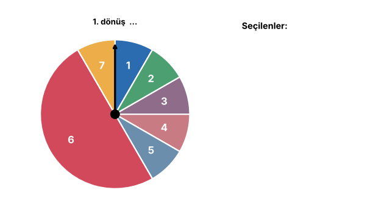
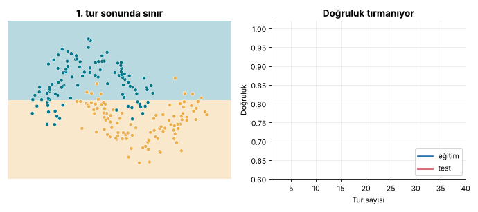
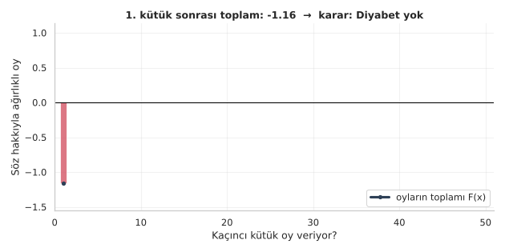
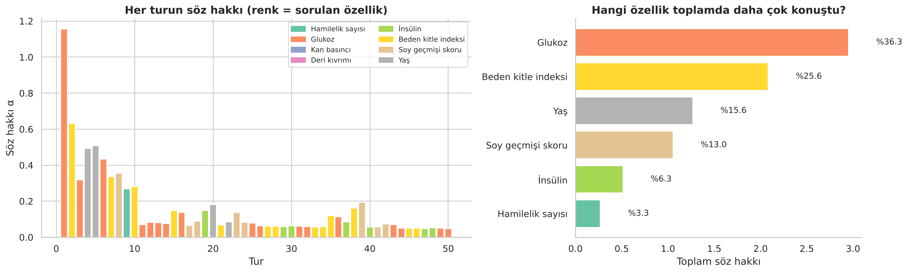
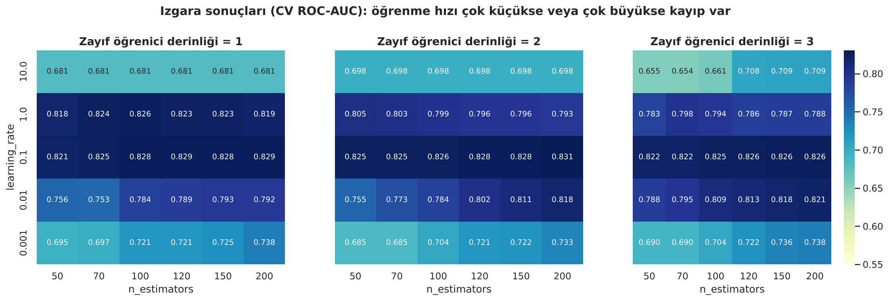
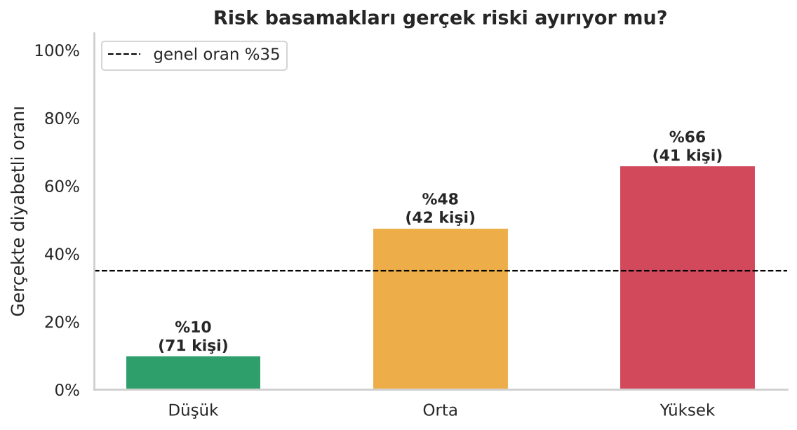
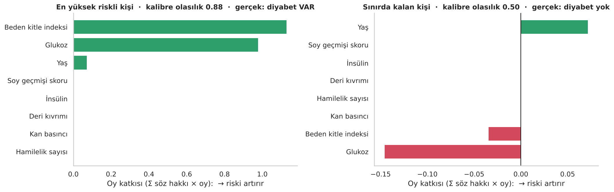

<p align="center">
  
</p>

<div align="center">

# 🚀 Gün 46 — AdaBoost: Kavram ve Diyabet Taraması Projesi


</div>

## 📌 Özet

Bu gün iki notebook'tan oluşur:

1. **Kavram dersi** — AdaBoost'u teknik ayrıntıya boğmadan, **animasyon ve diyagramlarla** anlatır. Atıl Samancıoğlu'nun PDF notundaki 7 satırlık başvuru örneğini adım adım (hata → söz hakkı → ağırlık güncelleme → rulet çarkı → ağırlıklı oy) hesaplar; ardından sıfırdan kod ve regresyon (AdaBoost Regressor) bölümüne geçer.
2. **Proje** — `16-diabetes.csv` (Pima Indians Diabetes, 768 kişi) ile uçtan uca bir **tarama önceliklendirme** sistemi kurar: gizli sıfırlar → keşif → sızıntısız `Pipeline` → baseline → AdaBoost'un içine bakış → ayar → rakip modeller → kalibrasyon, maliyet duyarlı eşik, risk basamakları, tek hasta açıklaması → kayıtlı model.

👉 Kavram dersi: [`day46_adaboost_kavram.ipynb`](day46_adaboost_kavram.ipynb) · Proje: [`day46_adaboost_projesi.ipynb`](day46_adaboost_projesi.ipynb)

> ⚠️ Proje **eğitim amaçlıdır**; klinik tanı aracı değildir.

## 🗺️ İçerik

**Kavram dersi (11 bölüm)**

| # | Bölüm | # | Bölüm |
|:-:|:--|:-:|:--|
| 1 | Kurulum | 7 | Rulet çarkı: hatalılar daha sık seçilir |
| 2 | Büyük fikir: zayıf modellerden güçlü takım | 8 | Tur 2 ve ağırlıklı oylama (PDF'teki iki test adayı) |
| 3 | AdaBoost'un beş adımlık döngüsü | 9 | Sıfırdan AdaBoost, sklearn karşılaştırması, boosting animasyonu |
| 4 | Söz hakkı (α) ve hata oranı | 10 | AdaBoost Regressor (artıkları öğrenmek) |
| 5 | 7 satırlık başvuru örneği, ilk kütük seçimi | 11 | Özet, artı/eksi, quiz, ödevler, kaynakça |
| 6 | Tur 1: ε, α, yeni ağırlıklar, animasyon | | |

**Proje (14 bölüm)**

| # | Bölüm | # | Bölüm |
|:-:|:--|:-:|:--|
| 1 | Kurulum | 8 | Kaç tur yeter? (`n_estimators` × `learning_rate`, sızıntısız CV) |
| 2 | Veri seti ve iş problemi | 9 | Özellik önemi: model içi vs permütasyon |
| 3 | Gizli sıfırlar (eksik veri) | 10 | Değerlendirme: karmaşıklık matrisi, ROC, PR, eşik |
| 4 | Keşifçi veri analizi | 11 | `GridSearchCV` (tur × hız × kütük derinliği) |
| 5 | Bölme, `Pipeline`, ölçekleme deneyi | 12 | Rakip modellerle tekrarlı CV yarışı |
| 6 | Baseline'lar ve ilk AdaBoost | 13 | Kalibrasyon, maliyet eşiği, risk basamağı, "neden?", yaş denetimi |
| 7 | Tur tur içeriden + hasta yolculuğu animasyonu | 14 | Model kaydı, `risk_tahmin()`, quiz, ödevler |

## 📊 Sonuçlar (test seti, 154 kişi)

| Model | Doğruluk | Duyarlılık | Kesinlik | F1 | ROC-AUC | PR-AUC |
|:--|:-:|:-:|:-:|:-:|:-:|:-:|
| Taban (hep "yok") | 0,649 | 0,000 | 0,000 | 0,000 | 0,500 | 0,351 |
| Tek kütük | 0,695 | 0,278 | 0,652 | 0,390 | 0,599 | 0,434 |
| Tek ağaç (derinlik 3) | 0,688 | 0,259 | 0,636 | 0,368 | 0,764 | 0,567 |
| **AdaBoost (varsayılan)** | 0,747 | 0,574 | 0,660 | 0,614 | 0,818 | 0,692 |
| AdaBoost (ayarlı: 200 tur, hız 0,1, derinlik 2) | 0,747 | 0,500 | 0,692 | 0,581 | 0,819 | 0,669 |

> **Dürüst okuma:** Test seti küçük (doğruluğun standart hatası ≈ 3,5 puan). Ayarlama **CV ROC-AUC'yi +0,012** artırdı (0,818 → 0,831) ama test skorlarını belirgin değiştirmedi. Tekrarlı CV'de **lojistik regresyon (0,843)** ayarlı AdaBoost'un (0,833) biraz önünde; farklar belirsizlik içinde. AdaBoost'un artısı **okunabilir kütüklerden** oluşması.

Kalibre edilmiş modelle maliyet duyarlı eşik (yanlış alarm = 1, kaçırılan hasta = 5 birim; **varsayımdır**):

| Eşik | Yakalanan hasta | Kaçırılan | Gereksiz alarm | Duyarlılık | Çağrılan kişi | Toplam maliyet |
|:--|:-:|:-:|:-:|:-:|:-:|:-:|
| 0,50 (varsayılan) | 27 | 27 | 14 | 0,50 | %26,6 | 149 |
| **0,27 (eğitim CV'sinden seçildi)** | 47 | 7 | 36 | 0,87 | %53,9 | **71** |

Risk basamakları gerçekten ayırıyor: **Düşük** %10, **Orta** %48, **Yüksek** %66 gözlenen diyabet oranı (genel oran %35).

<p align="center">
  
  <br>
  
  <br>
  <br>
  
  
</p>

## 🔍 Referans Notebook'tan Farklar

| Konu | Referans (video) | Bu gün |
|:--|:--|:--|
| Gizli sıfırlar | Sayıldı, medyanla dolduruldu | `NaN` + **`Pipeline` içinde** medyan, eksiklik–hedef ilişkisi |
| Bölme | `random_state=15`, tabakasız | `stratify=y`, `random_state=42` |
| Ölçekleme | `StandardScaler` uygulandı | Gereksizliği **deneyle** gösterildi, çıkarıldı |
| Ayar | `GridSearchCV` (doğruluk) | + kütük derinliği, **ROC-AUC**, ısı haritası, tur eğrileri |
| Değerlendirme | Rapor, karmaşıklık matrisi | + ROC/PR, tekrarlı CV, belirsizlik, kalibrasyon, maliyet eşiği, risk basamağı |
| Yorum / teslim | – | Kütük kuralları, permütasyon önemi, tek hasta açıklaması, kayıtlı model |

## 📝 PDF Notuyla İlgili Teknik Notlar

- PDF'teki `0.895 / 0.354 / 0.504 / 0.552` gibi değerler ara sonuçlar **yuvarlanarak** hesaplanmıştır; notebook tam değerleri (`0.896 / 0.350 / 0.500 / 0.549`) kullanır, sonuçlar aynıdır.
- PDF ikinci kütük olarak *GPA > 3.0* seçer (ε = 0,25); gerçek algoritma ağırlıklı hatası en düşük kütüğü seçer (*Mülakat > Düşük*, ε ≈ 0,083). Notebook ikisini de gösterir.
- `scikit-learn` söz hakkını $\ln\frac{1-\varepsilon}{\varepsilon}$ olarak (PDF'teki ½'li formülün 2 katı) hesaplar; karar işareti değişmez.
- PDF'in regresyon bölümü "artıkları öğren" anlatımıdır (Gradient Boosting'e yakın); `scikit-learn`'ün `AdaBoostRegressor`'ı ise AdaBoost.R2 kullanır. Notebook ikisini yan yana koyar.

## 📁 Klasör Yapısı

```text
day46/
├── day46_adaboost_kavram.ipynb           ← kavram dersi (çıktılarıyla birlikte)
├── day46_adaboost_projesi.ipynb          ← diyabet projesi (çıktılarıyla birlikte)
├── README.md
├── requirements.txt
├── 16-diabetes.csv                       ← Pima Indians Diabetes (768 satır)
├── assets/                               ← görsel dil (animasyonlu SVG)
│   ├── hero_kavram.svg · hero_proje.svg · kapanis_*.svg · yol_haritasi_*.svg
│   ├── kavram_01.svg … kavram_11.svg · proje_01.svg … proje_14.svg  ← bölüm banner'ları
│   ├── diyagram_*.svg                    ← zayıf→güçlü, döngü, ağırlık, oylama, proje akışı
│   └── etiket_*.svg                      ← bilgi kartı etiketleri
└── outputs/
    ├── figures/                          ← 25 grafik (PNG) + 5 animasyon (GIF)
    ├── reports/                          ← 8 CSV: ızgara, model yarışı, önem, eşik, risk basamağı, yaş denetimi …
    └── model/                            ← adaboost_diyabet.joblib + meta.json
```

## 🏠 Ödevler

Kavram notebook'u: tur sayısı deneyi · söz hakkı eğrisi · gürültü deneyi · öğrenme hızı · daha derin zayıf öğrenici · kendi örneğiniz.
Proje notebook'u: eksiklik bayrağı · farklı doldurma · maliyet oranı · `class_weight` karşılığı · `HistGradientBoosting` kıyası · etiket gürültüsü · BMI grubu denetimi.

## 🔗 Kaynaklar

- Atıl Samancıoğlu — *AdaBoost ML Algoritması* ders notu
- Freund, Y., & Schapire, R. E. (1997). A decision-theoretic generalization of on-line learning and an application to boosting. *Journal of Computer and System Sciences, 55*(1), 119–139. https://doi.org/10.1006/jcss.1997.1504
- Hastie, T., Rosset, S., Zhu, J., & Zou, H. (2009). Multi-class AdaBoost. *Statistics and Its Interface, 2*(3), 349–360. https://doi.org/10.4310/SII.2009.v2.n3.a8
- Smith, J. W., Everhart, J. E., Dickson, W. C., Knowler, W. C., & Johannes, R. S. (1988). Using the ADAP learning algorithm to forecast the onset of diabetes mellitus. *Proceedings of the Annual Symposium on Computer Application in Medical Care*, 261–265.
- Veri: [Kaggle · Pima Indians Diabetes Database](https://www.kaggle.com/datasets/uciml/pima-indians-diabetes-database)
