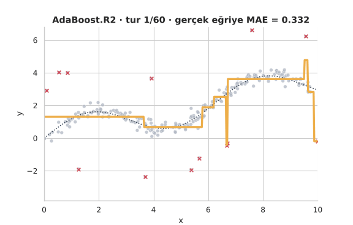
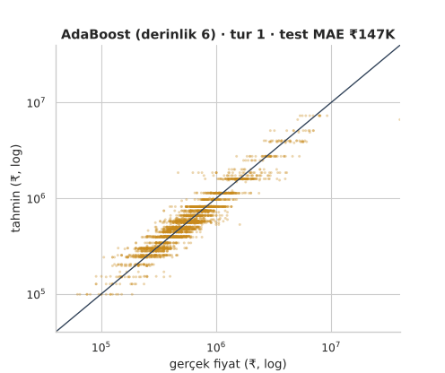
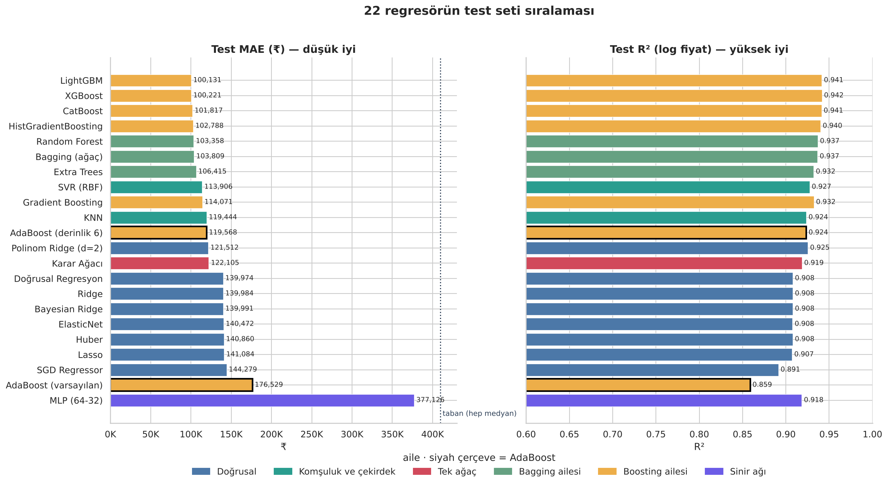
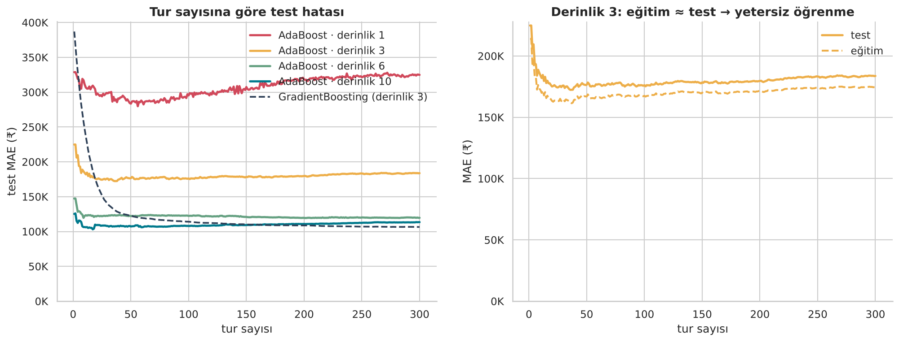
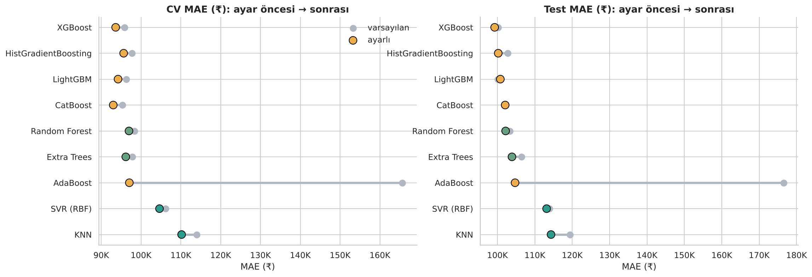
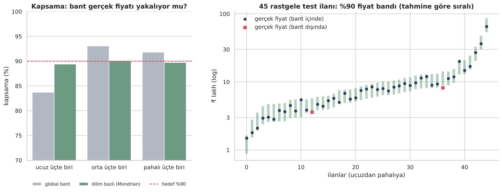

<p align="center">
  
</p>

<div align="center">

# 🚀 Gün 47 — AdaBoost Regressor ve 22 Algoritma: Araç Fiyat Tahmini


</div>

## 📌 Özet

Önce **AdaBoost.R2** (Drucker, 1997) algoritmasını sıfırdan kodlayıp `scikit-learn`'ün `AdaBoostRegressor`'ı ile doğruluyor; `loss`, derinlik ve `learning_rate` düğmelerini oyuncak veride çeviriyoruz. Ardından 15.411 ilanlık **CarDekho ikinci el araç** verisiyle uçtan uca bir sistem kuruyoruz: bir ilan platformu için **adil fiyat önerisi**, **%90 fiyat bandı** ve **fiyat politikası**.

Kapsam: hata ölçüleri → veri kalitesi → keşifçi analiz → sızıntısız `Pipeline` (`TargetEncoder`, log hedef) → **22 regresörün adil yarışı** (aynı bölme, 5 katlı CV, eşleştirilmiş bootstrap farkı) → AdaBoost'un röntgeni (`staged_predict`, `estimator_weights_`) → `RandomizedSearchCV` → özellik önemi ve kısmi bağımlılık → konformal fiyat bandı → asimetrik maliyetle fiyat politikası → segment denetimi → kayıtlı model.

👉 Ders notu: [`day47.ipynb`](day47.ipynb) · Referans (ders videosu) notebook'u: `17-AdaboostRegressor.ipynb` (repoya eklenmedi; yalnızca izlediği yol örnek alındı)

## 🗺️ İçerik

| # | Bölüm | # | Bölüm |
|:-:|:--|:-:|:--|
| 1 | Kurulum | 9 | Ön işleme: `Pipeline`, `TargetEncoder`, ölçekleme / log hedef / sızıntı / aykırı silme deneyleri |
| 2 | Regresyonda hata: MAE, RMSE, R², MdAPE, argüman sırası tuzağı | 10 | **Büyük yarış: 22 regresör** (6 aile) |
| 3 | Boosting ve AdaBoost.R2: algoritma, ağırlıklı medyan | 11 | Yarışın röntgeni: CV↔test, bootstrap farkı, fiyat dilimi |
| 4 | AdaBoost.R2'yi sıfırdan kodlamak, `sklearn` ile doğrulama, animasyon | 12 | AdaBoostRegressor yakından: tur eğrileri, ağırlıklar, animasyon, `loss × lr` ızgarası |
| 5 | AdaBoost'un düğmeleri (oyuncak veri) | 13 | `RandomizedSearchCV`: AdaBoost ve 8 rakip |
| 6 | Veri seti ve iş problemi | 14 | Özellik önemi (MDI vs permütasyon), kısmi bağımlılık |
| 7 | Veri kalitesi: gizli eksik, tekrar, imkânsız değer | 15 | Final model, hata analizi, **konformal bant**, fiyat politikası, segment denetimi, "neden?" |
| 8 | Keşifçi veri analizi | 16 | Özet, quiz, ödevler, kaynakça |

## 📊 Sonuçlar (test seti, 3.049 ilan)

| Model | CV MAE | Test MAE | Test MdAPE | Test R² (log fiyat) |
|:--|:-:|:-:|:-:|:-:|
| Taban (hep medyan) | ₹398,2 bin | ₹409,6 bin | %37,2 | -0,005 |
| Doğrusal Regresyon | ₹128,5 bin | ₹140,0 bin | %12,5 | 0,908 |
| Karar Ağacı | ₹120,1 bin | ₹122,1 bin | %11,2 | 0,919 |
| KNN | ₹114,0 bin | ₹119,4 bin | %10,9 | 0,924 |
| SVR (RBF) | ₹106,2 bin | ₹113,9 bin | %10,3 | 0,927 |
| Random Forest | ₹98,3 bin | ₹103,4 bin | %9,8 | 0,937 |
| **AdaBoost · varsayılan** (derinlik 3) | ₹165,6 bin | ₹176,5 bin | %16,5 | 0,859 |
| AdaBoost · derinlik 6 | ₹118,0 bin | ₹119,6 bin | %11,9 | 0,924 |
| **AdaBoost · ayarlı** | ₹97,1 bin | ₹104,7 bin | %9,9 | 0,936 |
| XGBoost · ayarlı | ₹93,6 bin | ₹99,2 bin | %9,6 | 0,941 |
| **CatBoost · ayarlı (CV ile seçilen final)** | ₹93,0 bin | ₹102,1 bin | %9,7 | 0,940 |

> **AdaBoost varsayılan ayarla 22 regresörün sonuncusu** (CV MAE ₹165,6 bin, doğrusal regresyondan bile ≈ %29 kötü). Ayarla (derinlik 12–14, 50 ağaç) CV MAE **₹165,6 bin → ₹97,1 bin**, test MAE **₹176,5 bin → ₹104,7 bin** (≈ %41 iyileşme); yine de gradyan artırma modellerinin (₹99,2 bin) ≈ %6 gerisinde. Asıl düğme **zayıf öğrenici derinliği**; `loss` ve `learning_rate` ikinci dereceden. Voting/Stacking bonusu (₹99,2 bin) en iyi tekil modeli kayda değer geçmiyor. Konformal %90 bant dilim bazlı kurulunca her fiyat diliminde ≈ %90 kapsıyor (global bant ucuz dilimde yalnızca %84); bekleme maliyeti yüksekse (cₒ = 4·cᵤ) tahminin ≈ %11 altında fiyat önermek maliyeti **%28** azaltıyor (maliyet varsayımları örnektir).

<p align="center">
  
  <br>
  <br>
  <br>
  <br>
  
</p>

## 🔍 Referans Notebook'tan Farklar

| Konu | Referans (video) | Bu notebook |
|:--|:--|:--|
| CSV okuma | `Unnamed: 0` sütunu sonradan silinir; global `display.float_format` | `index_col=0`; yalnızca ilgili tabloya `round()` |
| `seats = 0` | Elle `5` yazılır (bölmeden önce) | `NaN` yapılır, **pipeline içinde** eğitim medyanıyla doldurulur |
| Aykırı değer | Bölmeden önce `fiyat < 15 milyon` ve `km < 1 milyon` filtresi: **lüks ilanlar silinir** | Yalnızca imkânsız km silinir; lüks tutulur. Silmenin R²'yi şişirdiği **deneyle** gösterilir |
| Bölme | `random_state=15`, %30, tabakasız | %20, **fiyat onda birliğine göre tabakalı**, `random_state=42` |
| Marka / model kodlama | Bölmeden sonra elle **frekans kodlaması** (popülerlik; fiyat bilgisi yok) | `TargetEncoder` (çapraz uydurmalı, `smooth`) + `OneHotEncoder`, hepsi `Pipeline` içinde; sızıntı deneyi |
| Hedef | Ham fiyat | `log1p` + `TransformedTargetRegressor`; etkisi 3 modelde ölçülür |
| Metrik | `r2_score(y_pred, y_test)` (**argüman sırası ters**), MSE, MAE | Doğru sıra; MAE, RMSE, MdAPE, log R²; R²'nin tek ilana duyarlılığı gösterilir |
| Model | Tek model: varsayılan ve ayarlanmış AdaBoost | **22 regresör**, aynı CV, eşleştirilmiş bootstrap farkı, aşırı öğrenme makası |
| Arama uzayı | `max_depth ∈ {3,4,5}`, `scoring="r2"`, `n_iter` varsayılan (10) | `max_depth` 4–14, `min_samples_leaf`, log-uniform `learning_rate`, `scoring=MAE`; **9 model** ayarlanır |
| Sonrası | Yok | Özellik önemi, PDP, konformal bant, fiyat politikası, segment denetimi, "neden?" ve kayıtlı model |

## 📁 Klasör Yapısı

```text
day47/
├── day47.ipynb                           ← ders notu (çıktılarıyla birlikte)
├── README.md · requirements.txt
├── 17-cardekho.csv                       ← CarDekho ikinci el araçlar (15.411 ilan)
├── assets/                               ← görsel dil (animasyonlu SVG)
│   ├── hero.svg · kapanis.svg · yol_haritasi.svg
│   ├── bolum_01.svg … bolum_16.svg       ← bölüm banner'ları
│   ├── diyagram_*.svg                    ← AdaBoost.R2 döngüsü, ağırlıklı medyan, hata ölçüleri, model aileleri, proje akışı, bias–varyans
│   └── etiket_*.svg                      ← bilgi kartı etiketleri
└── outputs/
    ├── figures/                          ← 31 grafik (PNG) + 2 animasyon (GIF)
    ├── reports/                          ← 26 CSV: model karşılaştırma, CV skorları, ayar sonuçları, bant, politika, segment denetimi …
    └── model/                            ← fiyat_modeli.joblib + meta.json (final: CatBoost)
```

## 🏠 Ödevler

`day47.ipynb` sonunda: Ağırlıklı ortalama ile AdaBoost.R2 · Box–Cox hedef · marka/model olmadan yarış · `absolute_error` kayıplı gradyan artırma · marka kademesine göre Mondrian bant · maliyet oranı taraması · `Electric` araçlar için belirsizlik bayrağı.

## 🔗 Kaynaklar

- Drucker, H. (1997). Improving regressors using boosting techniques. In D. H. Fisher (Ed.), *Proceedings of the 14th International Conference on Machine Learning* (pp. 107–115). Morgan Kaufmann.
- Freund, Y., & Schapire, R. E. (1997). A decision-theoretic generalization of on-line learning and an application to boosting. *Journal of Computer and System Sciences, 55*(1), 119–139. https://doi.org/10.1006/jcss.1997.1504
- Pedregosa, F., et al. (2011). Scikit-learn: Machine learning in Python. *Journal of Machine Learning Research, 12*, 2825–2830.
- Veri: [Kaggle · CarDekho Used Cars Dataset](https://www.kaggle.com/datasets/sukritchatterjee/used-cars-dataset-cardekho) · [Kaggle · CarDekho (cleaned)](https://www.kaggle.com/datasets/sharooqfarzeenak/cardekho-cleaned)
