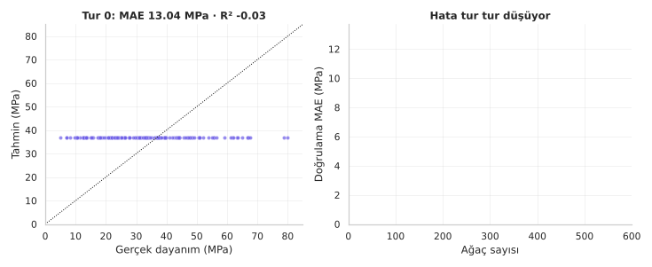
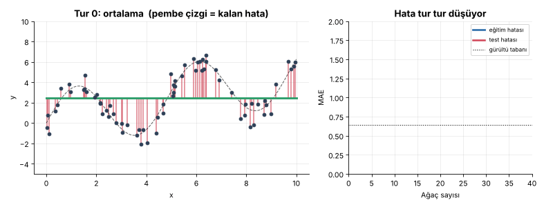
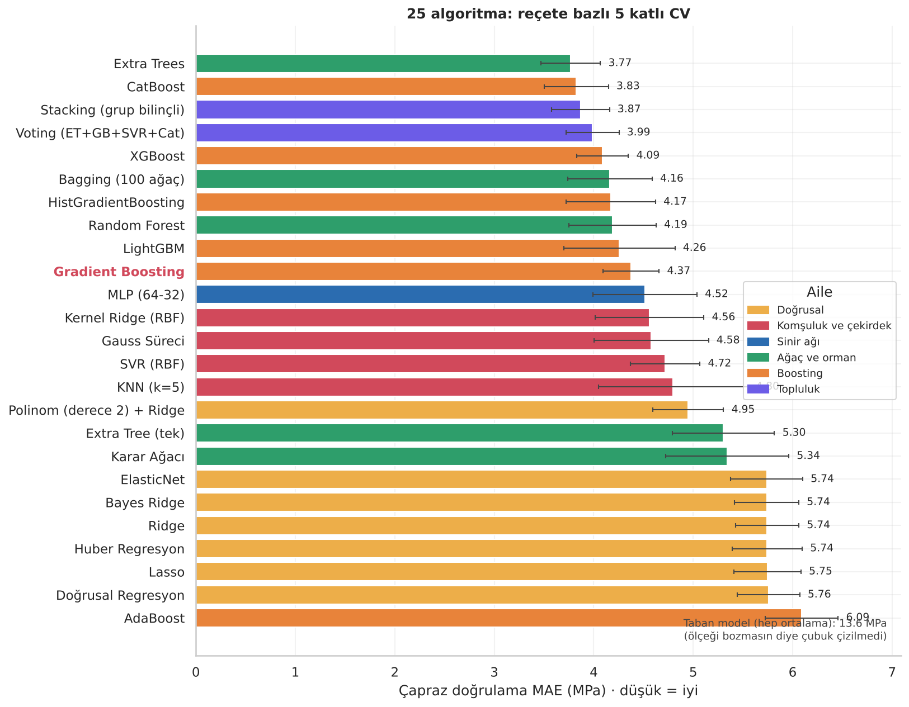
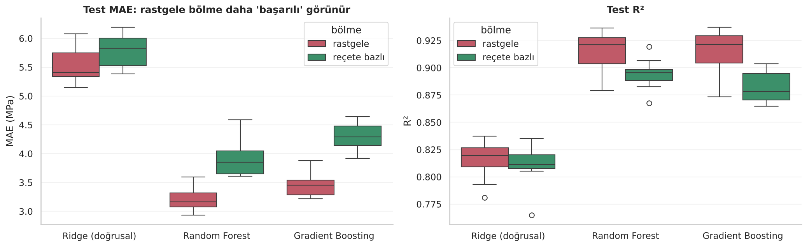
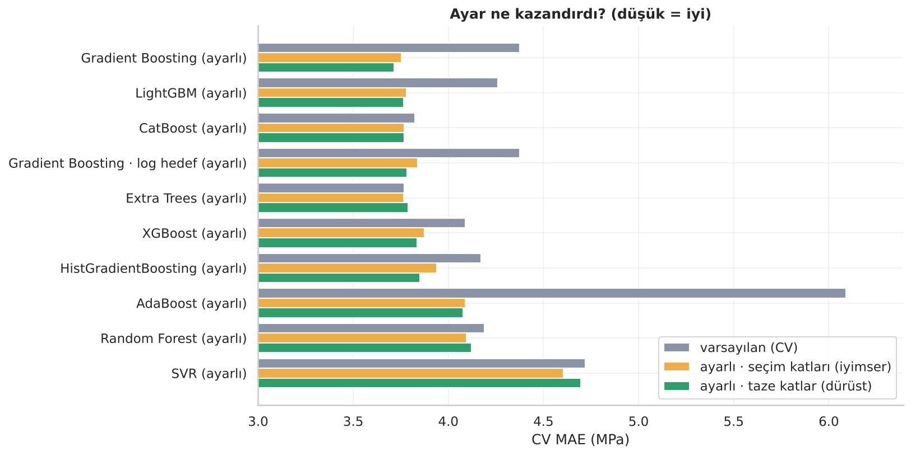
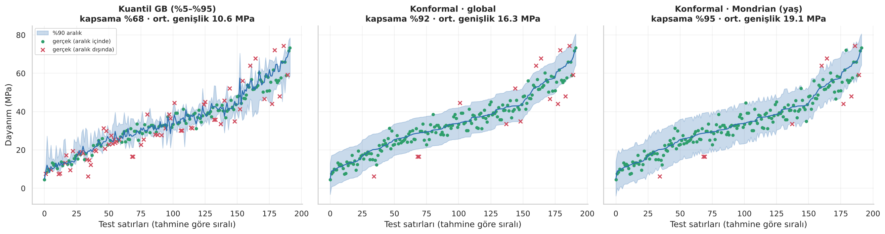

<p align="center">
  
</p>

<div align="center">

# 🏗️ Gün 48 — Gradient Boosting: Hatadan Öğrenen Orman ve Beton Dayanımı


</div>

## 📌 Özet

Bu gün **iki notebook** içeriyor:

1. **`day48_gradient_boosting_kavram.ipynb` (başlangıç düzeyi):** Gradient Boosting'in "her yeni küçük ağaç, öncekilerin **kalan hatasını** (artığını) öğrenir" fikrini golf benzetmesi, elle hesap (8 günlük dondurma satışı), animasyonlar, "neden *gradient*?" sezgisi, öğrenme hızı yarışı, AdaBoost ile karşılaştırma, **15 satırda sıfırdan kodlama** (`scikit-learn` ile doğrulama), düğmeler (tur, hız, derinlik, alt örnekleme, kayıp, erken durdurma) ve sınıflandırmada karar sınırının büyümesiyle anlatır. Teknik ayrıntı bilinçli olarak az tutuldu.
2. **`day48_gradient_boosting_projesi.ipynb` (uçtan uca proje):** **1.030 beton numunesiyle** (UCI *Concrete Compressive Strength*) bir hazır beton tesisi için **reçeteden basınç dayanımı (MPa) tahmini**. Veri 427 farklı reçeteden oluştuğu için **reçete bazlı** bölme ve çapraz doğrulama; **25 algoritma + taban** yarışı; Gradient Boosting'in düğmeleri ve `RandomizedSearchCV` ayarı; özellik önemi, kısmi bağımlılık, monotonluk kısıtı; **konformal / kuantil güven aralığı** ve güvenlik payına dayalı karar kuralı; "daha az çimentoyla aynı dayanım?" keşfi; model kaydı.

👉 Ders notları: [`day48_gradient_boosting_kavram.ipynb`](day48_gradient_boosting_kavram.ipynb) · [`day48_gradient_boosting_projesi.ipynb`](day48_gradient_boosting_projesi.ipynb)

## 🗺️ İçerik

**Kavram (12 durak):** Kurulum · Büyük fikir · 5 adımlık döngü · Küçük örnek (elle) · Hata avcısı (animasyon) · Neden "gradient"? · Öğrenme hızı · AdaBoost'tan farkı · Sıfırdan kodlama · Düğmeler · Sınıflandırma · Aile ve özet (quiz, ödevler, kaynakça)

| # | Proje bölümü | # | Proje bölümü |
|:-:|:--|:-:|:--|
| 1 | Kurulum | 9 | **Gradient Boosting yakından:** tur, hız, derinlik, rastgelelik, kayıp, erken durdurma, animasyon |
| 2 | Senaryo, veri, hata ölçüleri | 10 | **Hiperparametre ayarı:** 10 arama, taze katlarla doğrulama, final seçimi |
| 3 | Veri kalitesi, **gizli yapı:** aynı reçete, farklı yaşlar | 11 | Özellik önemi (MDI, permütasyon, ablasyon), PDP/ICE, **monotonluk kısıtı** |
| 4 | Keşifçi analiz, su/çimento oranı (Abrams) | 12 | Final, tahmin–gerçek, artık tanıları, **segment denetimi** |
| 5 | **Dürüst bölme:** rastgele ↔ reçete bazlı deney | 13 | **Belirsizlik:** kuantil GB, konformal (global / Mondrian), güvenlik payı kuralı |
| 6 | Pipeline; özellik / ölçek / log hedef / tekrar satır deneyleri | 14 | Reçete denemesi (keşif; kazananın laneti) |
| 7 | **Büyük yarış: 25 algoritma** (7 doğrusal, 4 çekirdek, MLP, 5 ağaç/orman, 6 boosting, 2 topluluk) | 15 | Model kaydı, ayrı süreçte yükleme testi, tahmin fonksiyonu |
| 8 | Yarışın röntgeni: CV↔test, reçete bazlı bootstrap, yaş dilimi | 16 | Özet, quiz, ödevler, kaynakça |

## 📊 Sonuçlar (test seti: 192 satır / 86 reçete, hiç görülmemiş reçeteler)

| Model | CV MAE (MPa) | Test MAE (MPa) | Test R² | Test MdAPE |
|:--|:-:|:-:|:-:|:-:|
| Taban (hep ortalama) | 13.63 | 12.74 | -0.024 | %30.2 |
| Ridge | 5.74 | 5.30 | 0.816 | %14.3 |
| SVR (RBF) | 4.72 | 3.56 | 0.896 | %8.9 |
| MLP (64-32) | 4.52 | 3.63 | 0.892 | %9.0 |
| Random Forest | 4.19 | 3.33 | 0.911 | %7.6 |
| Extra Trees | 3.77 | 3.00 | 0.917 | %6.0 |
| Gradient Boosting · varsayılan | 4.37 | 3.71 | 0.892 | %9.5 |
| XGBoost | 4.09 | 3.48 | 0.897 | %6.7 |
| CatBoost | 3.83 | 3.19 | 0.916 | %7.6 |
| Stacking (grup bilinçli) | 3.87 | 2.94 | 0.923 | %5.6 |
| **Gradient Boosting · ayarlı** | 3.71 (taze) | 3.25 | 0.910 | %7.1 |
| **FINAL · Voting (ayarlı GB + LightGBM + CatBoost)** | 3.67 (taze) | 3.09 | 0.917 | %6.2 |

> **Okuma:** Varsayılan Gradient Boosting yarışta **10.** sıradaydı (CV MAE 4,37). Ayar, onu test MAE'sinde **3,72 → 3,25 MPa**'ya (≈ %13; reçete bazlı bootstrap %95 aralığı [−0,88; −0,03]) indirdi ve yarışın en iyi ağaç topluluğuyla (varsayılan Extra Trees) **istatistiksel olarak ayırt edilemez** hâle getirdi; ondan *üstün* olduğu söylenemez. Üst sıradaki modeller arasındaki 0,05–0,12 MPa'lık CV farkları, katlama düzeninin gürültüsü (≈ 0,05–0,1 MPa) içinde.

**Bu projenin dürüst yönleri:**

- ✂️ **Rastgele bölme skoru şişiriyor:** aynı reçetenin satırları iki tarafa düşünce Gradient Boosting'in test MAE'si 3,45 (rastgele) ↔ 4,28 MPa (reçete bazlı), ≈ %24 fark; doğrusal modelde yalnızca ≈ %5.
- 🛡️ **Kuantil Gradient Boosting tek başına kalibre değil** (nominal %90 aralık test satırlarının ≈ %68'ini kapsıyor); **konformal** yöntem ≈ %92–95 kapsıyor (±8–10 MPa, yani MAE'nin ≈ 3 katı).
- 🧪 **Güvenlik payı bedava değil:** "alt sınır ≥ 30 MPa" kuralı yanlış kabulü %5,3 → 0'a indiriyor ama yeterli reçetelerin ≈ %40'ını kaçırıyor. Model yanlılığı **fazla tahmin** yönünde (ortalama artık −0,7 … −1,9 MPa).
- 🏗️ **Reçete denemesi başarısızlıkla bitiyor, bu iyi bir şey:** güvenli alt sınırla aranan en az çimentolu model adayı ≈ 195 kg/m³; veride zaten ölçülmüş 142 kg/m³'lük başarılı bir reçete var. Model, deney olmadan tasarruf sözü vermiyor.
- 🧯 **Monotonluk kısıtı** (çimento ↑, yaş ↑, su ↓) bu veride CV MAE'yi 3,85 → 4,00 MPa'ya kötüleştirdi; kısıt tutarlılık getirir, doğruluğu garanti etmez.

<p align="center">
  
  <br>
  
  <br>
  
  
</p>

## 🔍 Referans Dosyalar Hakkında Not

Bu ders, kullanıcının sağladığı üç referans dosyadan esinlenecek biçimde hazırlanacaktı: `17-Gradient_Boosting_Algorithm.pdf` (ders notu), `18-GradientBoostingRegressor.ipynb` (video notebook'u) ve `18-concrete_data.csv`. Bu üç dosya **notebook'ların hazırlandığı bulut ortamında erişilemedi** (yalnızca Windows yolları verilmişti). Bu yüzden:

| Konu | Ne yapıldı? |
|:--|:--|
| PDF ve referans notebook | **Okunamadı**, içerikleri kopyalanmadı ve repoya eklenmedi. Kavram notebook'u Gradient Boosting'in standart (Friedman, 2001) anlatımından, özgün örneklerle (dondurma satışı, golf benzetmesi, gürültülü eğri) yazıldı. Proje, `CLAUDE.md`'deki Day 44/46/47 akışına göre (senaryo → kalite → EDA → bölme → pipeline → yarış → ayar → yorum → sonuç) kurgulandı. |
| Veri seti | Aynı UCI veri setinin (1.030 satır, aynı sütun sırası) halka açık bir yansısı `18-concrete_data.csv` adıyla konuldu; notebook sütunları **konuma göre** adlandırdığından kendi kopyanız aynı adla çalışır. |
| Referansla farklar | Videodaki tek model (`GradientBoostingRegressor`) yerine 25 algoritma; **rastgele yerine reçete bazlı** bölme; güven aralığı, ayar, ablasyon ve segment denetimi eklendi. |

Kendi PDF/notebook'unuzu repoya koymadan yeniden paylaşırsanız, kavram notebook'u onun yoluyla (hangi örnek, hangi sıra) karşılaştırılıp uyumlaştırılabilir.

## 📁 Klasör Yapısı

```text
day48/
├── day48_gradient_boosting_kavram.ipynb      ← başlangıç düzeyi ders notu (çıktılarıyla birlikte)
├── day48_gradient_boosting_projesi.ipynb     ← uçtan uca beton dayanımı projesi (çıktılarıyla birlikte)
├── beton_yardimci.py                         ← pipeline içindeki özellik mühendisliği (joblib için ayrı dosya)
├── README.md · requirements.txt
├── 18-concrete_data.csv                      ← UCI Concrete Compressive Strength (1.030 numune)
├── assets/                                   ← görsel dil (animasyonlu SVG)
│   ├── hero_kavram.svg · hero_proje.svg · kapanis_*.svg · yol_haritasi_*.svg
│   ├── kavram_01.svg … kavram_12.svg · proje_01.svg … proje_16.svg   ← bölüm banner'ları
│   ├── diyagram_*.svg                        ← döngü, golf, takım toplamı, AdaBoost↔GB, aile, gradyan inişi, reçete, sızıntı, model ailesi, düğmeler, proje akışı
│   └── etiket_*.svg                          ← bilgi kartı etiketleri
└── outputs/
    ├── figures/                              ← 35 grafik (PNG) + 4 animasyon (GIF)
    ├── reports/                              ← 33 CSV: model karşılaştırma, ayar, ablasyon, konformal kapsama, güvenlik kuralı, segment denetimi …
    └── model/                                ← beton_dayanim_modeli.joblib + meta.json (final: Voting)
```

## 🏠 Ödevler

Kavram: dört turu elle sürmek, kütüklerle animasyon, öğrenme hızı ızgarası, kirli nokta sayısı, kuantil kaybı, `subsample` ile sıfırdan sınıf. Proje: tekrar satırların etkisi, farklı yaş dilimleri, monotonluk kümesi, CQR, Yeo–Johnson hedef, ekstrapolasyon testi, maliyet fonksiyonu, daha büyük arama bütçesi.

## 🔗 Kaynaklar

Dolaylı atıflar kullanıcı tercihine uygun biçimde yazılmıştır: *(Freund & Schapire, 1997, Friedman, 2001'den aktarma)* gibi ifadeler, birincil kaynağın **okunmadan, ikinci kaynak üzerinden** aktarıldığını gösterir. Atıf yapılan tüm eserler APA 7'ye göre aşağıda:

- Abrams, D. A. (1918). *Design of concrete mixtures* (Bulletin No. 1). Structural Materials Research Laboratory, Lewis Institute.
- Angelopoulos, A. N., & Bates, S. (2023). Conformal prediction: A gentle introduction. *Foundations and Trends in Machine Learning, 16*(4), 494–591. https://doi.org/10.1561/2200000101
- Chen, T., & Guestrin, C. (2016). XGBoost: A scalable tree boosting system. In *Proceedings of the 22nd ACM SIGKDD International Conference on Knowledge Discovery and Data Mining* (pp. 785–794). ACM. https://doi.org/10.1145/2939672.2939785
- Freund, Y., & Schapire, R. E. (1997). A decision-theoretic generalization of on-line learning and an application to boosting. *Journal of Computer and System Sciences, 55*(1), 119–139. https://doi.org/10.1006/jcss.1997.1504
- Friedman, J. H. (2001). Greedy function approximation: A gradient boosting machine. *The Annals of Statistics, 29*(5), 1189–1232. https://doi.org/10.1214/aos/1013203451
- Friedman, J. H. (2002). Stochastic gradient boosting. *Computational Statistics & Data Analysis, 38*(4), 367–378. https://doi.org/10.1016/S0167-9473(01)00065-2
- Friedman, J., Hastie, T., & Tibshirani, R. (2000). Additive logistic regression: A statistical view of boosting. *The Annals of Statistics, 28*(2), 337–407. https://doi.org/10.1214/aos/1016218223
- Grinsztajn, L., Oyallon, E., & Varoquaux, G. (2022). Why do tree-based models still outperform deep learning on typical tabular data? In *Advances in Neural Information Processing Systems 35 (NeurIPS 2022), Datasets and Benchmarks Track*.
- Huber, P. J. (1964). Robust estimation of a location parameter. *The Annals of Mathematical Statistics, 35*(1), 73–101. https://doi.org/10.1214/aoms/1177703732
- Kapoor, S., & Narayanan, A. (2023). Leakage and the reproducibility crisis in machine-learning-based science. *Patterns, 4*(9), Article 100804. https://doi.org/10.1016/j.patter.2023.100804
- Ke, G., Meng, Q., Finley, T., Wang, T., Chen, W., Ma, W., Ye, Q., & Liu, T.-Y. (2017). LightGBM: A highly efficient gradient boosting decision tree. In *Advances in Neural Information Processing Systems 30* (pp. 3146–3154).
- Koenker, R., & Bassett, G., Jr. (1978). Regression quantiles. *Econometrica, 46*(1), 33–50. https://doi.org/10.2307/1913643
- Lei, J., G'Sell, M., Rinaldo, A., Tibshirani, R. J., & Wasserman, L. (2018). Distribution-free predictive inference for regression. *Journal of the American Statistical Association, 113*(523), 1094–1111. https://doi.org/10.1080/01621459.2017.1307116
- Pedregosa, F., et al. (2011). Scikit-learn: Machine learning in Python. *Journal of Machine Learning Research, 12*, 2825–2830.
- Prokhorenkova, L., Gusev, G., Vorobev, A., Dorogush, A. V., & Gulin, A. (2018). CatBoost: Unbiased boosting with categorical features. In *Advances in Neural Information Processing Systems 31* (pp. 6638–6648).
- Rathakrishnan, V., Beddu, S. B., & Ahmed, A. N. (2022). Predicting compressive strength of high-performance concrete with high volume ground granulated blast-furnace slag replacement using boosting machine learning algorithms. *Scientific Reports, 12*, Article 9539. https://doi.org/10.1038/s41598-022-12890-2
- Roberts, D. R., et al. (2017). Cross-validation strategies for data with temporal, spatial, hierarchical, or phylogenetic structure. *Ecography, 40*(8), 913–929. https://doi.org/10.1111/ecog.02881
- Yeh, I.-C. (1998). Modeling of strength of high-performance concrete using artificial neural networks. *Cement and Concrete Research, 28*(12), 1797–1808. https://doi.org/10.1016/S0008-8846(98)00165-3
