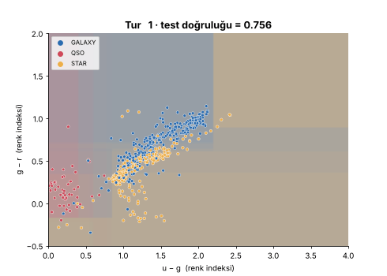
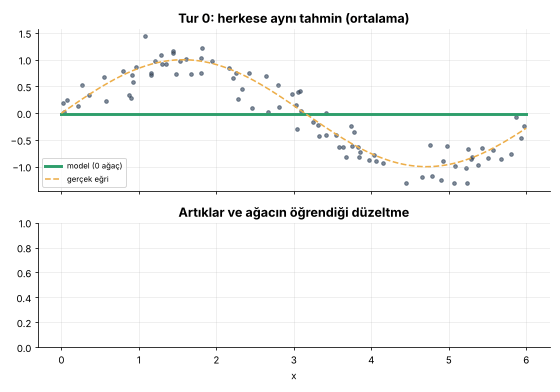
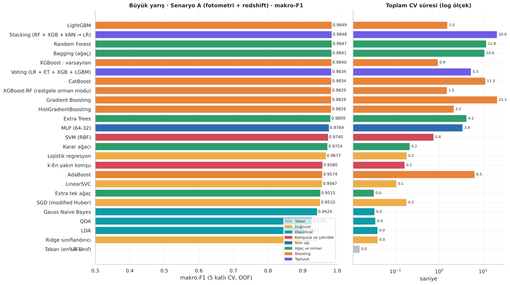
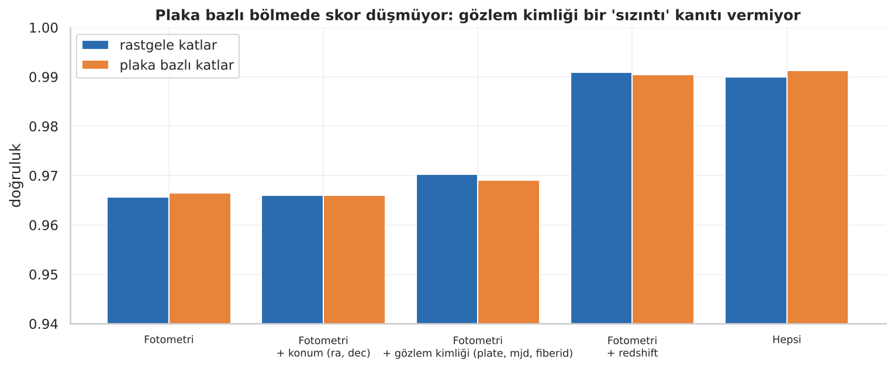
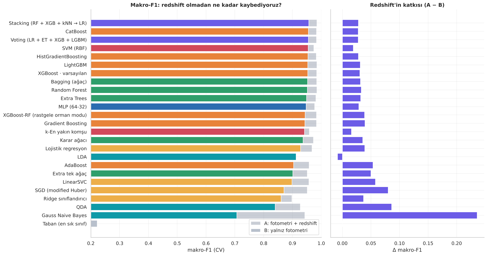
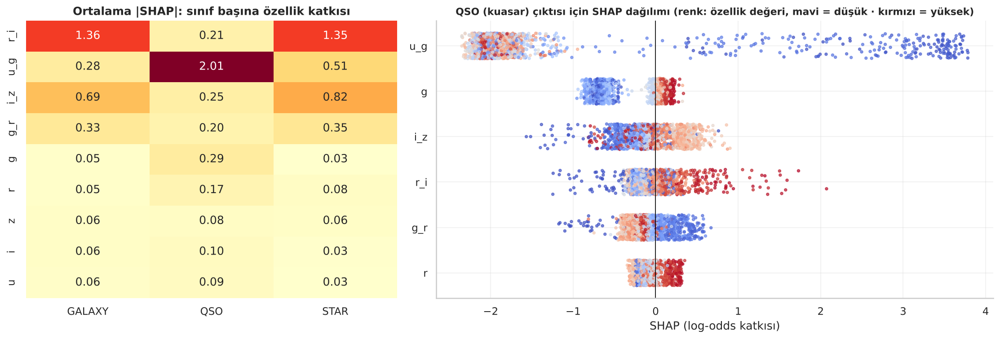

<p align="center">
  
</p>

<div align="center">

# 🔭 Gün 49 — XGBoost: Hatadan Öğrenen Ekip ve Gökyüzünün Sınıfları


</div>

## 📌 Özet

Bu gün **iki notebook** içeriyor:

1. **`day49_xgboost_kavram.ipynb` (başlangıç düzeyi):** XGBoost'un "usta ve çıraklar" fikrini, **7 kişilik kredi onayı örneğinde** her sayıyı elle hesaplayarak (log-odds, sigmoid, artık, benzerlik, gain, yaprak değeri, öğrenme hızı) ve **gerçek `xgboost` kütüphanesiyle doğrulayarak** anlatır. Gradyan–Hessian sezgisi, **λ / γ / cover** düzenlemesi (γ eşiğinin gain 2,459'da bölünmeyi gerçekten kestiği gösterilir), regresyon kardeşi, hız karşılaştırması, **animasyonlar** (bölünme tarayıcısı, tur tur olasılık, öğrenme hızı yarışı, hata avcısı, gökyüzünde karar sınırı) ve **40 satırlık mini XGBoost** (gerçek kütüphaneyle olasılık farkı ≈ 10⁻⁷) içerir. Teknik ayrıntı bilinçli olarak az tutuldu.
2. **`day49_xgboost_projesi.ipynb` (uçtan uca proje):** **SDSS gökyüzü taramasından 10.000 gök cismini** ışık ölçümlerinden **yıldız / galaksi / kuasar** olarak sınıflandırma. Bozuk kimlik sütunları ve sızıntı adayları ölçülerek karara bağlanır; **24 algoritma + taban**, **iki senaryoda** (A: fotometri + redshift, B: yalnız fotometri) yarışır; XGBoost'un düğmeleri tek tek çevrilir, `RandomizedSearchCV` ile ayarlanır; TreeSHAP, ablasyon, segment denetimi, kalibrasyon, **bütçeli spektroskopi seçimi** ve maliyete duyarlı eşik yapılır; model kaydedilip **ayrı süreçte** yeniden yüklenir.

👉 Ders notları: [`day49_xgboost_kavram.ipynb`](day49_xgboost_kavram.ipynb) · [`day49_xgboost_projesi.ipynb`](day49_xgboost_projesi.ipynb)

## 🗺️ İçerik

**Kavram (14 durak):** Kurulum · Büyük fikir · Beş adımlık döngü · Başlangıç tahmini (log-odds, sigmoid) · Hata (artık) · Bölünme ve gain · Yaprak ve güncelleme · Gradyan ve Hessian · Düzenleme (λ, γ, cover) · Hız ve ağaç sayısı · Regresyon kardeşi · Gökyüzünde karar · Sıfırdan XGBoost · Aile ve özet (quiz, ödevler, kaynakça)

| # | Proje bölümü | # | Proje bölümü |
|:-:|:--|:-:|:--|
| 1 | Kurulum | 9 | **Fotometri senaryosu:** spektrum yokken 24 algoritma, A ↔ B karşılaştırması |
| 2 | Senaryo, veri, başarı ölçütleri | 10 | **XGBoost yakından:** erken durdurma, η, derinlik, alt örnekleme, λ/α/γ, `booster`, animasyon |
| 3 | Veri kalitesi: **bozulmuş kimlikler**, sabit sütunlar, karar defteri | 11 | **Hiperparametre ayarı:** XGBoost ve LightGBM için rastgele arama, taze katlarla doğrulama |
| 4 | Keşif: gökyüzü haritası, renk–renk diyagramı, redshift, karşılıklı bilgi | 12 | Özellik önemi (weight/gain/cover, permütasyon, **TreeSHAP**), ablasyon |
| 5 | **Dürüst bölme:** plaka bazlı kısayol deneyi | 13 | Final, ROC/PR, **segment denetimi**, en kötü hatalar |
| 6 | Pipeline; renk indeksi / ölçek / sınıf ağırlığı deneyleri | 14 | **Kalibrasyon, bütçeli spektroskopi, maliyete duyarlı eşik** |
| 7 | **Büyük yarış (Senaryo A):** 24 algoritma + taban | 15 | Model kaydı, ayrı süreçte yükleme testi, tahmin fonksiyonu |
| 8 | Yarışın röntgeni: CV↔test, bootstrap, sınıf bazlı F1 | 16 | Özet, quiz, ödevler, kaynakça |

## 📊 Sonuçlar (test seti: 2.000 nesne, hiç dokunulmamış)

**Senaryo B (yalnız fotometri), 5 katlı CV makro-F1, öne çıkanlar:**

| Model | CV doğruluk | CV makro-F1 | QSO geri çağırma |
|:--|:-:|:-:|:-:|
| Taban (en sık sınıf) | 0,500 | 0,222 | 0,000 |
| Lojistik regresyon | 0,939 | 0,928 | 0,882 |
| Gauss Naive Bayes | 0,739 | 0,707 | 0,896 |
| SVM (RBF) | 0,966 | 0,955 | 0,912 |
| XGBoost · varsayılan | 0,966 | 0,953 | 0,916 |
| LightGBM | 0,967 | 0,954 | 0,909 |
| CatBoost | 0,968 | 0,956 | 0,918 |
| **Stacking (RF + XGB + kNN → LR)** | **0,968** | **0,957** | 0,916 |

**Test setinde final modeller (Senaryo B):**

| Model | Doğruluk | Makro-F1 | MCC | QSO geri çağırma | Log-loss | AUC (OvR) |
|:--|:-:|:-:|:-:|:-:|:-:|:-:|
| XGBoost · varsayılan | 0,9705 | 0,9607 | 0,9483 | 0,929 | 0,131 | 0,9907 |
| **XGBoost · ayarlı (final)** | 0,9695 | 0,9593 | 0,9466 | 0,929 | **0,109** | 0,9911 |
| LightGBM · ayarlı | 0,9710 | 0,9611 | 0,9492 | 0,929 | 0,177 | 0,9905 |
| CatBoost · varsayılan | 0,9750 | 0,9649 | 0,9562 | 0,929 | 0,112 | 0,9909 |
| Voting (XGB + LGBM + Cat) | 0,9705 | 0,9615 | 0,9483 | 0,929 | 0,108 | 0,9916 |

**Bu projenin dürüst bulguları:**

- 🩺 **Veri bozuk çıktı:** `objid` sütunu tek benzersiz değere (bilimsel gösterimle yuvarlanmış), `specobjid` ise bozulmuş kimliklere dönüşmüş; `rerun` sabit. Hepsi modelden çıkarıldı.
- 🔬 **"Sızıntı var" varsayımı ölçüldü ve doğrulanmadı:** `plate/mjd/fiberid` ve `ra/dec` eklemek plaka bazlı bölmede skoru **düşürmedi** (en büyük fark ≈ 0,001) ve fotometriye en fazla ≈ 0,5 puan ekledi; `redshift` ise ≈ **+2,5 puan**. Kimlikleri yine de **fiziksel girdi olmadıkları** için çıkardık.
- 📡 **Redshift'in değeri:** tek bir eşik kuralı (`redshift < 0,0016 → yıldız`) yıldızı %99,7 doğrulukla ayırıyor; çünkü etiket aynı spektrumdan geliyor. Redshift çıkarılınca boosting/orman modelleri makro-F1'de ≈ 0,03 kaybediyor.
- 🏁 **Üst sıralar şanstan ayırt edilemiyor:** Senaryo A'da LightGBM 1. olsa da en iyi 8 modelin varsayılan XGBoost'tan farkının %95 bootstrap aralığı **sıfırı kesiyor**.
- 🌈 **Renk indeksi ağaçlar için kritik:** XGBoost doğruluğu ham magnitüdle %92,4 → renk indeksiyle %96,6; lojistik regresyonda kazanç küçük (renkler zaten doğrusal birleşim).
- 🎚️ **Ayar dürüst bir ders verdi:** makro-F1/doğrulukta varsayılana göre anlamlı kazanç **yok**; kazanç **olasılık kalitesinde** (log-loss 0,131 → 0,109).
- 🔭 **Bütçeli spektroskopi:** P(QSO) sıralamasıyla en üstteki 100 nesne **%100 kuasar** (rastgeleye göre ≈ 11,8 kat zenginleşme); 170 nesnelik bütçeyle kuasarların %92,9'u bulunuyor.
- 🧪 **Eşik seçimi gürültülü:** 5:1 maliyetle en iyi eşik ≈ 0,09 (kuasar geri çağırma 0,929 → 0,959) ama test'te toplam maliyet 69 → 73: kazanç yok.
- 🎯 **Olasılıklar zaten kalibre:** ECE ≈ 0,009; isotonic kalibrasyon log-loss'u kötüleştirdi.
- 🧭 **Fizik tutarlı:** SHAP özetinde kuasar için baskın özellik **u−g** (morötesi aşırı parlaklık); u bandını çıkarmak kuasar geri çağırmayı ≈ 0,925 → 0,804'e düşürüyor.
- ⚠ **Kapsam sınırı:** örneklem u ≤ 19,6 ile sınırlı ve spektroskopik hedef seçimiyle gelmiş; çok soluk nesneler ve farklı taramalar için sonuçlar **doğrulanmamıştır**.

<p align="center">
  
  <br>
  
  <br>
  
  
</p>

## 🔍 Kaynak Dosyalar Hakkında Not

Bu ders, kullanıcının sağladığı üç referans dosyadan esinlenerek hazırlandı: **XGBoost ders notu (PDF)**, **bir XGBoost sınıflandırıcı video notebook'u** ve **SDSS CSV'si**. Uygulanan yol:

| Konu | Ne yapıldı? |
|:--|:--|
| Ders notu (PDF) | **Tamamı okundu**; 7 kişilik kredi örneği ve adım sırası kavram notebook'unda **yeniden hesaplandı ve gerçek `xgboost` ile doğrulandı**. Metin ve kod özgündür; PDF repoya **konmadı**. İki küçük fark bulundu: ders notunun sağ yaprak benzerliği 0,702 iken tam hassasiyetle ≈ 0,719 (gain 1,511 yerine ≈ 1,529); ayrıca notta "örnek" denen *Maaş ≤ 50K* bölünmesi **en iyisi değil**, kütüphane *Maaş ≤ 40K*'yı (gain 2,459) seçiyor. |
| Referans notebook | **Okundu**; yalnızca izlediği yol (veri → keşif → bölme → model → ayar → metrik) öğrenildi; içerik kopyalanmadı ve repoya **konmadı**. Videodaki tek model + ızgara araması yerine 24 algoritma, sızıntı ölçümü, rastgele arama, TreeSHAP, kalibrasyon ve karar analizi eklendi. |
| Veri seti | `20-digitalskysurvey.csv` (Kaggle *Sloan Digital Sky Survey*, DR14 örneği, 10.000 satır) projenin verisi olarak klasörde duruyor. |

## 📁 Klasör Yapısı

```text
day49/
├── day49_xgboost_kavram.ipynb      ← başlangıç düzeyi ders notu (çıktılarıyla birlikte)
├── day49_xgboost_projesi.ipynb     ← uçtan uca gökyüzü sınıflandırma projesi (çıktılarıyla birlikte)
├── gok_yardimci.py                 ← pipeline içindeki renk indeksi dönüştürücüsü (joblib için ayrı dosya)
├── README.md · requirements.txt
├── 20-digitalskysurvey.csv         ← SDSS örneklemi (10.000 gök cismi)
├── assets/                         ← görsel dil (animasyonlu SVG)
│   ├── hero_kavram.svg · hero_proje.svg · kapanis_*.svg · yol_haritasi_*.svg
│   ├── kavram_01.svg … kavram_14.svg · proje_01.svg … proje_16.svg   ← bölüm banner'ları
│   ├── diyagram_*.svg              ← döngü, aile, XGBoost farkları, log-odds, ağaç hesabı, düzenleme, takım, proje akışı, SDSS, sızıntı, sınıflar
│   └── etiket_*.svg                ← bilgi kartı etiketleri
└── outputs/
    ├── figures/                    ← grafikler (PNG) ve animasyonlar (GIF)
    ├── reports/                    ← CSV: yarış (A/B, CV/test), bootstrap, ayar, ablasyon, SHAP, segment, kalibrasyon, bütçe, karar …
    └── model/                      ← gok_cismi_siniflandirici.joblib + meta.json (final: ayarlı XGBoost, Senaryo B)
```

## 🚀 Çalıştırma

```bash
pip install -r requirements.txt
jupyter nbconvert --to notebook --execute --inplace day49_xgboost_kavram.ipynb
jupyter nbconvert --to notebook --execute --inplace day49_xgboost_projesi.ipynb
```

Modeli başka bir yerde yüklerken `gok_yardimci.py` dosyasının aynı klasörde bulunması gerekir.

## 🏠 Ödevler

Kavram: tek kişiyi ret yapıp turu elle sürmek, λ × γ ızgarası, dördüncü yarışçı (η = 1,0), `MiniXGB`'e erken durdurma, farklı renk çiftleriyle karar sınırı. Proje: konumu plaka yerine `ra` dilimlerine göre gruplayarak sınamak, geniş renk indeksleri, Optuna ile arama, çok sınıflı örnek ağırlıkları, maliyet oranı taraması, LightGBM/CatBoost için ayarlı yarış.

## 🔗 Kaynaklar

Metin içi atıflar APA 7'dir; **dolaylı atıf** gerektiğinde "(B, akt. A)" kalıbı kullanılır (örn. *Gradient Boosting fikri (Friedman, 2001, akt. Chen ve Guestrin, 2016)*).

- Abolfathi, B., Aguado, D. S., Aguilar, G., Allende Prieto, C., Almeida, A., Ananna, T. T., … Zou, H. (2018). The Fourteenth Data Release of the Sloan Digital Sky Survey: First spectroscopic data from the extended Baryon Oscillation Spectroscopic Survey and from the second phase of the Apache Point Observatory Galactic Evolution Experiment. *The Astrophysical Journal Supplement Series, 235*(2), Article 42. https://doi.org/10.3847/1538-4365/aa9e8a
- Bergstra, J., & Bengio, Y. (2012). Random search for hyper-parameter optimization. *Journal of Machine Learning Research, 13*, 281–305.
- Chen, T., & Guestrin, C. (2016). XGBoost: A scalable tree boosting system. *Proceedings of the 22nd ACM SIGKDD International Conference on Knowledge Discovery and Data Mining*, 785–794. https://doi.org/10.1145/2939672.2939785
- Clarke, A. O., Scaife, A. M. M., Greenhalgh, R., & Griguta, V. (2020). Identifying galaxies, quasars, and stars with machine learning: A new catalogue of classifications for 111 million SDSS sources without spectra. *Astronomy & Astrophysics, 639*, Article A84. https://doi.org/10.1051/0004-6361/201936770
- Friedman, J. H. (2001). Greedy function approximation: A gradient boosting machine. *The Annals of Statistics, 29*(5), 1189–1232. https://doi.org/10.1214/aos/1013203451
- Fukugita, M., Ichikawa, T., Gunn, J. E., Doi, M., Shimasaku, K., & Schneider, D. P. (1996). The Sloan Digital Sky Survey photometric system. *The Astronomical Journal, 111*, 1748–1756. https://doi.org/10.1086/117915
- Grinsztajn, L., Oyallon, E., & Varoquaux, G. (2022). Why do tree-based models still outperform deep learning on typical tabular data? *Advances in Neural Information Processing Systems, 35* (Datasets and Benchmarks Track). https://arxiv.org/abs/2207.08815
- Ke, G., Meng, Q., Finley, T., Wang, T., Chen, W., Ma, W., Ye, Q., & Liu, T.-Y. (2017). LightGBM: A highly efficient gradient boosting decision tree. *Advances in Neural Information Processing Systems, 30*, 3146–3154.
- Lundberg, S. M., Erion, G., Chen, H., DeGrave, A., Prutkin, J. M., Nair, B., Katz, R., Himmelfarb, J., Bansal, N., & Lee, S.-I. (2020). From local explanations to global understanding with explainable AI for trees. *Nature Machine Intelligence, 2*(1), 56–67. https://doi.org/10.1038/s42256-019-0138-9
- Niculescu-Mizil, A., & Caruana, R. (2005). Predicting good probabilities with supervised learning. *Proceedings of the 22nd International Conference on Machine Learning*, 625–632. https://doi.org/10.1145/1102351.1102430
- Pedregosa, F., Varoquaux, G., Gramfort, A., Michel, V., Thirion, B., Grisel, O., … Duchesnay, É. (2011). Scikit-learn: Machine learning in Python. *Journal of Machine Learning Research, 12*, 2825–2830.
- Prokhorenkova, L., Gusev, G., Vorobev, A., Dorogush, A. V., & Gulin, A. (2018). CatBoost: Unbiased boosting with categorical features. *Advances in Neural Information Processing Systems, 31*, 6638–6648.
- Samancıoğlu, A. (t.y.). *XGBoost algorithm* [Ders notu].
- York, D. G., Adelman, J., Anderson, J. E., Jr., Anderson, S. F., Annis, J., Bahcall, N. A., … Yasuda, N. (2000). The Sloan Digital Sky Survey: Technical summary. *The Astronomical Journal, 120*(3), 1579–1587. https://doi.org/10.1086/301513
