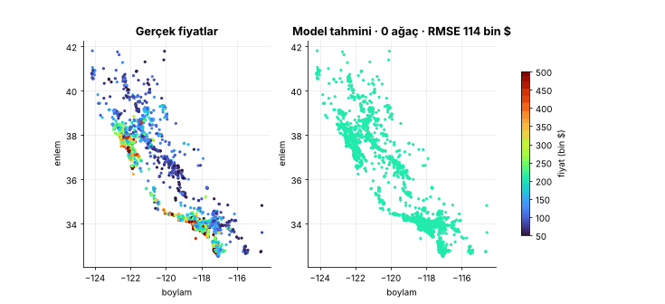
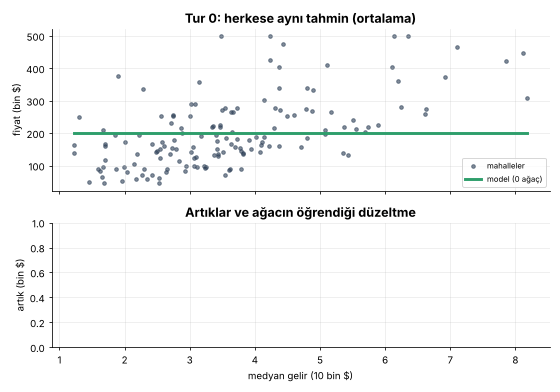
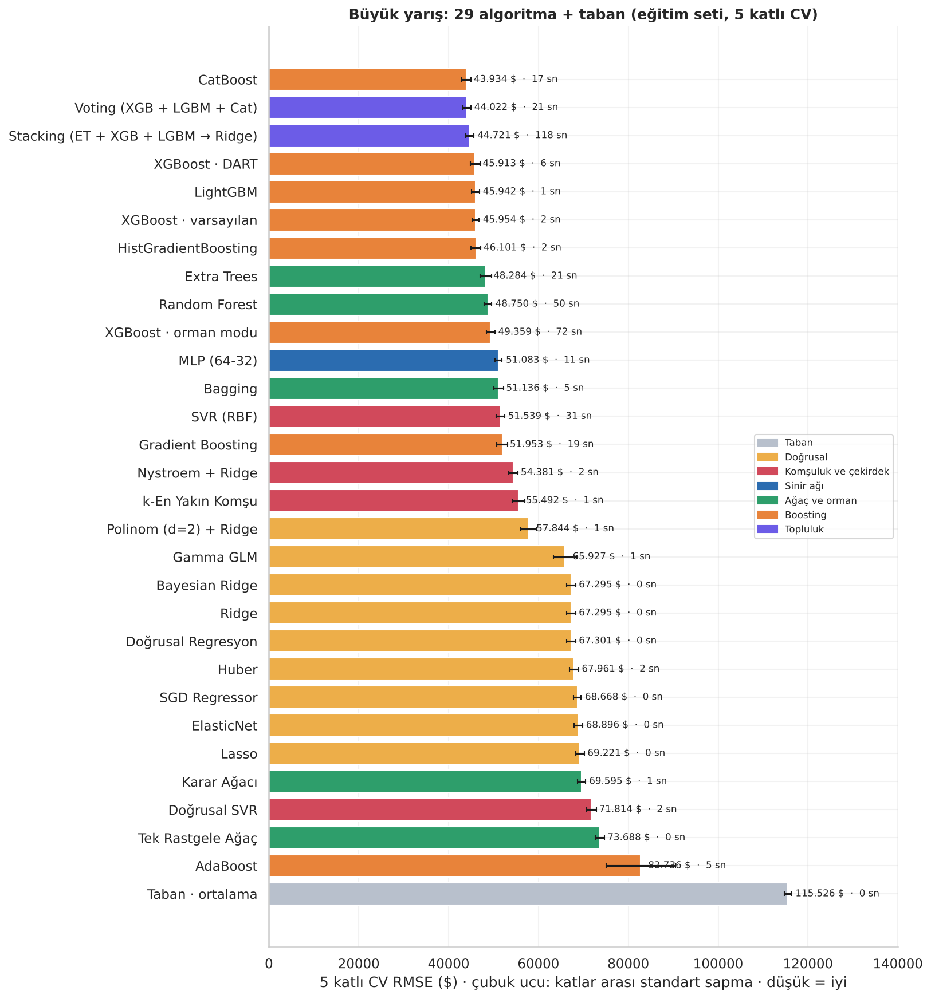
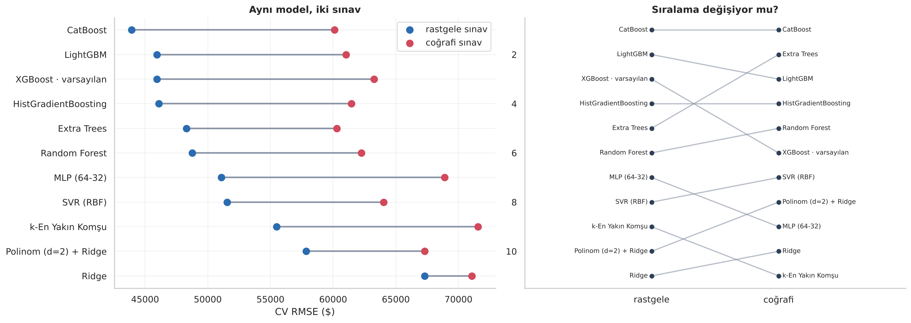
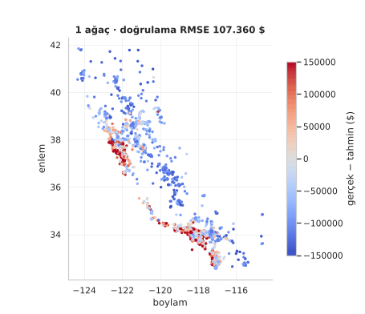
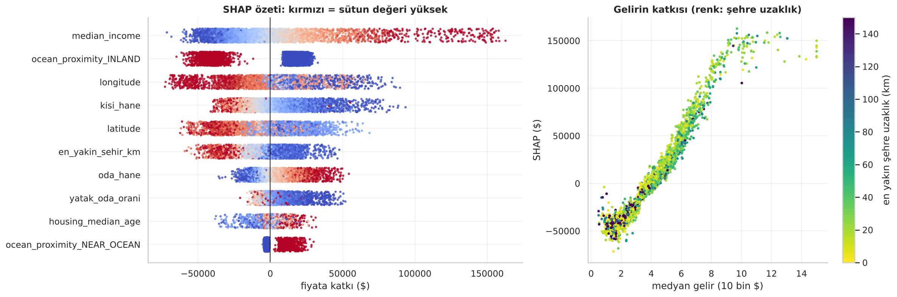

<p align="center">
  
</p>

<div align="center">

# 🏡 Gün 50 — XGBoost Regresyon: Usta ve Çıraklarla Kaliforniya'nın Ev Fiyatları


</div>

## 📌 Özet

Bu gün **iki notebook** içeriyor:

1. **`day50_xgboost_regresyon_kavram.ipynb` (başlangıç düzeyi):** XGBoost Regressor'ı **"usta + çıraklar"** benzetmesiyle, **altı evlik** bir örnekte her sayıyı elle hesaplayarak (başlangıç ortalaması, artık, benzerlik/kazanç, yaprak değeri, öğrenme hızı) ve **gerçek `xgboost` ile birebir doğrulayarak** anlatır. Düzenleme (λ, γ), **ezber ↔ yetersizlik** (derinlik 2 / 5 / 10), erken durdurma, **çizgi mi basamak mı?**, hız ve **eksik değerle başa çıkma**, TreeSHAP sezgisi ve **40 satırlık mini XGBoost** (gerçek kütüphaneyle fark ≈ 10⁻⁴ $) içerir. **Animasyonlar:** bölünme tarayıcısı, hata avcısı ve **Kaliforniya haritasının tur tur netleşmesi**. Teknik ayrıntı bilinçli olarak az tutuldu.
2. **`day50_xgboost_regresyon_projesi.ipynb` (uçtan uca proje):** **20.640 Kaliforniya mahallesinin** ortanca ev değerini tahmin etme. **Tavan (500.001 $) tuzağı**, eksik hücreler ve uç oranlar ölçülerek karara bağlanır; **29 algoritma + taban** aynı sızıntısız pipeline'da yarışır; **rastgele ↔ coğrafi** doğrulama farkı ölçülür; XGBoost'un düğmeleri tek tek çevrilir, `RandomizedSearchCV` ile ayarlanır; TreeSHAP, permütasyon, ablasyon, segment denetimi, **kuantil regresyonla fiyat aralığı (CQR düzeltmeli)** ve **maliyete duyarlı karar** yapılır; model kaydedilip **ayrı süreçte** yeniden yüklenir.

👉 Ders notları: [`day50_xgboost_regresyon_kavram.ipynb`](day50_xgboost_regresyon_kavram.ipynb) · [`day50_xgboost_regresyon_projesi.ipynb`](day50_xgboost_regresyon_projesi.ipynb)

## 🗺️ İçerik

**Kavram (15 durak):** Kurulum · Büyük fikir · Altı evlik örnek · Artıklar · Küçük ağaç · Küçük adımlar · Doğrulama (+ animasyon) · Frenler (λ, γ) · Ezber mi, yetersizlik mi? · Kaliforniya'da ilk dokunuş (harita animasyonu) · Çizgi mi, basamak mı? · Neden "extreme"? · Model neye bakıyor? · Sıfırdan XGBoost · Özet (quiz, ödevler, kaynakça)

| # | Proje bölümü | # | Proje bölümü |
|:-:|:--|:-:|:--|
| 1 | Kurulum | 9 | **Yeni bölgede sınav:** coğrafi çapraz doğrulama, sıralama değişimi |
| 2 | Senaryo, veri, başarı ölçütleri, **test setini kilitleme** | 10 | **XGBoost yakından:** erken durdurma, η, derinlik, alt örnekleme, λ/α/γ, `booster`, hata haritası animasyonu |
| 3 | Veri kalitesi: **tavan değerler**, eksik hücreler, uç oranlar, karar defteri | 11 | **Hiperparametre ayarı:** XGBoost ve LightGBM için rastgele arama, taze katlarla doğrulama |
| 4 | Keşif: dağılım, harita, gelir, korelasyon ve karşılıklı bilgi | 12 | Özellik önemi (gain, permütasyon, **TreeSHAP**), konum yüzeyi, ablasyon |
| 5 | **Dürüst bölme:** komşu mahalle mesafesi, rastgele ↔ coğrafi deney | 13 | Final, kalibrasyon, **segment denetimi**, en kötü hatalar |
| 6 | Pipeline; özellik kümesi, eksik değer, hedef dönüşümü, **tavan**, ölçek deneyleri | 14 | **Belirsizlik ve karar:** kuantil regresyon, CQR, otomatik onay bütçesi, asimetrik maliyet |
| 7 | **Büyük yarış:** 29 algoritma + taban | 15 | Model kaydı, ayrı süreçte yükleme testi, tahmin fonksiyonu |
| 8 | Yarışın röntgeni: CV ↔ test, ezber, bootstrap, hız–başarı | 16 | Özet, yönetici özeti, quiz, ödevler, kaynakça |

## 📊 Sonuçlar (test seti: 4.128 mahalle, hiç dokunulmamış)

**5 katlı CV RMSE, öne çıkanlar (eğitim seti, 16.512 mahalle):**

| Model | CV RMSE ($) | CV R² | Süre (sn, tek çekirdek) |
|:--|:-:|:-:|:-:|
| Taban (ortalama) | 115.526 | 0,000 | 0 |
| Ridge | 67.295 | 0,661 | 0,3 |
| Polinom (d=2) + Ridge | 57.844 | 0,749 | 0,5 |
| Random Forest | 48.750 | 0,822 | 50 |
| XGBoost · varsayılan | 45.954 | 0,842 | 1,8 |
| LightGBM | 45.942 | 0,842 | 1,2 |
| **CatBoost** | **43.934** | **0,855** | 18 |
| Voting (XGB + LGBM + Cat) | 44.022 | 0,855 | 20 |
| Stacking (ET + XGB + LGBM → Ridge) | 44.721 | 0,850 | 116 |

**Test setinde final modeller:**

| Model | RMSE ($) | MAE ($) | R² | Medyan yüzde hata |
|:--|:-:|:-:|:-:|:-:|
| Taban (ortalama) | 114.878 | 90.905 | 0,000 | %39,4 |
| XGBoost · varsayılan | 46.483 | 30.612 | 0,836 | %11,4 |
| CatBoost · varsayılan | 44.941 | 29.263 | 0,847 | %10,8 |
| **XGBoost · ayarlı (final)** | **43.838** | **28.276** | **0,854** | **%10,1** |

**Bu projenin dürüst bulguları:**

- 🧢 **Tavan tuzağı:** 965 mahalle (%4,7) tam 500.001 $'da **kesilmiş**. Tavanlıları eğitimden çıkarmak tavansız mahallelerde RMSE'yi 42.819 → 41.871 $ iyileştirdi ama **toplamı** 45.954 → 46.899 $ kötüleştirdi; testte tavanlı mahalleler için yanlılık ≈ −51 bin $.
- 🧭 **Rastgele sınav konumsal veride iyimser:** sınav mahallesinin en yakın eğitim komşusu rastgele bölmede **ortalama 1,2 km**, coğrafi bölmede **11,1 km**. XGBoost'un RMSE'si **45.954 → 63.257 $** (+%37,7); Ridge yalnızca +%5,6. Sıralama da değişti: Extra Trees 5. → 2., XGBoost 3. → 6.
- 🏁 **Üst sıralar şanstan ayırt edilemiyor:** CatBoost (−2.020 $), Voting (−1.934 $) ve Stacking (−1.235 $) varsayılan XGBoost'tan **gerçekten** iyi; DART, LightGBM ve HistGradientBoosting'in farkının %95 bootstrap aralığı **sıfırı kesiyor**.
- 🎚️ **Ayar, bu projenin en değerli hamlesi:** taze katlarda varsayılan XGBoost 46.453 → ayarlı 43.261 $ (**−%6,9**); test RMSE −%5,7. Ayarsız CatBoost bile ayarlı XGBoost'un ≈ 660 $ gerisinde.
- ⚠ **SGD standart ölçekle patlıyor:** `kisi_hane`'deki 1.243'lük uç değerle RMSE 10⁸–10¹⁵ $ mertebesine çıkıyor; log ölçek 68.668 $'a getiriyor. Ağaçlar ölçeğe hiç duyarsız.
- 🧪 **Düğmeler:** derinlik 6–8 plato, 10–12'de `min_child_weight=1` ile bozulma; **λ = 10** en işe yarayan düzenleme; α ve γ dolar² ölçeğinde neredeyse etkisiz; `lossguide` en iyi `grow_policy`; `gblinear` ağaçlara göre ≈ 25 bin $ kötü.
- 🔍 **Önem tek başına yetmez:** `gain` INLAND'ı (%56), SHAP gelir ve konumu, permütasyon `total_rooms`'u (oranlara bulaştığı için) öne çıkardı; **ablasyon**: konumu çıkarmak +9.480 $, tüm konum bilgisini çıkarmak +21.182 $, ham toplamları çıkarmak −166 $.
- 🎲 **Aralık kalibrasyonu:** ham kuantil aralığı hedef %80 yerine **%67,2** kapsadı; **CQR** ile **%79,1**. Ama yüksek gelir çeyreğinde %71,9, tavanlılarda %40,4: **marjinal garanti ≠ koşullu kapsama**.
- 🧮 **Karar:** en güvenilir %80 tahmin otomatik onaylanırsa RMSE 43.838 → 39.898 $; fazla tahmin 2× pahalıysa **τ = 1/3 kuantili** ortalama maliyeti **%9,4** düşürür (RMSE'yi artırarak).
- ⚠ **Kapsam sınırı:** veri **1990 nüfus sayımına** ait ve 500.001 $'da kesilmiş; bugünün fiyatları için kullanılamaz.

<p align="center">
  
  <br>
  
  <br>
  
  
</p>

## 🔍 Kaynak Dosyalar Hakkında Not

Bu ders, kullanıcının sağladığı iki referans dosyadan esinlenerek hazırlandı: **bir XGBoost Regressor video notebook'u** ve **California Housing CSV'si**. Uygulanan yol:

| Konu | Ne yapıldı? |
|:--|:--|
| Referans notebook | **Hücre hücre okundu**; yalnızca izlediği yol (veri → keşif → bölme → model → ayar → metrik) öğrenildi; içerik kopyalanmadı ve repoya **konmadı**. Videodaki dokuz modelli karşılaştırma ve ızgara araması yerine **29 algoritma**, tavan/eksik değer/ölçek **deneyleri**, coğrafi doğrulama, TreeSHAP, ablasyon, aralık tahmini ve maliyete duyarlı karar eklendi. |
| Veri seti | `21-housing.csv` (California Housing, 20.640 satır) projenin verisi olarak klasörde duruyor. |

## 📁 Klasör Yapısı

```text
day50/
├── day50_xgboost_regresyon_kavram.ipynb   ← başlangıç düzeyi ders notu (çıktılarıyla birlikte)
├── day50_xgboost_regresyon_projesi.ipynb  ← uçtan uca konut fiyatı projesi (çıktılarıyla birlikte)
├── konut_yardimci.py                      ← pipeline içindeki özellik mühendisliği (joblib için ayrı dosya)
├── README.md · requirements.txt
├── 21-housing.csv                         ← California Housing (20.640 mahalle)
├── assets/                                ← görsel dil (animasyonlu SVG)
│   ├── hero_kavram.svg · hero_proje.svg · kapanis_*.svg · yol_haritasi_*.svg
│   ├── kavram_01.svg … kavram_15.svg · proje_01.svg … proje_16.svg   ← bölüm banner'ları
│   ├── diyagram_*.svg                     ← usta–çırak, döngü, artık, ağaç hesabı, düzenleme, aile, XGBoost farkları, proje akışı, veri, sızıntı, ölçütler, yarışçılar, belirsizlik
│   └── etiket_*.svg                       ← bilgi kartı etiketleri
└── outputs/
    ├── figures/                           ← grafikler (PNG) ve animasyonlar (GIF)
    ├── reports/                           ← CSV: yarış (CV/test), bootstrap, coğrafi, ayar, ablasyon, SHAP, segment, aralık, maliyet …
    └── model/                             ← konut_fiyat_modeli.joblib + meta.json (final: ayarlı XGBoost + CQR aralığı)
```

## 🚀 Çalıştırma

```bash
cd day50
pip install -r requirements.txt
jupyter nbconvert --to notebook --execute --inplace day50_xgboost_regresyon_kavram.ipynb
jupyter nbconvert --to notebook --execute --inplace day50_xgboost_regresyon_projesi.ipynb
```

Kavram notebook'u yaklaşık **1 dakika**, proje notebook'u 4 çekirdekli bir makinede yaklaşık **15–20 dakika** sürer. Tüm rastgelelik `RANDOM_STATE = 42` ile sabitlenmiştir.
