<p align="center">
  
</p>

<div align="center">

# 🏘️ Gün 51 — LightGBM: Yaprak Yaprak Büyüyen Hız Ustası ve Premium Mahalle Avı


</div>

## 📌 Özet

Bu gün **iki notebook** içeriyor:

1. **`day51_lightgbm_kavram.ipynb` (başlangıç düzeyi):** LightGBM'in "usta ve çıraklar" fikrini **8 mahalleyle, her sayıyı elle hesaplayarak** (log-odds, artık, gain, yaprak değeri, öğrenme hızı) anlatır ve **gerçek `lightgbm` ile birebir doğrular**. LightGBM'i hızlı yapan **dört hile** (histogram, yaprak yaprak büyüme, GOSS, EFB) her biri bir diyagram, bir **animasyon** ve bir deneyle gösterilir; küçük veride `min_child_samples` tuzağı, hız yarışı ve **60 satırlık mini LightGBM** (gerçek kütüphaneyle 2–3 yapraklı ağaçlarda ~10⁻⁹ farkla örtüşür; örtüşmenin bozulduğu yer de dürüstçe gösterilir) içerir. Teknik ayrıntı bilinçli olarak az tutuldu.
2. **`day51_lightgbm_projesi.ipynb` (uçtan uca proje):** **506 Boston mahallesini** çevre ölçümlerinden **premium (MEDV ≥ 25 bin $) / standart** olarak sınıflandırma. Başlıksız dosya, **hedefin kendisi** (`MEDV`) ve etik açıdan sorunlu `B` sütunu ele alınır; **komşu mahalle sızıntısı** ilçe bazlı doğrulamayla ölçülür; **29 algoritma + taban** iki senaryoda (tüm özellikler / `LSTAT` olmadan) yarışır; LightGBM'in düğmeleri küçük veride tek tek çevrilir, `RandomizedSearchCV` ile ayarlanır; TreeSHAP, ablasyon, segment denetimi, kalibrasyon, **bütçeli mahalle seçimi** ve maliyete duyarlı eşik yapılır; model kaydedilip **ayrı süreçte** yeniden yüklenir.

👉 Ders notları: [`day51_lightgbm_kavram.ipynb`](day51_lightgbm_kavram.ipynb) · [`day51_lightgbm_projesi.ipynb`](day51_lightgbm_projesi.ipynb)

## 🗺️ İçerik

**Kavram (14 durak):** Kurulum · Büyük fikir · Beş adımlık döngü · Başlangıç tahmini · Hata (artık) · Bölünme ve yaprak · Hile 1: Histogram · Hile 2: Yaprak yaprak büyüme · Hile 3: GOSS · Hile 4: EFB · Frenler ve düğmeler · Hız yarışı · Sıfırdan mini LightGBM · Özet (quiz, ödevler, kaynakça)

| # | Proje bölümü | # | Proje bölümü |
|:-:|:--|:-:|:--|
| 1 | Kurulum | 9 | **Statü sütunu olmadan:** `LSTAT` yokken 29 algoritma, A ↔ B karşılaştırması |
| 2 | Senaryo, veri, başarı ölçütleri | 10 | **LightGBM yakından:** erken durdurma, η, `num_leaves`, `min_child_samples`, alt örnekleme, λ/α/γ, `boosting_type`, animasyon |
| 3 | Veri kalitesi: başlıksız dosya, `MEDV` kırpması, **etik sütun `B`**, karar defteri | 11 | **Hiperparametre ayarı:** LightGBM, XGBoost, CatBoost için rastgele arama, taze katlarla doğrulama |
| 4 | Keşif: dağılımlar, korelasyon, karşılıklı bilgi, `RM` × `LSTAT` haritası | 12 | Özellik önemi (split/gain/permütasyon/**TreeSHAP**), ablasyon |
| 5 | **Dürüst bölme:** hedef sızıntısı ve komşu mahalle deneyi | 13 | Final (iki test görünümü), ROC/PR, **segment denetimi**, en kötü hatalar |
| 6 | Pipeline; oran özelliği / ölçek / sınıf ağırlığı / `B` deneyleri | 14 | **Kalibrasyon, bütçeli mahalle seçimi, maliyete duyarlı eşik** |
| 7 | **Büyük yarış (Senaryo A):** 29 algoritma + taban | 15 | Model kaydı, ayrı süreçte yükleme testi, tahmin fonksiyonu |
| 8 | Yarışın röntgeni: CV↔test, bootstrap, ilçe bazlı sıralama | 16 | Özet, quiz, ödevler, kaynakça |

## 📊 Öne Çıkan Sonuçlar

> Tüm sayılar notebook'ta çalıştırılmış hücre çıktılarıdır (`RANDOM_STATE = 42`). Veri **küçük** (404 eğitim / 102 test satırı); bu yüzden farkların çoğu şanstan ayırt edilemez.

**Sızıntı deneyleri (15 katlı CV, F1 premium):**

| Deney | Sonuç |
|:--|:--|
| `MEDV`'yi özellik yapmak | F1 0,844 → **0,981** (sahte başarı) |
| Komşu mahalle sızıntısı (LightGBM) | rastgele katlar **0,844** → ilçe bazlı katlar **0,796** |

**Büyük yarış (CV F1):** 1. Rastgele orman 0,863 · CatBoost 0,856 · XGBoost 0,850 · LightGBM 0,844 (7.) · taban 0. Üst sıradaki farkların çoğu bootstrap'e göre **ayırt edilemez**; ilçe bazlı katlarda sıralama **karışıyor** (rastgele orman 1. → 6.). `LSTAT` olmadan (senaryo B) ağaç/boosting ailesi **neredeyse hiçbir şey kaybetmiyor** (LightGBM 0,844 → 0,851).

**LightGBM ayarı (taze katlar):** log-loss **0,261 → 0,198** (F1 yalnızca 0,843 → 0,849): ayar asıl olarak *olasılıkları daha az aşırı özgüvenli* yapıyor. Küçük veride en güçlü düğme **`min_child_samples`** (1 → 70: F1 0,76 → 0,84, log-loss 0,80 → 0,22).

**Final model (ayarlı LightGBM), test seti:**

| Test görünümü | Doğruluk | F1 (premium) | ROC-AUC |
|:--|:-:|:-:|:-:|
| Rastgele ayrılmış (102 mahalle) | 0,922 | 0,846 | 0,946 |
| **Hiç görülmemiş ilçeler** (151 mahalle) | 0,894 | 0,636 | 0,905 |

**Karar:** en yüksek olasılıklı **ilk 15 mahallenin 15'i de gerçekten premium** (lift ≈ 3,8×); kaçırılan premium 3× pahalı varsayımıyla eşik **0,15** (0,5 değil).

## 🧪 Dürüst Bulgular

- **Hedefi sızdırma ve komşu sızıntısı ölçüldü;** rastgele CV skorları yeni ilçeler için iyimserdir.
- `B` sütunu etik gerekçeyle **baştan çıkarıldı**; geri konulduğunda kazanç ihmal edilebilir çıktı.
- Üç boosting kütüphanesinin ayarlı hâlleri log-loss'ta **0,001 farkla berabere**; "LightGBM en iyi" iddiası **yapılmıyor**.
- GOSS ve EFB bu ölçeklerde süre kazandırmadı; **ölçek hilesi** oldukları gösterildi.
- Mini LightGBM, 4 yapraklı ağaçlarda 17. turdan sonra gerçeğinden ayrışıyor; nedeni bu derste çözülmedi, olduğu gibi raporlandı.

## 📁 Dosyalar

```text
day51/
├── 23-boston.csv                       # veri (başlıksız, boşlukla ayrılmış)
├── boston_yardimci.py                  # pipeline içindeki özellik üretici (joblib için ayrı dosya)
├── day51_lightgbm_kavram.ipynb
├── day51_lightgbm_projesi.ipynb
├── requirements.txt
├── assets/                             # hero, yol haritası, bölüm başlıkları, animasyonlu diyagramlar (SVG)
└── outputs/
    ├── figures/                        # 47 grafik ve GIF (kavram_* ve 01–30)
    ├── reports/                        # 34 rapor CSV'si
    └── model/                          # premium_mahalle_siniflandirici.joblib + meta.json
```

## ▶️ Çalıştırma

```bash
pip install -r requirements.txt
jupyter lab day51_lightgbm_kavram.ipynb
```

Notebook'lar **bu klasörün içinden** çalıştırılmalıdır (göreli yollar). Bütün çıktılar kayıtlıdır.

## 📚 Kaynakça (özet)

Ayrıntılı APA 7 listesi her notebook'un sonundadır. Başlıca kaynaklar: Ke vd. (2017, LightGBM); Chen ve Guestrin (2016, XGBoost); Friedman (2001, Gradient Boosting); Harrison ve Rubinfeld (1978, Boston verisi); Carlisle (2019, veri setinin etik tartışması); Lundberg vd. (2020, TreeSHAP); Roberts vd. (2017, grup bazlı doğrulama).
