<p align="center">
  
</p>

<div align="center">

# 🚢 Gün 52 — Yaprak Yaprak Büyüyen Akıllı Ekip ve Titanik'te Dürüst Yarış: LightGBM


</div>

## 📌 Özet

Bu gün **iki notebook** içeriyor:

1. **`day52_lightgbm_kavram.ipynb` (başlangıç düzeyi):** LightGBM'in "hatadan öğrenen ekip" fikrini **8 Titanik yolcusuyla elle hesaplayarak** anlatır ve **gerçek `lightgbm` ile doğrular** (fark ≈ 10⁻¹⁶). **Kova (histogram)**, **yaprak yaprak büyüme**, **doğal kategori desteği** ve **kazanç (gain)** kavramları diyagram + animasyon + deneyle gösterilir; XGBoost ile adil yarış yapılır. Teknik ayrıntı bilinçli olarak az tutuldu.
2. **`day52_lightgbm_titanik_projesi.ipynb` (uçtan uca proje):** 891 yolcunun hayatta kalmasını tahmin eder. **Aile/bilet sızıntısı** ölçülür ve **grup bazlı doğrulama** kurulur; **27 algoritma + taban** aynı sızıntısız boru hattında yarışır; LightGBM düğmeleri tek tek çevrilir; LightGBM/XGBoost/CatBoost rastgele aramayla ayarlanır; split/gain/permütasyon/**TreeSHAP** ve **ablasyon**; **segment ve adalet denetimi**; kalibrasyon, maliyete duyarlı eşik, bütçeli seçim; model kaydı ve **ayrı süreçte** yükleme testi.

👉 Ders notları: [`day52_lightgbm_kavram.ipynb`](day52_lightgbm_kavram.ipynb) · [`day52_lightgbm_titanik_projesi.ipynb`](day52_lightgbm_titanik_projesi.ipynb)

## 🗺️ İçerik

**Kavram (11 durak):** Kurulum · Büyük fikir · Beş adımlık döngü (8 yolcuyla elle hesap) · Kova hilesi · Yaprak yaprak büyüme · Kategorik sütunlar · Kazanç · XGBoost ile yarış · Frenler ve düğmeler · Canlı model animasyonu · Özet (quiz, ödevler, kaynakça)

| # | Proje bölümü | # | Proje bölümü |
|:-:|:--|:-:|:--|
| 1 | Kurulum | 9 | **LightGBM yakından:** erken durdurma, η × ağaç, `num_leaves` × `max_depth`, `min_child_samples`, örnekleme, λ/α/γ, `boosting_type`, animasyon |
| 2 | Senaryo, veri, başarı ölçütleri | 10 | **Hiperparametre ayarı:** üç boosting kütüphanesi, taze katlarda doğrulama, önceden yazılmış seçim kuralı |
| 3 | Veri kalitesi, karar defteri | 11 | Özellik önemi (split/gain/permütasyon/**TreeSHAP**), ablasyon |
| 4 | Keşif (test seti kilitli) | 12 | Final (iki test görünümü), ROC/PR, en kötü hatalar |
| 5 | **Dürüst bölme:** aile oranı sızıntısı, rastgele ↔ grup katları | 13 | **Adalet ve segment denetimi** (Wilson aralıkları, TPR/FPR) |
| 6 | Özellik mühendisliği, sızıntısız boru hattı | 14 | **Kalibrasyon, maliyete duyarlı eşik, bütçeli seçim** |
| 7 | **Büyük yarış:** 27 algoritma + taban | 15 | Model kaydı, ayrı süreçte yükleme, tahmin fonksiyonu |
| 8 | Yarışın röntgeni: taze katlar, bootstrap, düzen karşılaştırması | 16 | Özet, quiz, ödevler, kaynakça |

## 📊 Öne Çıkan Sonuçlar

> Tüm sayılar notebook'ta çalıştırılmış hücre çıktılarıdır (`RANDOM_STATE = 42`). Veri **küçük** (712 eğitim / 179 test yolcusu); farkların çoğu şanstan ayırt edilemez.

| Bulgu | Sonuç |
|:--|:--|
| Rastgele katlar ↔ bilet-grup katları | AUC 0,890 → **0,846** (aynı bilet iki tarafta olunca skor iyimser) |
| Seçilen özellik kümesi (grup-CV log-loss) | 8 özellik (ham 7 + `Unvan`); `KabinVar`/`Guverte`/bilet özellikleri kazandırmadı |
| Büyük yarış (grup-CV AUC) | 1. Oylama 0,873 · Yığın 0,872 · AdaBoost 0,869 · Rastgele orman 0,869 · LightGBM 0,865 · lojistik regresyon 0,863 · taban 0,500 |
| Bootstrap | Lider ile LightGBM/XGBoost/RF/AdaBoost farkı **%95 aralıkta sıfırı kesiyor** (ayırt edilemez) |
| LightGBM ayarı (taze katlar, log-loss) | **0,522 → 0,433** (AUC 0,848 → 0,864); XGBoost 0,611 → 0,430, CatBoost 0,449 → 0,432 |
| Final model (ayarlı LightGBM), test | doğruluk **0,821**, AUC **0,856** (basit «kadınsa kurtulur» kuralı: 0,777 / 0,753) |
| Görülmemiş bilet grupları (112 yolcu) | doğruluk 0,830, AUC 0,817 |
| Ablasyon | `Sex` + `Unvan` birlikte çıkarılınca AUC **−0,107**; tek tek çıkarılınca ≤ −0,007 |
| Adalet | TPR kadın 0,91 ↔ erkek 0,22: kurtulan erkekleri yakalamak çok daha zor |

## 🧪 Dürüst Bulgular

- Aile oranı özelliği (aynı biletteki diğerlerinin sonucu) **üretimde bilinemeyeceği için** modele alınmadı; etiket sızdırmanın etkisi bu veride küçük çıktı, ama doğrulama düzeninin etkisi büyük.
- **Üç boosting kütüphanesinin ayarlı hâlleri** log-loss'ta ≤ 0,004 farkla yakın; "LightGBM en iyi" iddiası **yapılmıyor**. Seçim kuralı sonuçlar görülmeden yazıldı.
- Küçük Titanik verisinde hız farkı yok; 200 bin satırlık yapay veride de XGBoost (`hist`) ile LightGBM süreleri bu makinede aynı çıktı.
- Test setinde lojistik regresyon/Ridge (0,83–0,84) LightGBM ayarlıya (0,82) **yakın ya da önde**; 179 yolcuda bu fark anlamlı değil.
- Maliyete duyarlı eşik OOF'ta maliyeti azalttı, testte etkisiz kaldı (küçük test).
- Kavram dersinde: kategori için tek-sıcak ≥ doğal kategori çıktı; doğal kategori küçük veride kesin üstünlük sağlamıyor.

## 📁 Dosyalar

```text
day52/
├── 22-titanic.csv                      # veri (Kaggle eğitim kümesi, 891 yolcu)
├── titanik_yardimci.py                 # özellik üretici ve boru hattı kurucuları (joblib için ayrı dosya)
├── day52_lightgbm_kavram.ipynb
├── day52_lightgbm_titanik_projesi.ipynb
├── requirements.txt
├── assets/                             # animasyonlu SVG: hero, yol haritası, bölüm bannerları, etiketler, diyagramlar
└── outputs/
    ├── figures/                        # PNG grafikler ve GIF animasyonlar
    ├── reports/                        # CSV raporları (karar defteri, yarış, ablasyon, segmentler…)
    └── model/                          # joblib model, meta.json, örnek yolcular
```

## ▶️ Çalıştırma

```bash
pip install -r requirements.txt
jupyter nbconvert --to notebook --execute --inplace day52_lightgbm_titanik_projesi.ipynb
```

> Not: Notebook'lar `day52/` klasöründen çalıştırılmalıdır (göreli yollar).

## 📚 Kaynakça

Tam APA 7 kaynak listesi ve dolaylı atıf örneği her iki notebook'un sonundaki **KAYNAKÇA** bölümündedir.
