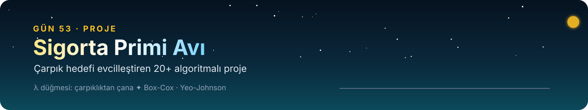

<p align="center">
  
</p>

<div align="center">

# 📐 Gün 53 — Eğriyi Düzleştir: Box-Cox, Yeo-Johnson ve Sigorta Primi Avı


</div>

## 📌 Özet

Bu gün **iki notebook** içeriyor:

1. **`day53_boxcox_kavram.ipynb` (başlangıç düzeyi):** Çarpık dağılımı **kafe hesabı** ve **lastik cetvel** benzetmeleriyle anlatır; Box-Cox'un tek düğmesi **λ**'yı animasyonla gösterir, altı faturayla **elle hesaplayıp** SciPy ile doğrular. «Çana en çok benzeyen λ» aramasını, sıfır/negatif değerlerde **Yeo-Johnson**'a geçişi, **gidiş-dönüş** (ters dönüşüm) ve **λ'yı yalnızca eğitimden öğrenme** kuralını deneyle işler. Ağaçların özellik dönüşümünden etkilenmediği gösterilir. Teknik ayrıntı bilinçli olarak az tutuldu.
2. **`day53_boxcox_sigorta_projesi.ipynb` (uçtan uca proje):** 1.337 kişinin yıllık sağlık masrafını tahmin eder. Hedef için altı dönüşüm tartılır; **27 algoritma + taban**, **ham hedef ↔ Box-Cox hedef** olmak üzere iki senaryoda aynı sızıntısız boru hattında yarışır (λ her katta eğitimden öğrenilir). Eşleştirilmiş bootstrap, aile bazlı özet, **λ düğmesi taraması** (animasyonlu), **smearing**, rastgele arama (dönüşüm de bir hiperparametre), permütasyon/**TreeSHAP**/ablasyon, **dönüşmüş uzayda asimetrik aralık**, segment denetimi, kalibrasyon, asimetrik maliyet, model kaydı ve **ayrı süreçte** yükleme testi.

👉 Ders notları: [`day53_boxcox_kavram.ipynb`](day53_boxcox_kavram.ipynb) · [`day53_boxcox_sigorta_projesi.ipynb`](day53_boxcox_sigorta_projesi.ipynb)

> ℹ️ **Veri notu:** `24-insurance.csv`, Kaggle'daki «Medical Cost Personal Datasets» ile aynı yapıdaki sigorta verisidir (kaynağı Lantz, 2013). Çalışma ortamı Kaggle'dan doğrudan indirmeye izin vermediği için aynı veri kitabın örnek veri deposunun GitHub kopyasından alındı; veri uydurulmamıştır.

## 🗺️ İçerik

**Kavram (10 durak):** Kurulum · Çarpıklık nedir? · Lastik cetvel (canlı λ animasyonu) · Box-Cox düğmesi (elle hesap) · λ'yı bulmak · Sıfır ve negatif: Yeo-Johnson · Gidiş-dönüş · Sızıntı tuzağı · Doğrusal mı, ağaç mı? · Özet (quiz, ödevler, kaynakça)

| # | Proje bölümü | # | Proje bölümü |
|:-:|:--|:-:|:--|
| 1 | Kurulum | 9 | **Dönüşüm × model**, λ düğmesi taraması, Yeo-Johnson özellik, **smearing** |
| 2 | Senaryo, veri, başarı ölçütleri | 10 | **Hiperparametre ayarı** (hedef dönüşümü dahil), taze katlar, seçim kuralı |
| 3 | Veri kalitesi, karar defteri | 11 | Permütasyon, **TreeSHAP**, ablasyon (`sex + region` maliyeti) |
| 4 | Keşif (test kilitli) | 12 | Final test, **asimetrik %90 aralık** |
| 5 | **Dönüşüm laboratuvarı**, λ güveni, sızıntı deneyi | 13 | Segment ve adalet denetimi |
| 6 | Özellik kararı, sızıntısız boru hattı | 14 | Kalibrasyon, asimetrik maliyet, bütçeli seçim |
| 7 | **Büyük yarış:** 27 algoritma + taban × 2 senaryo | 15 | Model kaydı, ayrı süreçte yükleme, tahmin fonksiyonu |
| 8 | Taze katlar, eşleştirilmiş bootstrap, aile özeti | 16 | Özet, quiz, ödevler, kaynakça |

## 📊 Öne Çıkan Sonuçlar

> Tüm sayılar notebook'ta çalıştırılmış hücre çıktılarıdır (`RANDOM_STATE = 42`; 1.069 eğitim / 268 test kişisi).

| Bulgu | Sonuç |
|:--|:--|
| Hedef çarpıklığı | +1,51 → Box-Cox sonrası −0,01 (λ ≈ 0,05; **log'a çok yakın**, %95 aralık −0,01…0,11) |
| Çarpıklık düzelince her şey düzelmez | Histogramda hâlâ çok tepe var: sigara içenler ve içmeyenler ayrı kitleler (grup başına λ 0,17 ↔ 0,44) |
| Büyük yarış (CV RMSE) | Lider yığın modeli ≈ 4.643 $; ilk 20'nin çoğu birbirinden ayırt edilemez; taban ≈ 12.100 $ |
| Box-Cox hedef, **dolar hatası (RMSE)** | Bootstrap: 2 algoritmada daha iyi, **15'inde daha kötü**, 10'unda ayırt edilemez |
| Box-Cox hedef, **göreli hata (RMSLE)** | **19 algoritmada daha iyi**, 0 daha kötü, 8 ayırt edilemez |
| Aile bazlı | Boosting/orman/sinir ağı/çekirdek: MAE −%10…−16, RMSLE −%8…−25, RMSE ≈ değişmez. **Doğrusal modeller:** RMSE ≈ +%64 (kötüleşir) |
| λ düğmesi | En iyi λ ölçüte ve modele göre kayar (RMSE için Ridge/SVR ≈ 0,9–1,0; LightGBM MAE/RMSLE için ≈ −0,2/−0,3); **MLE λ hiçbirinin optimumu değil** |
| Smearing | Toplamı hizalar ama aşırı düzeltir (+%5…+%11) ve RMSE/MAE'yi kötüleştirir |
| Ayar + seçim kuralı | Dönüşüm serbest bırakıldığında RMSE farkı <%0,5; MAE ağaç modellerinde düşer. Kural **SVR + ham hedef**'i seçti |
| Final test | RMSE **3.225 $**, MAE **1.530 $**, R² **0,928** (basit kural: 5.294 $). **CV RMSE (4.664 $) test'ten yüksek**: tek bölmenin şansı, CV'ye daha çok güvenilmeli |
| Ablasyon | `smoker` çıkınca RMSE +%174; `sex + region` çıkınca ≈ +%1,6 (MAE düşer) |
| Aralık | Box-Cox uzayında kurulan bant tahmine göre genişler (≈ 8 bin → 41 bin $), ama koşullu kapsama kusursuz değil (%80 / %98 / %100) |

## 🧪 Dürüst Bulgular

- «Box-Cox hedef her zaman iyidir» **söylenemez**: göreli hatada neredeyse hep kazandırır, dolar hatasında çoğu modelde kazandırmaz, doğrusal modellerde zarar verir. Olası nedenler (etkileşimin çarpımsallaşması, üstel ters dönüşüm) hipotez olarak yazıldı, doğrudan sınanmadı.
- Hedef dönüşümü **ölçüte göre** seçilmelidir; veri çana en çok benzeyen λ, hata en düşük λ ile aynı değildir.
- Test sonucu CV'den iyi çıktı; bu bir üstünlük kanıtı değil, küçük bölmenin dalgalanmasıdır.
- Segment denetiminde 17 segmentten yalnızca 1'inde (18–29 yaş, ≈ +%7,7 fazla prim) sapma aralığı sıfırı dışlıyor; küçük hücrelerde aralıklar geniştir.
- Asimetrik maliyet çarpanı eğitim OOF'unda 1,00 çıktı (SVR zaten yüksek kantilde tahmin ediyor).

## 📁 Dosyalar

```text
day53/
├── 24-insurance.csv                    # veri (1.338 satır; 1 birebir tekrar çıkarılır)
├── sigorta_yardimci.py                 # özellik üretici, hedef dönüşümleri, model zoo'su, aralık yardımcıları
├── day53_boxcox_kavram.ipynb
├── day53_boxcox_sigorta_projesi.ipynb
├── requirements.txt
├── assets/                             # animasyonlu SVG: hero, yol haritası, bölüm bannerları, etiketler, diyagramlar
└── outputs/
    ├── figures/                        # PNG grafikler ve GIF animasyonlar
    ├── reports/                        # CSV raporları (karar defteri, yarış, bootstrap, ablasyon, segmentler…)
    └── model/                          # joblib model, meta.json, örnek müşteriler
```
