<p align="center">
  
</p>

<div align="center">

# 🫘 Gün 54 — Gölgeden Hikâye, Fasulyeden Harita: PCA ve 27 Algoritmanın Yarışı


</div>

## 📌 Özet

Bu gün **iki notebook** içeriyor:

1. **`day54_pca_kavram.ipynb` (başlangıç düzeyi):** PCA'yı **"gölge"** benzetmesiyle anlatır. Boyut laneti (gürültü sütunu deneyi, mesafe çöküşü), **8 fasulyeyle elle PCA** (kovaryans → özvektör → izdüşüm; `scikit-learn` ile fark ≈ 10⁻¹⁶), standartlaştırma, **kaç bileşen?** (5 kural + doğrulama), 16 ölçüden 2 eksenli **fasulye haritası**, geri kurma ve **tuzaklar** (sızıntı, gizli ayrım, aykırı değer). 5 animasyon, 7 diyagram.
2. **`day54_pca_kuru_fasulye_projesi.ipynb` (uçtan uca proje):** Kaggle **Dry Bean** verisiyle 7 fasulye türünü tahmin eder. Kopya ve PCA sızıntısı **ölçülür**; **27 algoritma + taban** aynı sızıntısız boru hattında **ham ölçüler** ve **PCA** ile yarışır; bootstrap, süre deneyi, **k eğrisi**, PCA'yı da düğme sayan hiperparametre ayarı, permütasyon önemi ve **ablasyon**, final test, segment/kalibrasyon/**maliyet** analizi, **PCA ile yeni tür (anomali) avı**, model kaydı ve **ayrı süreçte** yükleme testi.

👉 Ders notları: [`day54_pca_kavram.ipynb`](day54_pca_kavram.ipynb) · [`day54_pca_kuru_fasulye_projesi.ipynb`](day54_pca_kuru_fasulye_projesi.ipynb)

## 🧾 Veri Hakkında

**Kaggle "Dry Bean Dataset"** (Koklu ve Özkan, 2020): 13.611 fasulye, 16 şekil ölçüsü, 7 tür. 68 kopya satır çıkarılınca **13.543** satır kalır.

> Çalışma ortamında Kaggle'a doğrudan erişim kapalıydı; aynı dosya bir GitHub aynasından alındı ve Kaggle/UCI sayfasındaki satır/sütun/sınıf sayılarıyla **birebir** doğrulandı. Veri uydurma değildir.

## 📊 Öne Çıkan Sonuçlar

> Tüm sayılar notebook'ta çalıştırılmış hücre çıktılarıdır (`RANDOM_STATE = 42`). Veri bölmesi: eğitim 10.834 / test 2.709.

| Bulgu | Sonuç |
|:--|:--|
| PCA yapısı (eğitim) | PC1 %55,5 + PC2 %26,4; ilk **4** bileşen %95,0, ilk 2 bileşen %81,9 |
| Kopya satırlar | 1-NN makro F1 0,9221 (kopyalı) ↔ 0,9216 (kopyasız): etki küçük |
| PCA sızıntısı | Bu veride fark ≈ 0 (≤ 0,0005); kural yine de: PCA boru hattının içinde |
| Büyük yarış (ham, 5 kat makro F1) | 1. Oylama 0,9424 · SVM (RBF) 0,9418 · Yığın 0,9416 · LightGBM 0,9404; taban 0,059 |
| PCA(k=4, %95 kuralı) | **Neredeyse tüm** algoritmalar ≈ 4–5 puan kaybetti (bootstrap aralıkları 0'ı kesmiyor); Ridge/Perceptron/Pasif-agresif çok daha sert düştü |
| Önceden yazılmış kural 2 | (ΔF1 ≥ −0,005 **ve** ≥ %30 hızlanma) hiçbir algoritma geçemedi → **ham ölçüler** |
| k eğrisi | Başarı **k = 5–6 civarında platoya** ulaşıyor; k ≥ 8'de ham skora yaklaşıyor |
| Ayar (taze katlar, makro F1) | SVM(RBF)+PCA(k=8) 0,9424 · SVM(RBF) PCA'sız 0,9422 · MLP 0,9415; farklar şanstan ayırt edilemez |
| Final model (kural 3) | **SVM (RBF), PCA'sız**: test doğruluk **0,928**, makro F1 **0,939**, AUC 0,994 |
| Güven eşiği | %88,3 otomatik kabul, kabul edilenlerde doğruluk 0,967; kalanı insana gider |
| Yeni tür avı (PCA yeniden kurma hatası) | Bombay AUC ≈ 1,00; Sıra < 0,5 (diğer türlerin ölçü aralığının içinde) |

## 🧪 Dürüst Bulgular

- **%95 varyans kuralı bu veride yetersiz kaldı**; k eğrisi ve ayar, bileşen sayısının model başarısıyla seçilmesi gerektiğini gösterdi.
- PCA **hız** kazandırdı (boosting/bagging'de ≈ 2–4×) ama k=4'te **doğruluk bedeli** ödetti; sonuç algoritmaya göre değişiyor.
- Üst sıradaki modeller birbirine çok yakın; "en iyi algoritma" iddiası yapılmıyor.
- Maliyete duyarlı karar bu testte maliyeti **düşürmedi** (251 → 251); sigmoid kalibrasyon ECE'yi **kötüleştirdi** (model zaten iyi kalibre). Maliyet matrisi **varsayımsaldır**.
- Koklu ve Özkan (2020) skorları farklı bölme/kopya düzeniyle raporlandığı için burada **doğrudan kıyaslanmaz**.

## 📁 Dosyalar

```text
day54/
├── 25-dry-bean.csv                     # veri (Kaggle Dry Bean, 13.611 satır)
├── fasulye_yardimci.py                 # veri okuma, Türkçe adlar, tahmin fonksiyonu
├── day54_pca_kavram.ipynb
├── day54_pca_kuru_fasulye_projesi.ipynb
├── requirements.txt
├── assets/                             # animasyonlu SVG: hero, yol haritası, bölüm bannerları, etiketler, diyagramlar
└── outputs/
    ├── figures/                        # PNG grafikler ve GIF animasyonlar
    ├── reports/                        # CSV raporları (yarış, ayar, ablasyon, segment, anomali…)
    └── model/                          # joblib model, meta.json, örnek fasulyeler
```

## 📚 Kaynakça (özet)

Tam liste notebook'ların sonundadır. Dolaylı atıf örneği: *PCA'nın kökeni (Pearson, 1901; Hotelling, 1933; Jolliffe ve Cadima, 2016'dan aktarma).*

- Greenacre, M., Groenen, P. J. F., Hastie, T., D'Enza, A. I., Markos, A., & Tuzhilina, E. (2022). Principal component analysis. *Nature Reviews Methods Primers, 2*, Article 100. https://doi.org/10.1038/s43586-022-00184-w
- Jolliffe, I. T., & Cadima, J. (2016). Principal component analysis: A review and recent developments. *Philosophical Transactions of the Royal Society A, 374*(2065), Article 20150202. https://doi.org/10.1098/rsta.2015.0202
- Koklu, M., & Özkan, İ. A. (2020). Multiclass classification of dry beans using computer vision and machine learning techniques. *Computers and Electronics in Agriculture, 174*, Article 105507. https://doi.org/10.1016/j.compag.2020.105507
