<p align="center">
  
</p>

<div align="center">

# 🛒 Gün 55 — Benzer Olan Bir Araya: K-Means ve Müşteri Takımyıldızları


</div>

## 📌 Özet

Bu gün **iki notebook** içeriyor:

1. **`day55_kmeans_kavram.ipynb` (başlangıç düzeyi):** K-Means'i **"yıldızlar ve çekim alanları"** benzetmesiyle anlatır. Gözetimli ↔ gözetimsiz öğrenme, **canlı K-Means** (ata → taşı), Öklid ve Manhattan mesafesi, **8 müşteriyle elle K-Means** (`scikit-learn` ile birebir aynı sonuç), ölçeklemenin etkisi (η²), **rastgele başlangıç tuzağı ve K-Means++** (200 denemelik deney), **dirsek + diz noktası**, **silüet / Davies-Bouldin / Calinski-Harabasz**, K-Means'in sevmediği şekiller (DBSCAN ve GMM ile) ve yeni müşteriyi sızıntısız biçimde **segmente atama**. 5 animasyon, 10 diyagram.
2. **`day55_kmeans_musteri_projesi.ipynb` (uçtan uca proje):** Kaggle **Customer Personality Analysis** verisiyle müşteri segmentasyonu. Kopya müşteri ve uç değer **karar defteri**, kilitli test seti, sızıntısız ön işleme boru hattı, ön işleme deneyi, **önceden yazılmış kurallarla** segment sayısı seçimi, **28 kümeleme algoritması + rastgele taban** (merkez, bölerek, sağlam merkez, hiyerarşik, olasılık, graf, yoğunluk aileleri), bootstrap ve tohum kararlılığı, sabit ölçüm uzayında ayar, segment profili ve **vekil karar ağacı**, test denetimi, **kampanya yanıtıyla dış doğrulama**, kâr eşiğine göre **hedefleme**, adalet (hassas özellikler, yaşsız segmentasyon), sınırdaki/sıra dışı müşteriler, model kaydı ve **ayrı süreçte** yükleme testi.

👉 Ders notları: [`day55_kmeans_kavram.ipynb`](day55_kmeans_kavram.ipynb) · [`day55_kmeans_musteri_projesi.ipynb`](day55_kmeans_musteri_projesi.ipynb)

## 🧾 Veri Hakkında

**Kaggle "Customer Personality Analysis"** (Patel, 2021): bir gıda/market zincirinin (iFood vaka çalışması) 2.240 müşterisi, 29 sütun: gelir, aile yapısı, son 2 yılda 6 ürün grubundaki harcama, web/katalog/mağaza alışverişleri, 5 eski kampanya ve son kampanya yanıtı.

> Çalışma ortamında Kaggle'a doğrudan erişim kapalıydı. Aynı içerik **iki bağımsız GitHub aynasından** alındı; iki dosyanın hücre hücre aynı olduğu ve Kaggle sayfasındaki boyutla (2.240 × 29) uyuştuğu doğrulandı. Biçim farkı: Kaggle dosyası sekme ayraçlı ve tarihi gün-ay-yıl yazar; bu dosya virgül ayraçlı ve tarihi yıl-ay-gün yazar. **Veri uydurma değildir.**

Kümeleme **7 özellikle** yapılır: Gelir, Yaş, Çocuk, Toplam harcama, Alışveriş sayısı, İndirim oranı, Web ziyaret/ay. Kampanya yanıtı, eğitim ve medeni durum kümelemede **kullanılmaz**; yalnızca dış doğrulama ve adalet denetimi içindir.

## 📊 Öne Çıkan Sonuçlar

> Tüm sayılar notebook'ta çalıştırılmış hücre çıktılarıdır (`RANDOM_STATE = 42`). Temiz veri 2.054 müşteri; eğitim 1.643 / test 411.

| Bulgu | Sonuç |
|:--|:--|
| Veri kalitesi | 182 kopya müşteri (silinmeseydi test müşterilerinin %13,4'ünün ikizi eğitimde olurdu), 3 imkânsız yaş, 1 hatalı gelir; 24 eksik gelir boru hattında dolduruldu |
| Ön işleme | Ölçeksiz kümelemede segmentleri neredeyse yalnızca **gelir** belirliyor ve kararlılık 0,66'ya düşüyor; log + standartlaştırma seçildi |
| Kaç segment? | Silüet, DB ve CH'nin üçü de **k = 2** diyor (çok/az harcayan); önceden yazılmış kural (kararlılık ≥ 0,85, en küçük segment ≥ %8, k ≥ 3) **k = 3** seçti; dirsek noktası da 3 |
| Büyük yarış | 28 algoritmanın 18'i uygun; lider **K-Medoids**, hemen ardında K-Means ve Bisecting K-Means; rastgele taban silüet ≈ 0 |
| Silüet tuzağı | En yüksek silüetler (RBF spektral 0,66, tek bağlantı 0,61) **tek dev segment + 1–2 uç müşteri** demek; en küçük segment şartıyla elendi. 4 yoğunluk algoritmasının hiçbiri uygun değil |
| Kararlılık | K-Medyan ve Bisecting en kararlı (40 bootstrap ARI ≈ 0,97); deterministik Ward'ın bootstrap kararlılığı yalnızca ≈ 0,48 |
| Final model | **K-Medoids** (k = 3): silüet eğitim **0,274** / test **0,275**; testte sıfırdan kurulan modelle uyum ARI **0,86**; vekil ağaç test sadakati **%90,8** |
| Segmentler | 💎 Varlıklı Keyif Müşterileri (%23 müşteri, ≈ %50 ciro) · 🏡 Olgun Orta Gelirli Aileler · 🌱 Genç ve Bütçe Dostu Aileler |
| Dış doğrulama | Test yanıt oranları **%29,9 / %13,3 / %7,1** (kümelemede yanıt kullanılmadı); kâr eşiği %27,3 |
| Hedefleme (test) | Herkese gönder: kâr **−540** · segment + eski kampanya kuralı (eğitimde seçildi): **56 müşteri**, kâr **+118**, yanıtların %41'i |

## 🧪 Dürüst Bulgular

- Geometrik ölçütler **k = 2**'yi seçiyor; k = 3 bir **iş kısıtı** sonucudur ve bu kural sonuçlardan **önce** yazıldı.
- Silüet ≈ 0,27: gerçek müşteri verisinde segmentler **birbirine değen bulutlardır**, kitap örneğindeki gibi ayrık adalar değildir.
- Finaldeki ilk dört aday (K-Medoids, K-Means, Bisecting, küresel GMM) **neredeyse aynı segmentleri** buluyor; "en iyi algoritma" iddiası yapılmıyor.
- Segmentasyon **yaşla ilişkili** (Cramér V 0,27); yaş çıkarılınca segmentlerin %81 düzeyinde aynı kaldığı (ARI 0,81) ölçüldü ve alternatif olarak sunuldu.
- Maliyet (3) ve gelir (11) değerleri veri setindeki sabit sütunlardan gelen **vaka çalışması varsayımlarıdır**.

## 📁 Dosyalar

```text
day55/
├── 26-customer-personality.csv          # veri (Kaggle Customer Personality Analysis, 2.240 satır)
├── musteri_yardimci.py                  # veri okuma, özellik üretimi, K-Medoids / K-Medyan / Bulanık C-Ortalamalar, segment_ata()
├── day55_kmeans_kavram.ipynb
├── day55_kmeans_musteri_projesi.ipynb
├── requirements.txt
├── assets/                              # animasyonlu SVG: hero, yol haritası, bölüm bantları, etiketler, diyagramlar
└── outputs/
    ├── figures/                         # PNG grafikler ve GIF animasyonlar
    ├── reports/                         # CSV raporları (k seçimi, yarış, kararlılık, ayar, profil, yanıt, hedefleme…)
    └── model/                           # joblib model, meta.json, örnek müşteriler
```

## 📚 Kaynakça (özet)

Tam liste notebook'ların sonundadır. Dolaylı atıf örneği: *algoritmaya "k-means" adını MacQueen (1967) vermiştir (MacQueen, 1967; Ikotun ve ark., 2023'ten aktarma).*

- Arthur, D., & Vassilvitskii, S. (2007). k-means++: The advantages of careful seeding. In *Proceedings of the Eighteenth Annual ACM-SIAM Symposium on Discrete Algorithms* (pp. 1027–1035). Society for Industrial and Applied Mathematics.
- Ikotun, A. M., Ezugwu, A. E., Abualigah, L., Abuhaija, B., & Heming, J. (2023). K-means clustering algorithms: A comprehensive review, variants analysis, and advances in the era of big data. *Information Sciences, 622*, 178–210. https://doi.org/10.1016/j.ins.2022.11.139
- Patel, A. (2021). *Customer personality analysis* [Data set]. Kaggle. https://www.kaggle.com/datasets/imakash3011/customer-personality-analysis
- Rousseeuw, P. J. (1987). Silhouettes: A graphical aid to the interpretation and validation of cluster analysis. *Journal of Computational and Applied Mathematics, 20*, 53–65. https://doi.org/10.1016/0377-0427(87)90125-7
- Salminen, J., Mustak, M., Sufyan, M., & Jansen, B. J. (2023). How can algorithms help in segmenting users and customers? A systematic review and research agenda for algorithmic customer segmentation. *Journal of Marketing Analytics, 11*(4), 677–692. https://doi.org/10.1057/s41270-023-00235-5
