<p align="center">
  
</p>

<div align="center">

# 🌳 Gün 56 — Benzerden Aileye: Hiyerarşik Kümeleme ve Ülkelerin Soy Ağacı


</div>

## 📌 Özet

Bu gün **iki notebook** içeriyor:

1. **`day56_hiyerarsik_kavram.ipynb` (başlangıç düzeyi):** Hiyerarşik kümelemeyi **"aile ağacı"** benzetmesiyle, formüle boğulmadan anlatır. Hiyerarşi neden her yerde, birleştirerek ↔ bölerek kümeleme, ülkeler arası **mesafe tablosu**, **6 ülkeyle elle birleştirme** (`SciPy` ile birebir aynı sonuç), **canlı birleşme** (ülkeler aileleşirken dendrogram dal dal büyür), **dendrogram okuma ve kesme** (167 ülke + dünya haritası animasyonu), **tek / tam / ortalama / Ward** bağlantıları ve **zincirleme tuzağı** (sentetik şekil testi), **ölçeklemenin** etkisi (η²), dendrogramdaki **büyük sıçramayla** küme sayısı, **kofenetik korelasyon**, **DIANA** ile yukarıdan aşağı bölme, hız/bellek bedeli ve **yeni gelen ülkeyi** atama. 5 animasyon, 9 diyagram.
2. **`day56_hiyerarsik_ulke_projesi.ipynb` (uçtan uca proje):** Kaggle **Unsupervised Learning on Country Data** verisiyle bir insani yardım kuruluşu için ülke segmentasyonu. Veri kalitesi **karar defteri** (Myanmar'ın hatalı ticaret verisi), kilitli test seti, sızıntısız boru hattı, ön işleme deneyi, **önceden yazılmış dört kural**, dendrogram sıçraması + beş ölçütle segment sayısı, **27 kümeleme algoritması + rastgele taban** (12'si hiyerarşik ya da ağaç tabanlı), **silüet tuzağı**, bootstrap + tohum + **konsensüs matrisi**, 66 ayarlık tarama, segment kimliği (dünya haritası, adlı soy ağacı, vekil karar ağacı), test denetimi, **BM En Az Gelişmiş Ülkeler** listesiyle bağımsız doğrulama, **ihtiyaç endeksi + konsensüs oyu + bütçe senaryosu**, kıta adaleti, özellik duyarlılığı, sınırdaki/sıra dışı ülkeler, model kaydı ve **ayrı süreçte** yükleme testi.

👉 Ders notları: [`day56_hiyerarsik_kavram.ipynb`](day56_hiyerarsik_kavram.ipynb) · [`day56_hiyerarsik_ulke_projesi.ipynb`](day56_hiyerarsik_ulke_projesi.ipynb)

## 🧾 Veri Hakkında

**Kaggle "Unsupervised Learning on Country Data"** (Kokkula, 2020): 167 ülke × 9 gösterge (çocuk ölümü, ihracat, sağlık harcaması, ithalat, gelir, enflasyon, yaşam beklentisi, doğurganlık, kişi başı GSYH). Veri setinin hikâyesi: *HELP International* adlı bir yardım kuruluşu topladığı ≈ 10 milyon doları en çok ihtiyacı olan ülkelere yönlendirmek istiyor.

> Çalışma ortamında Kaggle'a doğrudan erişim kapalıydı. Dosya **dört bağımsız GitHub aynasından** indirildi; dördünün içerik olarak birebir aynı olduğu (167 × 10) doğrulandı. **Veri uydurma değildir.**

İki **dış bilgi** kümelemede **kullanılmaz**: **kıta** (Natural Earth sınıflaması; yalnızca adalet denetimi) ve **BM En Az Gelişmiş Ülkeler 2018 listesi** (yalnızca dış doğrulama). Dünya haritaları, Natural Earth 1:110m sınırlarından (kamu malı) sadeleştirilmiş `dunya_sinirlari.json` ile yalnızca `matplotlib` kullanılarak çizilir.

## 📊 Öne Çıkan Sonuçlar

> Tüm sayılar notebook'ta çalıştırılmış hücre çıktılarıdır (`RANDOM_STATE = 42`). Eğitim 133 / test 34 ülke (kişi başı GSYH çeyreklerine göre tabakalı).

| Bulgu | Sonuç |
|:--|:--|
| Veri kalitesi | **Myanmar**'ın ihracatı %0,109, ithalatı %0,066 (GSYH'nin) → hatalı sayılıp boru hattında eğitim medyanıyla dolduruldu. Düzeltilmeseydi log dönüşümünden sonra Myanmar **tek kişilik bir küme** oluyordu |
| Ön işleme | Log + standart, dokuz göstergeye en dengeli söz hakkını verdi (denge 0,945) |
| Kaç segment? | Silüet, DB, CH ve kesim aralığının dördü de **k = 2** diyor; önceden yazılmış kural (kararlılık ≥ 0,70, en küçük segment ≥ %8, k ≥ 3) **k = 3** seçti |
| Büyük yarış | 27 algoritmanın 18'i uygun; lider **K-Means**, ardından spektral ve K-Medoids; rastgele taban silüet −0,02 |
| Silüet tuzağı | En yüksek silüetler (HDBSCAN 0,46, OPTICS 0,43) ülkelerin **%44–51'ini gürültü** sayıyor; UPGMA, tek, WPGMA, UPGMC, WPGMC bağlantıları **1–2 ülkelik** segmentler üretiyor → 9 algoritma elendi |
| Kararlılık | K-Means 40 bootstrap'ta ARI 0,91; **Ward deterministik ama kararlı değil** (0,66); konsensüs matrisinde segment içi birlikte kalma %84, segmentler arası %11 |
| Final model | Kural 3 → **Konsensüs hiyerarşik** (50 K-Means oylaması + ortalama bağlantı): silüet eğitim **0,262** / test **0,265**; K-Means ile aynı segmentler (ARI 1,00), Ward ile ARI 0,84 |
| Test | Segment payları farksız (p = 0,49), testte sıfırdan kurulan modelle uyum **ARI 0,82**, vekil ağaç sadakati eğitim %91 / test %76,5 |
| Segmentler | 🆘 Öncelikli Destek (46 ülke) · 🌱 Gelişmekte Olan (71) · 🏙️ Gelişmiş (50) |
| BM EAGÜ doğrulaması | Öncelikli segmentin **%80'i** EAGÜ (kesinlik), EAGÜ'lerin **%90'ı** öncelikli segmentte (duyarlılık); Gelişmiş segmentte hiç EAGÜ yok |
| Kısa liste | Haiti, Orta Afrika Cumhuriyeti, Kongo DC, Nijer, Burundi, Sierra Leone, Mozambik, Malavi, Çad, Liberya: hepsi EAGÜ ve 18 uygun algoritmanın **en az 17'sinde** öncelikli |
| Adalet | Kıta × segment Cramér V 0,63 (kıta kullanılmadı); bir gösterge çıkarılınca en fazla 6 ülkenin öncelik durumu değişiyor |

## 🧪 Dürüst Bulgular

- Geometrik ölçütler **k = 2**'yi seçiyor; k = 3 bir **iş kısıtının** sonucudur ve bu kural sonuçlardan **önce** yazıldı.
- Final modeli hiyerarşik yapan, sonuçlardan önce yazılmış **kural 3**'tür; seçilen konsensüs ağacı K-Means ile **aynı segmentleri** verir. Kural segmentleri değil, **açıklama biçimini** değiştirdi.
- Ward'ın bootstrap kararlılığı tohuma göre 0,66–0,81 arasında oynuyor; 133 ülkelik veride kararlılık ölçümünün kendisi de gürültülüdür.
- Vekil karar ağacı testte %76,5 sadık; iki soruluk kural **anlatım** içindir, resmî atama final modelle yapılır.
- Kısa liste endeks ağırlıklarına orta düzeyde duyarlı (alternatif endekslerle ilk 10'un 6–9'u ortak); bütçe dağılımı bir **varsayımdır**.

## 📁 Dosyalar

```text
day56/
├── 27-country-data.csv                  # veri (Kaggle Unsupervised Learning on Country Data, 167 ülke)
├── dunya_sinirlari.json                 # Natural Earth 1:110m sınırları (sadeleştirilmiş, yalnızca harita çizimi için)
├── ulke_yardimci.py                     # veri okuma, Türkçe adlar, EAGÜ, harita, DIANA, SciPy bağlantıları, K-Medoids,
│                                        # konsensüs hiyerarşik, AgacAtayici, ihtiyac_ata()
├── day56_hiyerarsik_kavram.ipynb
├── day56_hiyerarsik_ulke_projesi.ipynb
├── requirements.txt
├── assets/                              # animasyonlu SVG: hero, yol haritası, bölüm bantları, etiketler, diyagramlar
└── outputs/
    ├── figures/                         # PNG grafikler ve GIF animasyonlar
    ├── reports/                         # CSV raporları (kalite, k seçimi, yarış, kararlılık, ayar, profil, EAGÜ, öncelik…)
    └── model/                           # joblib model, meta.json, örnek ülkeler
```

## 📚 Kaynakça (özet)

Tam liste notebook'ların sonundadır. Dolaylı atıf örneği: *Ward bağlantısı, birleşmede grup içi kareler toplamındaki artışı en küçük yapan ölçüte dayanır (Ward, 1963; Murtagh ve Legendre, 2014'ten aktarma).*

- Kokkula, R. (2020). *Unsupervised learning on country data* [Data set]. Kaggle. https://www.kaggle.com/datasets/rohan0301/unsupervised-learning-on-country-data
- Monti, S., Tamayo, P., Mesirov, J., & Golub, T. (2003). Consensus clustering: A resampling-based method for class discovery and visualization of gene expression microarray data. *Machine Learning, 52*(1–2), 91–118. https://doi.org/10.1023/A:1023949509487
- Murtagh, F., & Legendre, P. (2014). Ward's hierarchical agglomerative clustering method: Which algorithms implement Ward's criterion? *Journal of Classification, 31*(3), 274–295. https://doi.org/10.1007/s00357-014-9161-z
- Ran, X., Xi, Y., Lu, Y., Wang, X., & Lu, Z. (2023). Comprehensive survey on hierarchical clustering algorithms and the recent developments. *Artificial Intelligence Review, 56*(8), 8219–8264. https://doi.org/10.1007/s10462-022-10366-3
- Sokal, R. R., & Rohlf, F. J. (1962). The comparison of dendrograms by objective methods. *Taxon, 11*(2), 33–40. https://doi.org/10.2307/1217208
- Ward, J. H., Jr. (1963). Hierarchical grouping to optimize an objective function. *Journal of the American Statistical Association, 58*(301), 236–244. https://doi.org/10.1080/01621459.1963.10500845
