<p align="center">
  
</p>

<div align="center">

# 🌃 Gün 57 — Kalabalığı Bul, Yalnızı Tanı: DBSCAN, HDBSCAN ve New York'un Airbnb Odakları


</div>

## 📌 Özet

Bu gün **iki notebook** içeriyor:

1. **`day57_yogunluk_kavram.ipynb` (başlangıç düzeyi):** Yoğunluk tabanlı kümelemeyi **"şehrin ışıkları"** ve **"fener"** benzetmeleriyle, formüle boğmadan anlatır. K-Means'in yuvarlak dünyası ve şekil testi, **eps / minPts** ve üç nokta türü (çekirdek, sınır, gürültü), **canlı DBSCAN** (yangın gibi yayılan kümeler), **12 ilanla elle DBSCAN** (`scikit-learn` ile birebir aynı), eps ve minPts düğmeleri, **k-mesafe dirseği**, **birim meselesi** (derece / km / z-skor), farklı yoğunluklar ve **HDBSCAN'in "alçalan su"** sezgisi, yoğunlaştırılmış ağaç (EOM ↔ yaprak), OPTICS erişilebilirlik grafiği, **silüet tuzağı ve DBCV**, yeni ilanı sızıntısız atama. **6 animasyon, 11 diyagram.**
2. **`day57_yogunluk_airbnb_projesi.ipynb` (uçtan uca proje):** Kaggle **New York City Airbnb Open Data** ile kısa dönem kiralama denetimi için **Airbnb odaklarının** bulunması. Karar defteri, kilitli test seti, merkezi bile eğitimden öğrenen sızıntısız boru hattı, **özellik uzayı deneyi**, eps × minPts **parametre haritası**, **23 kümeleme algoritması + rastgele taban** (yoğunluk, merkez, hiyerarşik, olasılık, graf aileleri), bootstrap kararlılığı, kurallarla ayar ve final seçimi, odak profilleri ve adları, **3B "odak dağları" animasyonu**, test seti ve **fiyatla dış doğrulama**, **aynı alan bütçesiyle denetim hedeflemesi**, ilçe ilçe **adalet** analizi, parametre duyarlılığı, "tek işletmeci" odakları, model kaydı ve **ayrı süreçte** yükleme testi.

👉 Ders notları: [`day57_yogunluk_kavram.ipynb`](day57_yogunluk_kavram.ipynb) · [`day57_yogunluk_airbnb_projesi.ipynb`](day57_yogunluk_airbnb_projesi.ipynb)

<p align="center">
  
</p>

## 🧾 Veri Hakkında

**Kaggle "New York City Airbnb Open Data"** (Dgomonov, 2019; kaynağı Inside Airbnb): 2019'da New York'taki 48.895 Airbnb ilanı, 16 sütun (konum, ilçe, mahalle, oda tipi, fiyat, en az gece, yorumlar, müsaitlik, ev sahibinin ilan sayısı).

> Çalışma ortamında Kaggle'a doğrudan erişim kapalıydı. Dosya **iki bağımsız GitHub aynasından** indirildi; iki kopyanın **bayt bayt aynı** olduğu (MD5 eşleşmesi) ve Kaggle sayfasındaki boyutla (48.895 × 16) uyuştuğu doğrulandı. Gizlilik için **ilan başlığı** ve **ev sahibi adı** sütunları repodaki kopyadan çıkarıldı (`28-nyc-airbnb.csv`, 14 sütun). İlçe sınırları NYC Open Data *Borough Boundaries* katmanından sadeleştirildi (`nyc_ilce_sinirlari.json`). **Veri uydurma değildir.**

Kümeleme **yalnızca konumla** (enlem, boylam → kilometre ızgarası) yapılır. Fiyat, oda tipi ve müsaitlik yalnızca odakları **anlamak, önceliklendirmek ve dış doğrulama** için kullanılır.

## 📊 Öne Çıkan Sonuçlar

> Tüm sayılar notebook'ta çalıştırılmış hücre çıktılarıdır (`RS = 42`). Eğitim 39.116 / test 9.779 ilan; hiçbir ilan silinmedi.

| Bulgu | Sonuç |
|:--|:--|
| Yoğunluk dokusu | Manhattan ≈ 295 ilan/km², Staten Island ≈ 2 ilan/km²; 20. komşuya tipik uzaklık ≈ 100 m'ye karşı ≈ 1 km |
| Özellik uzayı | km ızgarası seçildi; derece ve z-skor odak sınırlarını kaydırıyor (ARI ≈ 0,70), fiyat eklemek odakları bölüyor (ARI 0,32) |
| Ders kitabı dirseği | k-mesafe dirseği eps ≈ 1,2 km → ilanların **%98,5'i tek odakta** |
| Parametre haritası | 35 DBSCAN ayarından yalnızca **1'i** kurallara uyuyor (eps 150 m, minPts 40; DBCV ≈ −0,02) |
| Büyük yarış | 23 algoritma + taban; 16 uygun ama k-tabanlıların hepsi **negatif DBCV**; uygunların lideri Mean Shift (+0,048); en yüksek DBCV HDBSCAN-yaprak (+0,117, Kural 1 ihlali) |
| Silüet tuzağı | En yüksek silüet (0,85) ilanların %96'sını gürültü sayan OPTICS-ξ'de |
| Final | **HDBSCAN · yaprak** (`min_cluster_size = 150`, `min_samples = 10`), 67 ayar içinden; yeni ilan tahmini özgün `hdbscan` kütüphanesinin `approximate_predict`'i ile |
| Odaklar | **53 odak**, ilanların %51'i odakta, en büyük odak %4,7; 14 turist vitrini · 9 ticari yoğunlaşma · 10 oda kiralayan yerel · 20 karma konut |
| Test seti | DBCV eğitim **0,133** / test **0,107**; odak payları korelasyonu **0,986**; birlikte kümelemeyle "odakta mı?" uyumu %83 |
| Dış doğrulama (test R², log fiyat) | ilçe 0,131 < **odak 0,197** < mahalle 0,260 |
| Denetim (test, aynı alan) | 10 km²: odak %21,8 · mahalle %20,8 · rastgele %2,9 — 60 km²: odak %39,3 · mahalle %63,9 |
| Adalet | Tek eşikli DBSCAN Queens/Bronx/Staten Island'ı **%100 gürültü** sayıyor; final model %29 / %57 / %6; Brooklyn'deki riskli ilanların %60'ı odak dışında |

## 🧪 Dürüst Bulgular

- **Kurallar yetmez:** rastgele taban bile "gürültü ≤ %50, en büyük odak ≤ %15, 10–150 odak" kurallarını sağladı. Anlamsız dilimlemeyi ayıran DBCV oldu.
- Final model yarışta Kural 1'e takılan algoritmadır; **ayar turunda** (eğitim verisinde, aynı ölçütlerle) kurala uyan bir ayar bulundu. Kural sınırına yakın: `min_cluster_size` aşağı çekilirse gürültü %50'yi aşıyor.
- scikit-learn `HDBSCAN` ile özgün `hdbscan` kütüphanesi aynı algoritmadır ama eşitlik bozma farkları yüzünden etiketleri birebir aynı değil (ARI 0,82); final modelin tüm ölçütleri özgün kütüphaneyle yeniden hesaplandı ve kurallar yeniden denetlendi.
- Odak haritası denetimde mahalle listesini **büyük bütçede geçemiyor**; değeri küçük bütçede sokak ölçeğinde başlangıç noktası vermesi. Veri büyüdükçe yaprak kümeleri değişebiliyor (eğitim ARI 0,61) → harita periyodik yenilenmeli.
- "Riskli ilan" yasal bir hüküm değil, denetim önceliği için kurulmuş bir **vekil** göstergedir (tüm ev, < 30 gece, yılda ≥ 90 gün müsait).

## 📁 Dosyalar

```text
day57/
├── 28-nyc-airbnb.csv                    # veri (Kaggle NYC Airbnb Open Data, 48.895 ilan; ad/başlık sütunları çıkarıldı)
├── nyc_ilce_sinirlari.json              # sadeleştirilmiş ilçe sınırları (NYC Open Data)
├── airbnb_yardimci.py                   # veri okuma, KmProjeksiyon, DBCV, Yoğunluk Tepeleri, Izgara, SNN, K-Medoids, YogunlukAtayici, odak_ata()
├── day57_yogunluk_kavram.ipynb
├── day57_yogunluk_airbnb_projesi.ipynb
├── requirements.txt
├── assets/                              # animasyonlu SVG: hero, yol haritaları, bölüm bantları, etiketler, diyagramlar
└── outputs/
    ├── figures/                         # PNG grafikler ve GIF animasyonlar
    ├── reports/                         # CSV raporları (kalite, karar defteri, yarış, kararlılık, ayar, odak profili, test, denetim, adalet…)
    └── model/                           # joblib boru hattı, meta.json, örnek ilanlar
```

## 📚 Kaynakça (özet)

Tam liste notebook'ların sonundadır. Dolaylı atıf örneği: *DBSCAN'in özgün tanımı ve k-mesafe sezgisi Ester ve ark. (1996)'ya aittir (Ester ve ark., 1996; Schubert ve ark., 2017'den aktarma).*

- Campello, R. J. G. B., Moulavi, D., & Sander, J. (2013). Density-based clustering based on hierarchical density estimates. In *Advances in knowledge discovery and data mining (PAKDD 2013)* (LNCS Vol. 7819, pp. 160–172). Springer. https://doi.org/10.1007/978-3-642-37456-2_14
- Dgomonov. (2019). *New York City Airbnb open data* [Data set]. Kaggle. https://www.kaggle.com/datasets/dgomonov/new-york-city-airbnb-open-data
- McInnes, L., Healy, J., & Astels, S. (2017). hdbscan: Hierarchical density based clustering. *Journal of Open Source Software, 2*(11), 205. https://doi.org/10.21105/joss.00205
- Moulavi, D., Jaskowiak, P. A., Campello, R. J. G. B., Zimek, A., & Sander, J. (2014). Density-based clustering validation. In *Proceedings of the 2014 SIAM International Conference on Data Mining* (pp. 839–847). https://doi.org/10.1137/1.9781611973440.96
- Schubert, E., Sander, J., Ester, M., Kriegel, H.-P., & Xu, X. (2017). DBSCAN revisited, revisited: Why and how you should (still) use DBSCAN. *ACM Transactions on Database Systems, 42*(3), Article 19. https://doi.org/10.1145/3068335
